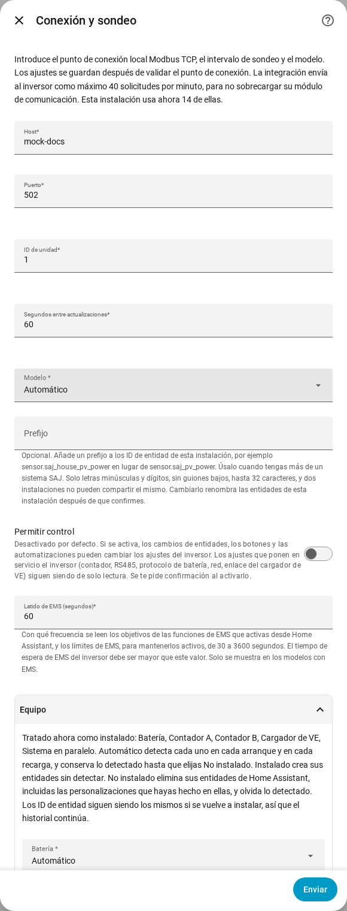

[en](../../en-gb/user/optional-equipment.md) | [de](../../de/user/optional-equipment.md) | [nl](../../nl/user/optional-equipment.md) | [fr](../../fr/user/optional-equipment.md) | [zh](../../zh-hans/user/optional-equipment.md) | es | [it](../../it/user/optional-equipment.md) | [pl](../../pl/user/optional-equipment.md) | [sv](../../sv/user/optional-equipment.md)

# Equipo opcional

La página Equipo opcional explica cómo averigua SAJ Local qué equipo opcional tiene tu inversor y cómo anular el resultado. La lista completa está en la sección [Equipo opcional](../../../custom_components/saj_local/docs/features.md#optional-equipment) de la lista de funciones de la integración. La página de [equipos compatibles](supported-equipment.md) indica qué puede tener cada modelo, y la [referencia de entidades](entities/README.md) indica qué entidades añade cada equipo.

## Qué detecta SAJ Local

La configuración no pregunta nada sobre el equipo. Cada vez que se carga SAJ Local, lo que incluye cada arranque de Home Assistant y cada recarga, SAJ Local pregunta al inversor qué está instalado y crea entidades solo para ese equipo.

| Equipo | Modelos |
| --- | --- |
| Batería | HS3 y H2 |
| Contador A, el contador de la red | HS3 y H2 |
| Contador B, el segundo contador | HS3 y H2 |
| Sistema en paralelo | HS3 y H2 |
| Cargador de VE | Solo HS3 |

- **El inversor no responde a la comprobación:** SAJ Local supone que hay una batería y el Contador A, y no supone el resto del equipo.
- **Un contador está desconectado durante un reinicio:** el equipo detectado se recuerda, así que el equipo conserva sus entidades.
- **Equipo instalado más tarde:** SAJ Local lo detecta en el siguiente reinicio o recarga.

## Cuando el equipo recordado ya no se detecta

SAJ Local conserva las entidades del equipo, para que el historial y los paneles sigan igual, y genera un aviso de reparación en Home Assistant. El aviso nombra el equipo y el sistema. Comprueba el equipo, o ajusta el equipo a No instalado como se describe abajo. El aviso desaparece en la siguiente carga que vuelva a detectar el equipo, o cuando cambias el ajuste.

## Anular la detección

1. Abre Configurar, el engranaje de la fila del sistema en la página de la integración SAJ Local.
2. Expande la sección Equipo.
3. Ajusta cada equipo a Automático, Instalado o No instalado y elige Enviar.

La sección también lista lo que SAJ Local trata ahora como instalado.

| Ajuste | Qué hace el ajuste |
| --- | --- |
| Automático | Detecta el equipo en cada arranque y en cada recarga, y conserva lo detectado hasta que eliges No instalado. Automático es el valor por defecto. |
| Instalado | Crea las entidades del equipo sin detectar el equipo. |
| No instalado | Elimina de Home Assistant las entidades del equipo, incluidos los cambios que hayas hecho en las entidades, como un nombre nuevo. SAJ Local olvida lo detectado. |

Los ID de entidad no cambian, así que el historial continúa si vuelves a ajustar el equipo a Instalado o a Automático. Las entidades de un equipo que no está instalado no se pueden leer, sondear ni escribir.

La sección lista solo el equipo que puede tener tu modelo. Solo HS3: el cargador de VE.

## Módulos de batería

- **H2:** un H2 informa de cuántos módulos de batería tiene, hasta cinco. SAJ Local crea las entidades de módulo para esa cantidad de módulos. Un recuento de 0 conserva las entidades de todos los módulos. SAJ Local recuerda el recuento más alto que ha visto. Cada módulo tiene entidades de identidad, creadas deshabilitadas.
- **HS3:** un HS3 tiene entidades para un módulo de batería.

## Cargador de VE

Solo HS3: un HS3 con un cargador de VE recibe además las lecturas, los ajustes, las franjas de carga y los controles de carga de EMS del cargador. La mayoría se crean deshabilitados. Activar Permitir control habilita los ajustes y las franjas, consulta [cambiar ajustes](changing-settings.md#el-conjunto-de-control).

## Aún no compatible

- Equipo que SAJ Local no detecta. El equipo de la tabla es la lista completa.
- Detectar un cargador de VE en un H2.
