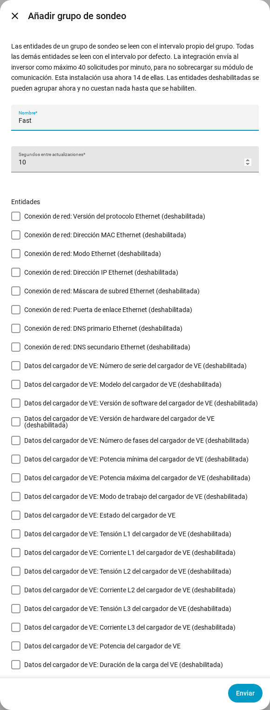

[en](../../en-gb/user/polling.md) | [de](../../de/user/polling.md) | [nl](../../nl/user/polling.md) | [fr](../../fr/user/polling.md) | [zh](../../zh-hans/user/polling.md) | es | [it](../../it/user/polling.md) | [pl](../../pl/user/polling.md) | [sv](../../sv/user/polling.md)

# Sondeo

La página Sondeo explica con qué frecuencia lee SAJ Local el inversor y cómo leer algunas entidades más rápido o más despacio. La lista completa está en la sección [Sondeo](../../../custom_components/saj_local/docs/features.md#polling) de la lista de funciones de la integración. Los límites que se aplican a cada solicitud están en [proteger el inversor](protecting-the-inverter.md).

SAJ Local lee el inversor por Modbus TCP en tu red local, con un calendario que controlas tú. Nada sale de tu red.

## El intervalo por defecto

Cada entidad habilitada se lee cada 60 segundos por defecto. Cambia el campo Segundos entre actualizaciones en Configurar, el engranaje de la fila del sistema en la página de la integración SAJ Local. El intervalo nunca es inferior a 10 segundos.

Solo se leen las entidades habilitadas. Deshabilita una entidad en Home Assistant y el registro de la entidad deja de leerse.

## Grupos de sondeo

Un grupo de sondeo lee entidades elegidas más rápido o más despacio que el valor por defecto. Usa un grupo, por ejemplo, para leer la potencia de la carga, solar, de la batería y de la red cada 10 segundos mientras todo lo demás sigue en 60.

1. Abre el menú de la fila del sistema en la página de la integración SAJ Local y elige Añadir grupo de sondeo. El botón Añadir grupo de sondeo de la parte superior de la página también abre el formulario Añadir grupo de sondeo.
2. Introduce un nombre, los segundos entre actualizaciones (al menos 10) y las entidades del grupo.
3. Elige Enviar, lee la revisión y elige Guardar el grupo.

- **Cualquier entidad:** un grupo puede contener entidades de cualquier tipo. También se puede elegir una entidad deshabilitada, y no cuesta nada hasta que habilitas la entidad.
- **Como máximo un grupo:** una entidad pertenece como máximo a un grupo. Toda entidad que no está en ningún grupo sigue con el intervalo por defecto.
- **Orden de registro:** el formulario lista las entidades en orden de registro, cada una con la etiqueta del bloque de registros del que se lee, para que las entidades que pueden compartir una solicitud queden juntas.
- **Editar o eliminar:** abre el grupo de sondeo desde la página de la integración. Cambiar o eliminar un grupo conserva las entidades, los nombres de las entidades y el historial de las entidades.

Todos los intervalos de un sistema comparten un único reloj, así que las entidades que toca leer a la vez se leen a la vez. Una lectura que se alarga no se recupera. Los ciclos perdidos se descartan y el sondeo continúa desde el siguiente ciclo.

## La carga de solicitudes

SAJ Local envía a un inversor como máximo 40 solicitudes en cualquier periodo de 60 segundos. El formulario muestra lo que cuesta tu elección, en solicitudes por minuto frente a ese límite. El formulario de arriba muestra como ejemplo una carga actual de 14 solicitudes por minuto.

- **Antes de guardar un grupo:** el paso de revisión muestra cuántas solicitudes necesita una lectura del grupo, y la carga antes y después de guardar.
- **Por encima del límite:** aun así puedes guardar el grupo. La revisión advierte de que las lecturas van más despacio de lo que configuraste, porque SAJ Local nunca envía más del límite.
- **Un nuevo intervalo por defecto:** Configurar te pide confirmar cuando el nuevo intervalo lleva la carga por encima del límite.
- **Menos solicitudes:** las entidades que están juntas en un bloque de registros cuestan una solicitud. Las entidades en bloques distintos cuestan una solicitud cada una.

Un formulario no puede interceptar la habilitación de una entidad en Home Assistant. La [descarga de diagnósticos](troubleshooting.md#descargar-los-diagnósticos) lista la carga prevista frente al límite para ese caso.

## Aún no compatible

- Un grupo de sondeo con un intervalo inferior a 10 segundos.
