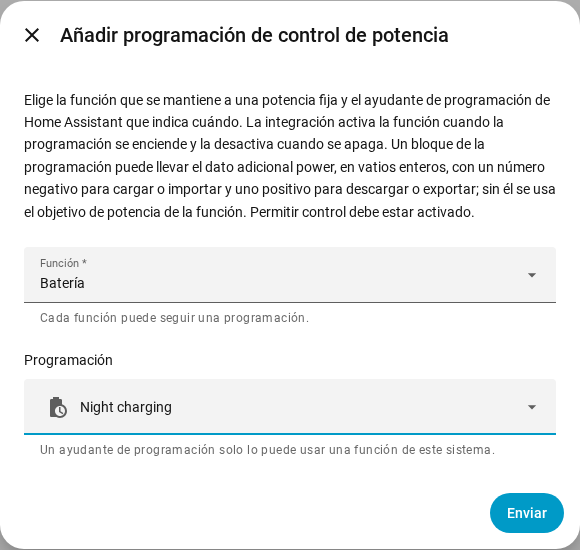

[en](../../en-gb/user/power-control.md) | [de](../../de/user/power-control.md) | [nl](../../nl/user/power-control.md) | [fr](../../fr/user/power-control.md) | [zh](../../zh-hans/user/power-control.md) | es | [it](../../it/user/power-control.md) | [pl](../../pl/user/power-control.md) | [sv](../../sv/user/power-control.md)

# Control de potencia

La página Control de potencia explica cómo mantener la batería, el punto de conexión a la red o el inversor a una potencia fija, a mano o con una programación de Home Assistant. La lista completa está en la sección [Control de potencia](../../../custom_components/saj_local/docs/features.md#power-control) de la lista de funciones de la integración. Los interruptores y los objetivos están en las [entidades que añade la integración](entities/added-by-the-integration.md) de la referencia de entidades.

El control de potencia funciona de una sola manera en cada modelo que ofrece una función. El control de potencia no hace nada mientras [Permitir control](changing-settings.md#permitir-control) está desactivado o el modelo está sin verificar.

| Función | Qué mantiene la función a la potencia fijada | HS3 | H2 |
| --- | --- | --- | --- |
| Batería | La batería se carga o se descarga. | Sí | Sí |
| Red | El punto de conexión a la red importa o exporta. Necesita el Contador A. | Sí | No |
| Inversor | El inversor absorbe o entrega potencia. | Sí | No |

Una potencia positiva descarga, exporta o entrega. Una potencia negativa carga, importa o absorbe. Los signos siguen el [signo de la potencia](entities-and-prefix.md#signo-de-la-potencia) de las lecturas.

## Mantener una función a una potencia

Cada función tiene un interruptor y un objetivo de potencia en vatios enteros. Ambos se crean deshabilitados y están en la categoría de configuración. Activar Permitir control habilita los interruptores y los objetivos, consulta [el conjunto de control](changing-settings.md#el-conjunto-de-control).

1. Ajusta el objetivo de potencia de la función. El objetivo se redondea al paso más cercano que admite el inversor, y muestra la potencia que mantiene el inversor.
2. Activa la función. Una función necesita un objetivo de potencia antes de poder activarse.
3. Para detenerla, desactiva la función.

- El objetivo se conserva a través de los reinicios y se envía cuando arranca la función. Cambiar el objetivo mientras la función está en marcha envía la nueva potencia de inmediato.
- Solo una función funciona a la vez. Se rechaza activar una función mientras otra está en marcha, y el mensaje nombra la función en marcha.
- El interruptor está activado mientras el inversor informa de que la función está en marcha, incluso cuando la función se inició fuera de Home Assistant.
- Un arranque que falla se deshace. Una parada que falla se vuelve a enviar en cada intervalo de latido, hasta que el inversor informa de que la función se detuvo.
- La [tarjeta de controles del panel](cards/controls-card.md) muestra cada función con un interruptor, un objetivo y una indicación del signo.

### Cuando Home Assistant se detiene

Una función que activaste desde Home Assistant se desactiva cuando SAJ Local se descarga y cuando Home Assistant se detiene. Una función que ya estaba en marcha cuando se cargó SAJ Local se deja en marcha.

- Solo HS3: el latido de EMS mantiene activa la función. Tras una parada brusca, el tiempo de espera de EMS del inversor puede terminar la función, pero SAJ Local no cuenta con el tiempo de espera. Consulta [EMS](changing-settings.md#ems).
- Solo H2: una función que queda en marcha tras una parada brusca sigue en marcha hasta que la desactivas.

## Seguir una programación

Una programación de control de potencia hace que una función siga un ayudante de programación de Home Assistant. La función está activada mientras la programación está encendida y se desactiva cuando la programación se apaga.

1. Crea un ayudante de programación en Home Assistant: Ajustes, Dispositivos y servicios, Ayudantes, Crear ayudante, Programación. Ajusta las horas y los días de la semana de la programación.
2. Abre el menú de la fila del sistema en la página de la integración SAJ Local y elige Añadir programación de control de potencia.
3. Elige la función y el ayudante de programación, y luego elige Enviar.

Un bloque del ayudante de programación puede llevar el dato adicional `power`, en vatios enteros con el signo de arriba, por ejemplo `power: -600` para cargar la batería a 600 W. Sin `power`, SAJ Local usa el objetivo de potencia de la función.

- Cada función sigue una programación, y un ayudante de programación controla una función de un sistema.
- La programación sigue un cambio de nombre del ayudante. Se rechaza un ayudante que no está en el registro de entidades, así que elige un ayudante que hayas creado en la interfaz.
- SAJ Local rechaza una programación mientras Permitir control está desactivado.
- Cambia o quita una programación desde la página de la integración. El sistema se recarga cuando lo haces.

### Qué hace una programación

| Situación | Qué ocurre |
| --- | --- |
| La programación se enciende y ninguna función está en marcha | SAJ Local fija la potencia del bloque, o usa el objetivo de potencia, y luego arranca la función. |
| El bloque no tiene `power` y la función no tiene objetivo de potencia | No arranca nada. La acción queda pendiente, con una advertencia. |
| La función ya está en marcha | SAJ Local cambia la potencia cuando el bloque tiene una, y se hace cargo de la función. |
| Otra función está en marcha | No se escribe nada. La acción queda pendiente. |
| El arranque se rechaza o falla | La acción queda pendiente. SAJ Local lo vuelve a intentar en cada intervalo de latido. |
| El `power` del bloque no es un número entero dentro del intervalo del objetivo | No arranca nada. La acción queda pendiente, con una advertencia. |
| La programación pasa a un bloque con otro `power` | SAJ Local cambia la potencia. |
| Desactivas la función a mano mientras la programación está encendida | La función sigue desactivada hasta que la programación se enciende de nuevo. |
| La programación se apaga y SAJ Local había arrancado la función | SAJ Local detiene la función. |

Sin nada que se desee y sin nada pendiente, SAJ Local no envía nada. La [descarga de diagnósticos](troubleshooting.md#descargar-los-diagnósticos) lista cada función, cada programación y la acción que está pendiente.

## Aún no compatible

- Control de potencia de Red e Inversor en el H2.
- Más de una función a la vez.
- Más de una programación para una función.
