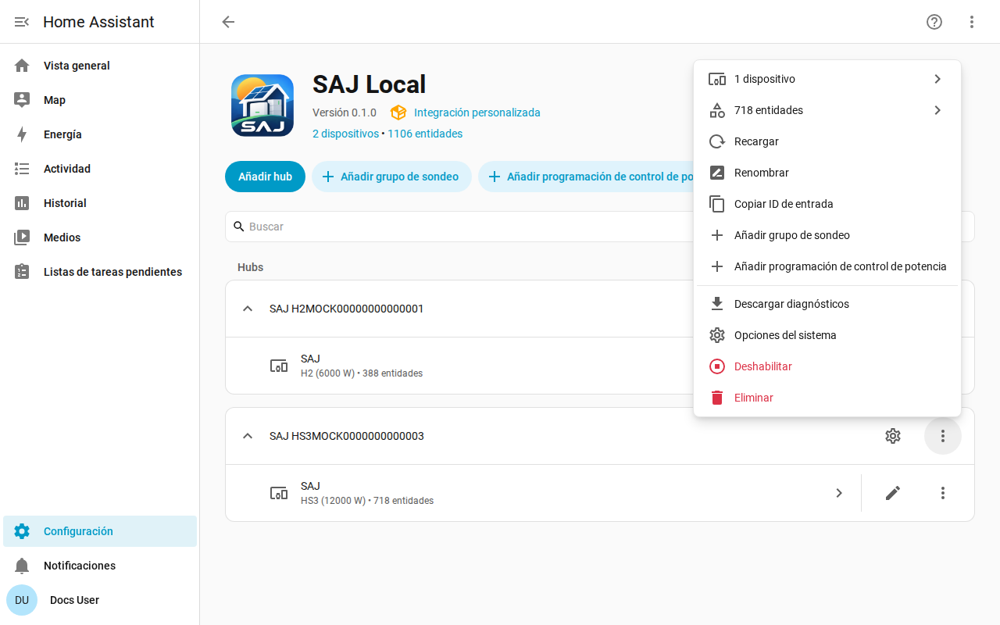

[en](../../en-gb/user/troubleshooting.md) | [de](../../de/user/troubleshooting.md) | [nl](../../nl/user/troubleshooting.md) | [fr](../../fr/user/troubleshooting.md) | [zh](../../zh-hans/user/troubleshooting.md) | es | [it](../../it/user/troubleshooting.md) | [pl](../../pl/user/troubleshooting.md) | [sv](../../sv/user/troubleshooting.md)

# Solución de problemas

La página Solución de problemas muestra cómo descargar los diagnósticos, activar el registro de depuración y leer los problemas habituales. La lista completa está en la sección [Diagnósticos y registro de depuración](../../../custom_components/saj_local/docs/features.md#diagnostics-and-debug-logging) de la lista de funciones de la integración.

La descarga de diagnósticos y el registro de depuración muestran lo que devuelve el inversor y lo que hizo SAJ Local con las lecturas, sin revelar quién eres ni dónde estás. Ambos usan las herramientas de Home Assistant, así que no hay que instalar nada y no se envía nada a ningún sitio.

## Empieza por las entidades y las reparaciones

- Comprueba [Ajustes y Reparaciones](faults-and-repairs.md#avisos-de-reparación) por si hay un aviso de reparación del sistema. Cada aviso dice qué va mal y qué hacer.
- Comprueba los [fallos del dispositivo](faults-and-repairs.md#fallos-del-dispositivo) cuando el inversor informa de un problema.
- Las entidades que aparecen como no disponibles tras un rechazo se describen en [proteger el inversor](protecting-the-inverter.md#cuando-el-inversor-rechaza-una-lectura).

## Descargar los diagnósticos

1. Abre Ajustes, luego Dispositivos y servicios y luego SAJ Local.
2. Abre el menú de la fila del sistema y elige Descargar diagnósticos.

El archivo contiene:

- las entidades habilitadas, los intervalos con las solicitudes que necesita cada uno, y la carga prevista frente al límite de 40 solicitudes por minuto;
- las entidades rechazadas y suspendidas;
- los fallos activos con las palabras sin procesar de los fallos, y los bits de fallo no reconocidos como registro y bit;
- los avisos de reparación abiertos, y cuánto tiempo lleva fallando el inversor;
- las funciones de control de potencia, cuál está en marcha, cuál es propiedad de SAJ Local y la acción pendiente de cada programación;
- una instantánea de las palabras sin procesar de cada registro que SAJ Local ha leído desde que se cargó el sistema, con la antigüedad de cada una, para que un mantenedor pueda comprobar una lectura con el dispositivo real;
- cada solicitud que no obtuvo una respuesta utilizable, con el motivo. Una solicitud que agotó el tiempo de espera se ve distinta de una solicitud que el inversor rechazó, y la diferencia importa cuando otro cliente mantiene la conexión del inversor. Cada entidad rechazada, cada solicitud fallida y cada línea del registro de depuración nombra la función Modbus de la solicitud.

La instantánea no añade ninguna solicitud al inversor. La instantánea empieza vacía cada vez que se carga el sistema.

## Activar el registro de depuración

1. Abre la página de la integración SAJ Local.
2. Abre el menú de tres puntos de la página de la integración y elige Habilitar el registro de depuración.
3. Cuando el sistema no se pudo configurar, recarga el sistema desde el menú del sistema, para que el registro cubra la configuración.
4. Reproduce el problema.
5. Elige Deshabilitar el registro de depuración. Home Assistant descarga el registro.

El registro de depuración anota cada conexión, sondeo, solicitud, escritura, latido y cambio de programación, una línea por evento. Cada línea del registro empieza con el título del sistema y el número de serie enmascarado salvo los tres últimos caracteres, para distinguir las líneas de dos sistemas. Un título que contiene el número de serie lo lleva enmascarado en el mismo sitio, por ejemplo `SAJ xxxxx123`.

## Qué dejan fuera el archivo y el registro

Los diagnósticos y los registros nunca contienen el host, el puerto, el ID de unidad, el número de serie completo, la dirección MAC, las direcciones de red, el número de serie del cargador de VE, el prefijo ni los nombres de los grupos de sondeo. En la instantánea de registros, las palabras de los registros que contienen las direcciones de red y los números de serie se sustituyen por el marcador de redacción de Home Assistant, para que veas que el registro respondió sin ver qué decía.

## Problemas habituales

| Qué ves | Qué comprobar |
| --- | --- |
| La configuración falla por falta de conexión o de respuesta | El host, el puerto y el ID de unidad. Asegúrate de que ningún otro cliente Modbus mantenga la conexión del inversor. |
| La configuración dice que el dispositivo no se reconoce | Elige el modelo a mano. Consulta los [primeros pasos](getting-started.md#cuando-no-se-reconoce-el-inversor). |
| Un ajuste rechaza un cambio | Permitir control está desactivado, el modelo está sin verificar o el ajuste es un ajuste de puesta en servicio. El mensaje indica cuál. Consulta [cambiar ajustes](changing-settings.md). |
| Las lecturas van más despacio que el intervalo que configuraste | La carga supera el límite de 40 solicitudes por minuto. Consulta el [sondeo](polling.md#la-carga-de-solicitudes). |
| Una entidad que habilitaste todavía no tiene valor | Home Assistant recarga el sistema unos 30 segundos después de habilitar una entidad, y la entidad se lee desde la siguiente lectura. |
| Los ID de entidad han ganado un número | El ID que quería la entidad estaba en uso. Consulta [entidades y el prefijo](entities-and-prefix.md#el-prefijo). |
| Faltan entidades | El equipo no se detecta o está ajustado a No instalado. Consulta el [equipo opcional](optional-equipment.md). |

## Ayuda y comentarios

Las preguntas, los informes de errores y las ideas son bienvenidos en el [seguimiento de incidencias](https://github.com/Counterphase-Labs/ha-saj-local/issues). Abre el formulario Bug report para un problema con la integración y el formulario Card bug report para un problema con una tarjeta del panel. El formulario Bug report exige la descarga de diagnósticos. Informa de un problema de seguridad en privado, consulta la [política de seguridad](../../../SECURITY.md).
