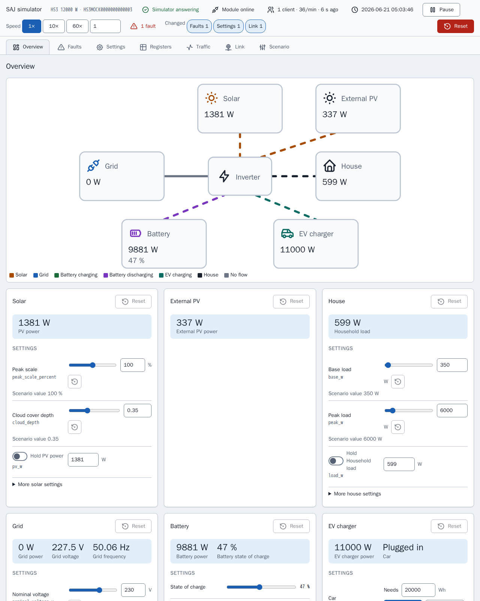

[en](../../en-gb/developer/README.md) | [de](../../de/developer/README.md) | [nl](../../nl/developer/README.md) | fr | [zh](../../zh-hans/developer/README.md) | [es](../../es/developer/README.md) | [it](../../it/developer/README.md) | [pl](../../pl/developer/README.md) | [sv](../../sv/developer/README.md)

# Documentation développeur de SAJ Local

Comment SAJ Local est construit, vérifié et publié, et où se trouve la vérité sur chaque partie. La documentation explique pourquoi le projet est construit ainsi et renvoie au fichier qui contient chaque fait. Les versions, les listes de commandes et les cartes de registres se trouvent dans le code et la configuration, pas ici.

Pour obtenir une copie de travail fonctionnelle et envoyer une modification, commencez par [CONTRIBUTING.md](../../../CONTRIBUTING.md). SAJ Local est une intégration Home Assistant uniquement locale : SAJ Local communique avec l'onduleur sur le réseau local et n'ajoute aucun service cloud ni SDK compagnon.

## Développer sans onduleur

Le simulateur est un appareil SAJ de remplacement, la plupart du travail ne demande donc aucun matériel. Chaque simulateur sert une page qui montre ce que fait le système simulé et permet à un développeur de modifier le système pendant que Home Assistant l'interroge, sans modifier un scénario ni redémarrer.

[Simulateur Modbus](simulator.md) explique à quoi sert le simulateur et comment exécuter un scénario. [Page du simulateur](simulator-page.md) montre chaque vue de la page.

## Pages

- [Simulateur Modbus](simulator.md) : à quoi sert le simulateur, les scénarios et l'exécution d'un autre système.
- [Page du simulateur](simulator-page.md) : chaque vue de la page, l'inspecteur de registres, le journal du trafic, les défauts de liaison, les préréglages et l'état enregistré.
- [Environnement](environment.md) : préparer une copie de travail et exécuter le Home Assistant de développement avec les simulateurs.
- [Vérifications](checks.md) : les cibles make, le seuil de couverture et comment restreindre une exécution.
- [Architecture](architecture.md) : la bibliothèque SAJ et l'intégration, les profils, le catalogue, l'interrogation et les noms stables.
- [Frontend](frontend.md) : la source des cartes, la compilation et les tableaux de bord de démonstration.
- [Documentation](documentation.md) : comment ces pages, la référence des entités générée et les captures d'écran sont faites et vérifiées.
- [Publication](releasing.md) : la mise à jour de la version de Home Assistant et les étapes avant une publication.

La documentation utilisateur se trouve dans la [documentation utilisateur](../user/README.md).

## Où se trouve la vérité

| Question | Référence faisant autorité |
| --- | --- |
| Que doit faire le projet ? | [Exigences globales](../../../.github/work/requirements.md), [exigences de l'intégration](../../../custom_components/saj_local/docs/requirements.md), [exigences des cartes](../../../frontend/docs/requirements.md), [exigences du simulateur](../../../mock/docs/requirements.md) |
| Que fait chaque partie aujourd'hui ? | [Fonctionnalités de l'intégration](../../../custom_components/saj_local/docs/features.md), [fonctionnalités des cartes](../../../frontend/docs/features.md), [fonctionnalités du simulateur](../../../mock/docs/features.md) |
| Comment le code, les tests et la documentation sont-ils écrits ? | [code-style.md](../../../.github/work/code-style.md) |
| Quelles règles lient tous ceux qui travaillent ici ? | [AGENTS.md](../../../AGENTS.md) |
| Qu'est-ce qui a été construit, et pourquoi ? | [done/index.md](../../../.github/work/done/index.md) |
| Qu'est-ce qui est prévu ? | [.github/work/future/](../../../.github/work/future/) |
| Quelles commandes existent ? | [Makefile](../../../Makefile) |
| Que fait tourner la CI ? | [ci.yml](../../../.github/workflows/ci.yml) |
| Dépendances Python et réglages des outils | [pyproject.toml](../../../pyproject.toml) |
| Dépendances et scripts du frontend | [frontend/package.json](../../../frontend/package.json) |
| Services de développement | [compose.yaml](../../../compose.yaml) |

Le code existant n'a aucune autorité sur les exigences. Quand ils divergent, le code est faux ou le propriétaire modifie l'exigence.

## Style de code

[code-style.md](../../../.github/work/code-style.md) fait autorité. La règle de documentation de code-style.md façonne ces pages : expliquer pourquoi, pas comment, et laisser les noms et les types décrire le reste.
