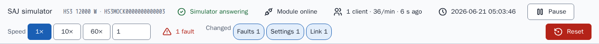
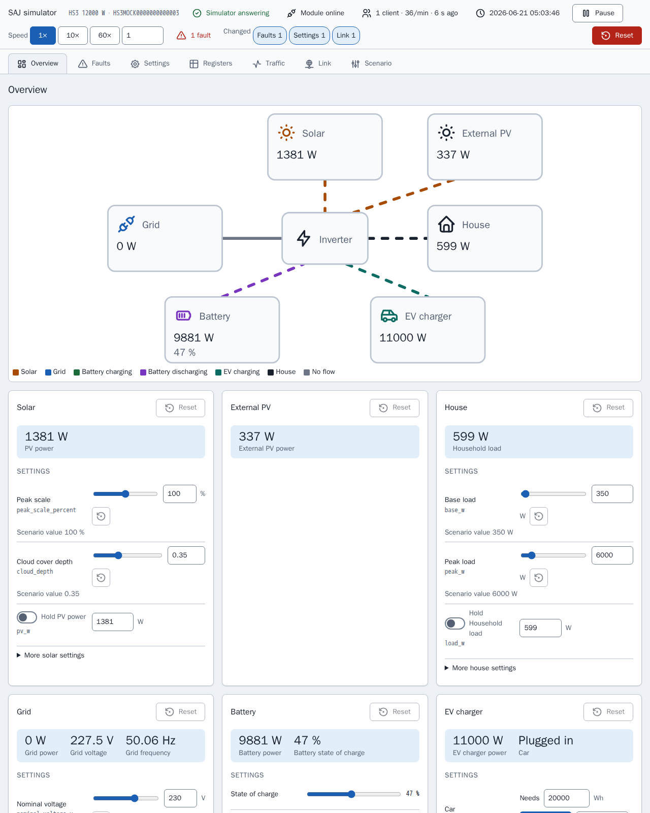
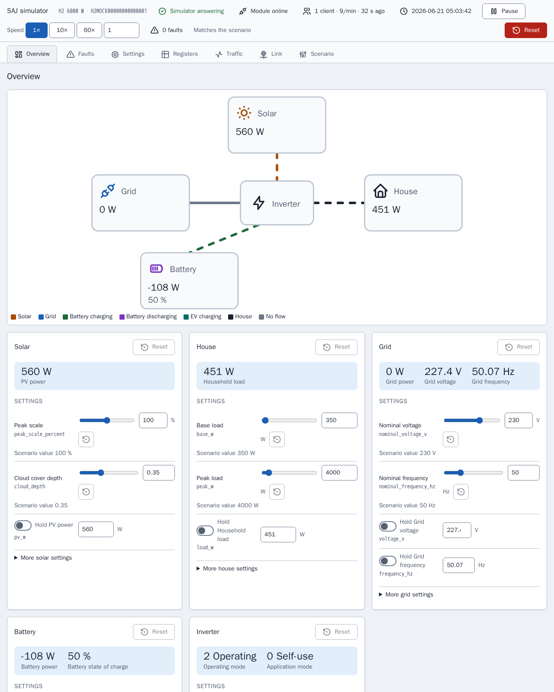
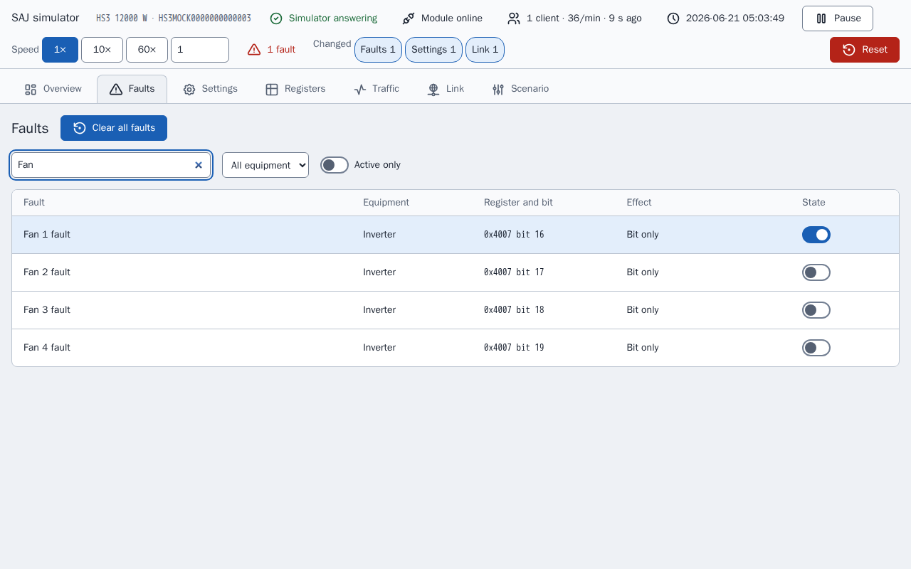
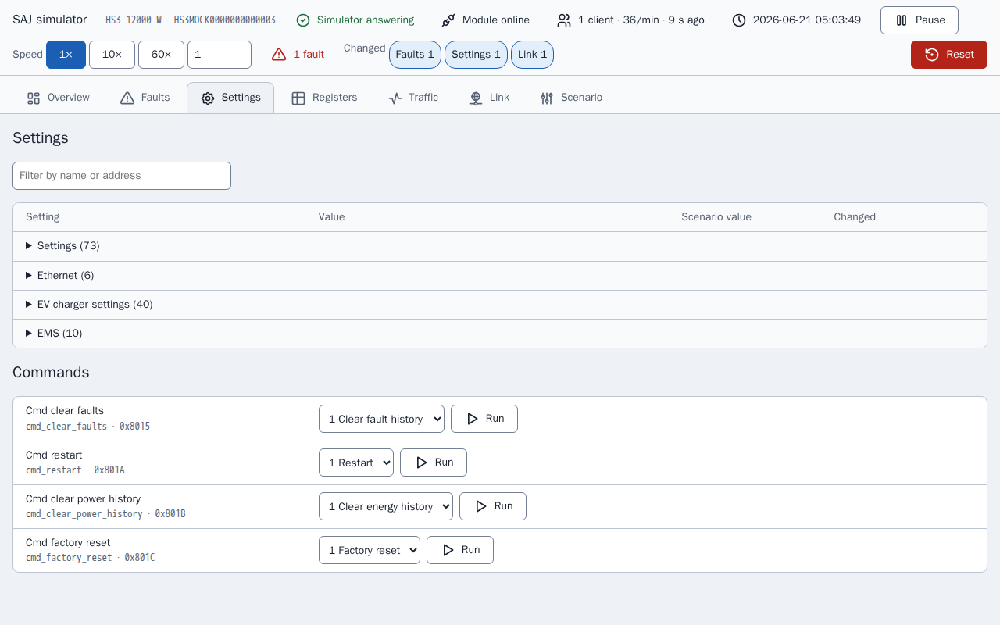
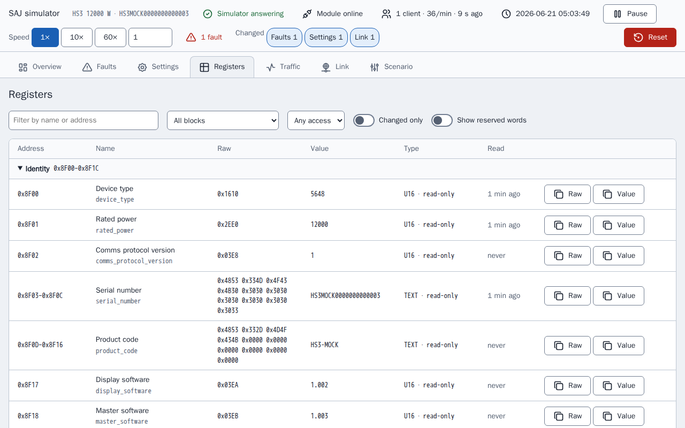
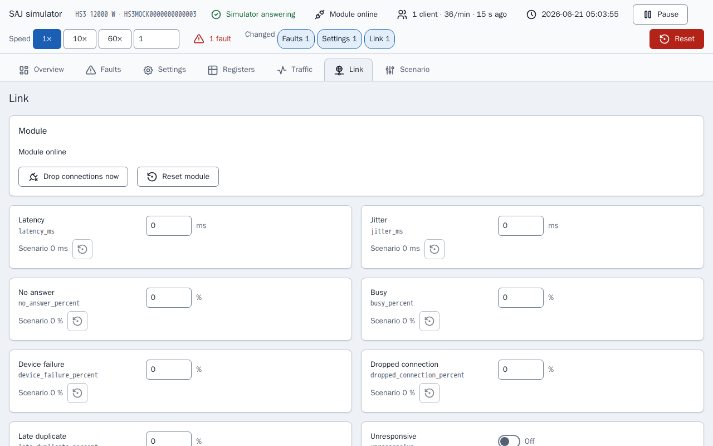
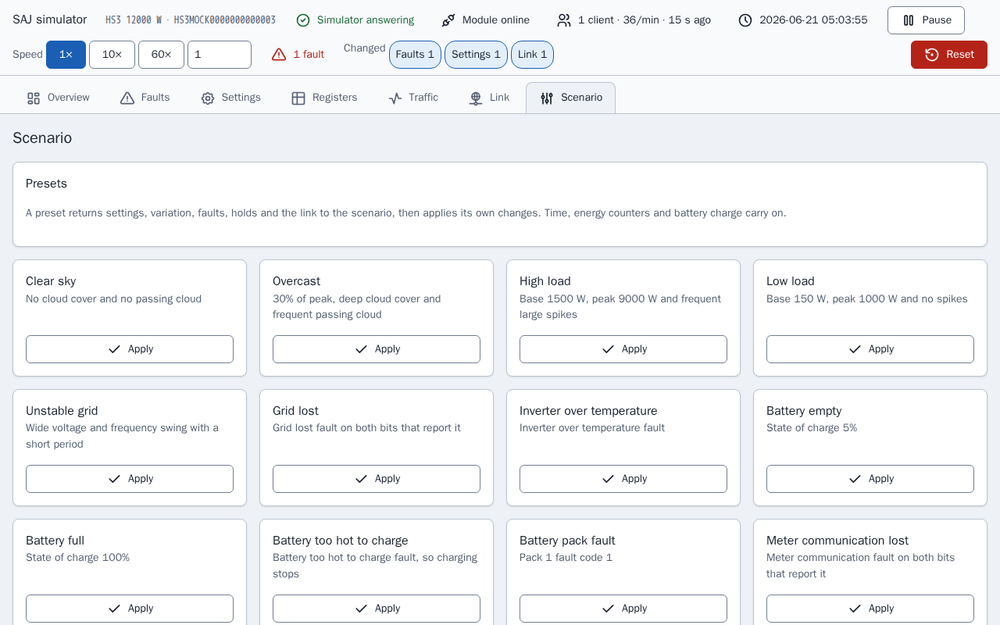
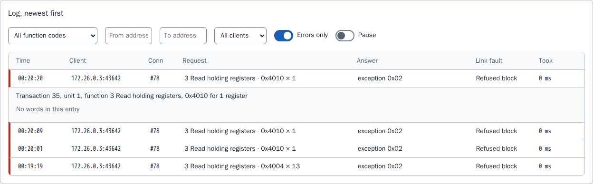

[en](../../en-gb/developer/simulator-page.md) | [de](../../de/developer/simulator-page.md) | [nl](../../nl/developer/simulator-page.md) | fr | [zh](../../zh-hans/developer/simulator-page.md) | [es](../../es/developer/simulator-page.md) | [it](../../it/developer/simulator-page.md) | [pl](../../pl/developer/simulator-page.md) | [sv](../../sv/developer/simulator-page.md)

# Page du simulateur

La page de contrôle d'un simulateur : vues, inspecteur de registres, journal du trafic, défauts de liaison, effets des défauts, préréglages et état enregistré. La page elle-même n'existe qu'en anglais, ses libellés sont donc cités en anglais dans cette description.

La liste complète de ce que couvre la page se trouve dans les sections de la liste des fonctionnalités [Page de contrôle](../../../mock/docs/features.md#control-page), [État et préréglages](../../../mock/docs/features.md#state-and-presets), [Inspecteur de registres et journal du trafic](../../../mock/docs/features.md#register-inspector-and-traffic-log), [Défauts de liaison](../../../mock/docs/features.md#link-faults).

Chaque simulateur sert une page web à `http://localhost:<panel port>/` : `5080` pour le HS3 et `5081` pour le H2 démarrés par `make up` (`SAJ_MOCK_PANEL_HOST_PORT` et `SAJ_MOCK_H2_PANEL_HOST_PORT` les modifient). Dans le conteneur, le simulateur écoute sur `server.panel_port`, 8080 par défaut. Il n'y a aucune authentification : le simulateur est un outil de développement.

La page existe pour qu'un développeur puisse voir ce que fait le système simulé et le mettre dans une situation donnée sans modifier un scénario ni redémarrer. La page construit chaque commande à partir de la description de l'appareil, elle ne liste donc que l'équipement installé.
La page interroge l'état toutes les 3 secondes, une modification faite depuis Home Assistant apparaît donc, et les vues Registers et Traffic se rafraîchissent aussi chaque seconde tant qu'elles sont ouvertes. Une commande qui a le focus n'est pas écrasée. Deux clients peuvent modifier des choses en même temps : la dernière écriture l'emporte, comme sur un vrai appareil. Chaque modification affiche une courte confirmation et chaque refus sa raison.

Une barre d'état présente dans chaque vue indique si le simulateur fonctionne comme son scénario ou a été modifié : si le module est en ligne, les clients connectés et leur débit de requêtes, l'heure simulée, la marche et la pause, la vitesse, les défauts actifs et une pastille pour chaque type de modification par rapport au scénario en vigueur. Le même résumé (`changes` dans l'état) marque les lignes et les cartes modifiées. Pause règle la vitesse à 0 et lecture rétablit la vitesse précédente, la mise en pause ne perd donc pas la vitesse.



La vue courante est dans le fragment de l'URL (`#registers`), un rechargement la conserve donc. Rien n'est enregistré dans le navigateur. Les captures d'écran des vues ci-dessous sont prises après qu'un défaut, « Fan 1 fault », a été activé et après que le simulateur a refusé un registre, chaque vue montre donc une modification par rapport au scénario.

La page déduit des noms lisibles à partir des noms de champs et arrondit chaque valeur mise à l'échelle au nombre de décimales de son échelle, si bien qu'un 65535 brut à l'échelle 0.0001 se lit 6.5535 au lieu de montrer du bruit de virgule flottante.

## Vues

### Vue d'ensemble (Overview)

Un schéma du flux de puissance de l'équipement installé, coloré et animé selon le sens, au-dessus d'une carte par équipement. Une carte contient la mesure en direct, les commandes qui règlent la mesure et les défauts de l'équipement, avec une remise au scénario pour cette carte.



La page du H2 a moins de cartes que la page du HS3 ci-dessus, car le scénario du H2 installe moins d'équipement.



Une carte garde ce qu'une commande règle séparément de la mesure que la commande produit, car les deux diffèrent dès qu'un maintien, un défaut ou l'état de charge entre en jeu : une échelle de crête de 100 % ne signifie pas 100 % de la puissance PV. La remise à zéro d'une carte rétablit la variation, les maintiens et les bits de défaut de la carte, et laisse tels quels l'état de charge, la voiture, l'horloge et les compteurs d'énergie, pour la même raison que les préréglages. Une carte avec un défaut actif est marquée, comme la carte ci-dessous.


### Défauts (Faults)

Chaque bit de défaut de l'équipement installé, avec recherche, et ce que fait le simulateur quand le bit est activé. Les bits que le document ne nomme pas sont listés comme réservés, pour que le chemin des défauts non reconnus de l'intégration puisse être essayé.

L'image montre la recherche « Fan », avec les quatre défauts de ventilateur et l'interrupteur du défaut activé, « Fan 1 fault », sur activé.



### Réglages (Settings)

Les réglages et commandes modifiables, avec des noms pour les valeurs brutes et la valeur du scénario de chacun.



### Registres (Registers)

L'inspecteur de registres, décrit ci-dessous.



### Trafic (Traffic)

Le journal du trafic, décrit ci-dessous.


### Liaison (Link)

Les défauts de liaison et l'état du module, décrits ci-dessous.



### Scénario (Scenario)

Les préréglages, l'heure simulée, les compteurs d'énergie, la remise à zéro et l'export.



## Inspecteur de registres

`GET /api/registers` liste chaque bloc de l'appareil et, pour chaque champ d'un bloc qui répond, les mots bruts, la valeur décodée avec son libellé, l'accès (lecture seule, modifiable ou commande) et le moment où un client a lu le champ pour la dernière fois. La vue Registers affiche la liste sous forme de tableau avec un filtre, un interrupteur « changed only » et une mise en évidence d'une valeur qui vient de changer, si bien que l'effet d'un défaut ou d'une écriture sur les registres est visible sans client Modbus.

L'inspecteur ne fait que montrer. L'inspecteur lit l'appareil sans l'observateur de l'appareil, regarder un registre n'est donc pas une lecture de client : le coup d'œil ne compte pas comme un keep-alive, ne touche pas le champ qu'une lecture toucherait et n'est pas enregistré dans le trafic. Un registre n'est écrit que par les commandes qui passent par la même validation qu'une écriture Modbus.

## Journal du trafic

Le serveur Modbus signale chaque événement de connexion et chaque requête, avec sa réponse, à un enregistreur (`traffic.py`). `GET /api/traffic?after=<sequence>` renvoie les entrées après un numéro de séquence, la page ne demande donc que ce qui est nouveau, avec les compteurs et un historique de 30 minutes par tranches de 10 secondes. `POST /api/traffic/reset` les efface. La vue Traffic montre le débit de requêtes en direct, un graphique des requêtes dans le temps, les compteurs par client et le journal, qui peut être filtré et ouvert pour voir les mots lus ou écrits. L'image montre le journal avec seulement les erreurs listées et une requête refusée ouverte : une requête refusée n'a pas de mots, l'entrée le dit donc et nomme le défaut de liaison qui a refusé la requête.



Les compteurs comptent les requêtes et les registres, car c'est ainsi que les rapports de terrain décrivent la charge d'un module, et les deux sont affichés car on ne sait pas si la taille des requêtes compte aussi. L'enregistreur garde les 2000 dernières entrées en mémoire et ne les enregistre pas : le journal décrit ce qui est arrivé à l'exécution courante du simulateur, et un redémarrage est une nouvelle exécution.

## Défauts de liaison

La vue Link et la section `link` d'un scénario règlent la manière dont le module simulé se comporte mal. Chaque réglage reproduit une panne que les rapports de terrain décrivent sur les modules de communication SAJ, et aucun n'est activé sauf si un scénario ou la page l'active.

| Clé | Effet |
| --- | --- |
| `latency_ms`, `jitter_ms` | Chaque réponse attend la latence plus ou moins jusqu'à la gigue, de 0 à 60000 ms |
| `no_answer_percent` | La requête est lue et jamais traitée, et la connexion reste ouverte |
| `busy_percent`, `device_failure_percent` | La réponse est l'exception `0x06` ou `0x04` |
| `dropped_connection_percent` | Le module ferme la connexion au lieu de répondre |
| `late_duplicate_percent` | Après une réponse d'exception, la même trame est renvoyée juste avant la réponse suivante sur cette connexion |
| `refused_blocks` | Une liste de `start`, `end` et `code` (0 à 255). Une requête qui touche le bloc reçoit ce code en réponse, ce qui permet de reproduire des appareils qui envoient des codes non standard, y compris 0 |
| `unresponsive` | Les connexions sont acceptées et rien n'est jamais répondu |
| `offline` | Le module cesse d'écouter et ferme chaque connexion |
| `offline_seconds`, `offline_period_seconds` | Hors ligne pendant les premières `offline_seconds` de chaque période, qui doit être au moins aussi longue |
| `lockout_requests`, `lockout_window_seconds`, `lockout_whole_port` | Un client qui envoie plus de `lockout_requests` requêtes dans la fenêtre voit sa connexion fermée et son adresse refusée, ou chaque client quand `lockout_whole_port` est défini, jusqu'à la réinitialisation du module. Une fenêtre est requise quand un seuil est défini |

<!-- jscpd:ignore-start -->
```yaml
link:
  latency_ms: 800
  jitter_ms: 400
  busy_percent: 10
  refused_blocks:
    - {start: 0x4000, end: 0x40FF, code: 0}
```
<!-- jscpd:ignore-end -->

Les pourcentages vont de 0 à 100. Une mauvaise valeur, ou une combinaison qui ne peut pas fonctionner, arrête le simulateur au démarrage et nomme la clé, comme `link.offline_seconds`.

Les décisions sont prises dans `link.py` et exécutées par le transport, qui interroge la liaison avant d'accepter une connexion et avant de répondre. La première vérification qui s'applique décide, dans cet ordre : hors ligne, sans réponse (unresponsive), verrouillage, connexion coupée, pas de réponse, bloc refusé, défaut de l'appareil, occupé (busy). La latence s'applique à chaque réponse envoyée. Qu'une probabilité s'applique est tiré de la graine de la simulation et du numéro de séquence de la requête, la même graine et les mêmes requêtes donnent donc les mêmes pannes, et une panne trouvée pendant le débogage peut être reproduite. La latence, la période hors ligne et la fenêtre de verrouillage suivent l'heure réelle, pas l'heure simulée, car les réglages décrivent la liaison telle que le client la voit et la vitesse de l'horloge ne doit pas les changer.

Les réglages de liaison et un verrouillage sont conservés après un redémarrage et exportés avec le scénario. Un verrouillage n'est levé que par « Reset module », par Reset ou par un préréglage, car les rapports de terrain décrivent un verrouillage qui a duré jusqu'à ce que le module reçoive une nouvelle adresse, et « Reset module » représente la nouvelle adresse. « Drop connections now » ferme une fois chaque connexion ouverte. Les routes sont `POST /api/link`, `/api/link/drop` et `/api/link/reset`.

L'enregistreur du trafic montre quel défaut a été appliqué à chaque requête, l'effet d'un réglage sur le client peut donc se lire dans le journal.

## Effets des défauts

Certains défauts font plus que positionner leur bit, là où un vrai système le ferait. Un défaut qui nomme une condition de réseau, de PV, de bus continu, de port de batterie, de température, de relais, de capteur ou d'isolement arrête l'onduleur, la perte du réseau fait fonctionner l'onduleur hors réseau, la perte de communication du compteur rend muet le compteur A, certains défauts de batterie arrêtent la charge ou la décharge, tout code de défaut de module différent de 0 arrête les deux, et un défaut du chargeur de VE arrête le chargeur. Tout autre défaut, et tout bit réservé, ne fait que positionner le bit. Les tables se trouvent dans `mock/saj_local_mock/profiles/fault_tables.py` et les effets sont appliqués par `simulation/faults.py`.

## Préréglages, état enregistré et export

**Les préréglages** ramènent d'abord les réglages, la variation, la graine, les défauts et les maintiens au scénario, puis appliquent leurs modifications, si bien que chacun donne les mêmes conditions quel que soit l'état dans lequel le simulateur a été laissé. L'heure simulée, la vitesse de l'horloge, les compteurs d'énergie et l'état de charge de la batterie continuent, sauf si le préréglage définit les valeurs, pour que Home Assistant ne voie ni l'horloge revenir en arrière ni les totaux à vie baisser. **Reset** est celui qui remet tout à zéro. L'équipement qui n'est pas installé n'a pas de préréglages, ni un modèle dont les tables ne nomment pas le défaut. Un préréglage ramène aussi la liaison au scénario, puis applique ses propres changements de liaison, et un verrouillage est levé. Les préréglages de liaison sont proposés sur chaque modèle : Slow link, Flaky link, Busy module, Module offline et Module locked out. Aucun rapport de terrain ne donne la charge à laquelle un module se verrouille, le seuil de Module locked out est donc un point de départ à modifier sur la page, et ne vient d'aucune limite de l'intégration.

**État enregistré.** Les modifications sont conservées après un redémarrage dans `/data/state.json`, dans un dossier monté par service dans [compose.yaml](../../../compose.yaml) : `mock/state/hs3/` et `mock/state/h2/`, remis à zéro en supprimant le contenu du dossier. Les réglages de liaison et un verrouillage sont enregistrés avec l'état. Un état enregistré pour un autre scénario est ignoré et consigné une fois, car l'appliquer à un autre système serait faux. Un état qui ne peut pas être lu est ignoré de la même façon et le fichier est conservé. Seuls les réglages qu'un client peut écrire sont enregistrés, une modification d'un registre fixe dans le code n'est donc jamais masquée par un ancien fichier, et les compteurs d'énergie sont enregistrés avec le début de chaque jour, mois et année, si bien qu'un redémarrage n'est pas une remise à zéro des compteurs. Sans dossier monté, le simulateur consigne une ligne indiquant que les modifications ne seront pas conservées et continue. **Reset** supprime le fichier et revient au scénario. La pile Playwright ne monte aucun dossier, chaque exécution part donc du scénario.

**L'export** télécharge la graine, la variation, les défauts, la liaison et l'horloge en cours sous forme de scénario, si bien qu'un état réglé peut être validé et relancé dans un simulateur neuf avec la même variation.

## Icônes

Les icônes de la page viennent du jeu d'icônes Tabler sous `mock/static/vendor/tabler/`, car le simulateur doit être autonome et ne rien charger de l'extérieur. Seules les icônes que la page utilise sont conservées, sous forme de fichiers SVG d'origine, pour que le jeu puisse être comparé à la source. Le dossier contient aussi la `LICENSE` du jeu et un `README.md` qui nomme la version des icônes. La page intègre les icônes en ligne pour qu'elles prennent la couleur du texte ; ni police d'icônes ni emoji n'est utilisé. Tout jeu sous licence MIT ou ISC peut être intégré de cette façon, avec sa licence à côté.
