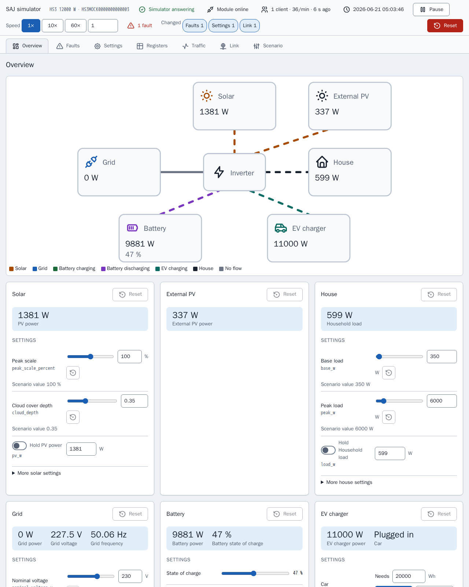

[en](../../en-gb/developer/simulator.md) | [de](../../de/developer/simulator.md) | [nl](../../nl/developer/simulator.md) | fr | [zh](../../zh-hans/developer/simulator.md) | [es](../../es/developer/simulator.md) | [it](../../it/developer/simulator.md) | [pl](../../pl/developer/simulator.md) | [sv](../../sv/developer/simulator.md)

# Simulateur Modbus



À quoi sert le simulateur, comment exécuter et configurer un scénario, et comment étendre le simulateur.

La liste complète de ce que couvre le simulateur se trouve dans les sections de la liste des fonctionnalités [Modèles simulés](../../../mock/docs/features.md#simulated-models), [Scénarios](../../../mock/docs/features.md#scenarios), [Variation](../../../mock/docs/features.md#variation).

Le simulateur est un appareil SAJ de remplacement auquel Home Assistant ou n'importe quel client Modbus peut se connecter, pour que l'intégration puisse être développée sans posséder le matériel ni risquer le matériel. Le simulateur vise des tests de fumée crédibles, pas une émulation exacte, et n'est pas un serveur Modbus généraliste. Le paquet est `mock/saj_local_mock/`, et chaque simulateur s'exécute dans son propre conteneur.

## Décisions de conception

- **Autonome.** Le simulateur ne partage aucun code avec l'intégration, et un contrat d'import-linter interdit au simulateur d'importer Home Assistant ou `custom_components`. Si les deux côtés utilisaient les mêmes définitions de registres, une erreur dans les définitions resterait invisible.
- **Sa propre couche Modbus.** Les vrais appareils SAJ s'écartent du standard : codes d'exception étranges, blocs qui rejettent les lectures au-delà de leur fin, limite basse de clients. L'intégration doit savoir gérer ces défaillances, elles sont donc intégrées.
- **Un conteneur, un appareil.** Chaque instance garde son propre état, dans son propre dossier sous `mock/state/`, les instances ne s'affectent donc jamais.
- **Modifiable en cours d'exécution.** Le scénario est le point de départ, pas la seule entrée. La page du simulateur et les requêtes entrantes modifient le système en cours, et le scénario reste l'état connu auquel revenir.
- **Déterministe.** La météo et la charge ne dépendent que de la graine et de l'heure simulée. Le même scénario, le même instant et les mêmes écritures donnent les mêmes valeurs, quelle que soit la fréquence d'interrogation d'un client.
- **Un seul bilan énergétique.** Seuls l'irradiance et la charge sont générées ; tout le reste est dérivé, les registres ne se contredisent donc jamais.
- **Les écritures prennent effet.** Les réglages sont enregistrés, relus et appliqués. Une écriture depuis la page passe par la même validation et le même traitement qu'une écriture Modbus, l'intégration ne peut donc pas distinguer les deux et la page ne peut pas mettre l'appareil dans un état qu'un client ne pourrait pas atteindre.
- **La page ne sait rien des modèles.** La page se construit à partir de la description que donne l'appareil, un nouveau modèle ne demande donc aucune modification de la page. La page est un outil de développement, c'est donc de simples fichiers HTML, CSS et JavaScript dans `mock/static/` servis tels quels, sans bibliothèques, sans étape de compilation et sans tests propres à la page, tandis que le Python derrière la page est testé comme le reste. Voir la [page du simulateur](simulator-page.md).
- **Le module fait partie de la simulation.** Le serveur Modbus représente le module de communication auquel un client se connecte, les défaillances que les rapports de terrain décrivent sur ces modules (réponses lentes ou absentes, codes d'exception étranges, connexions coupées, un verrouillage) sont donc des réglages du simulateur et non des cas particuliers dispersés dans l'appareil.
- **Le comportement des écritures vient des documents SAJ.** Les écritures sont spécifiées par les documents de protocole de SAJ et par des mesures réelles, pas par le simulateur. Si le simulateur s'écarte du comportement documenté de `0x06` et `0x10`, l'écart est un défaut du simulateur à signaler, pas quelque chose autour de quoi adapter l'intégration.

## S'orienter

| Pour | Où regarder |
| --- | --- |
| Pourquoi le simulateur est construit ainsi | Les travaux terminés [Construire le simulateur Modbus SAJ](../../../.github/work/done/build-saj-modbus-mock-simulator.md), [Ajouter le panneau de contrôle du simulateur](../../../.github/work/done/add-simulator-control-panel.md) et [Refondre le panneau du simulateur avec inspecteur et défauts de liaison](../../../.github/work/done/redesign-simulator-panel-with-inspector-and-link-faults.md) |
| Systèmes prêts à l'emploi | [mock/scenarios/](../../../mock/scenarios/) |
| Clés de scénario valides et valeurs par défaut | `mock/saj_local_mock/scenario.py` |
| Ce que prend en charge chaque modèle | `mock/saj_local_mock/models.py` |
| Registres | `mock/saj_local_mock/profiles/` |
| Comment les valeurs évoluent | `mock/saj_local_mock/simulation/` |
| Services et ports | [compose.yaml](../../../compose.yaml) |
| Page du simulateur | `panel.py` (routes), `description.py`, `presets.py` et la page dans [mock/static/](../../../mock/static/) |
| Défauts de liaison | `mock/saj_local_mock/link.py` (réglages, bornes, décisions) et `transport.py` (exécution des décisions) |
| Enregistrement du trafic | `mock/saj_local_mock/traffic.py` |
| Bits de défaut par modèle | `mock/saj_local_mock/profiles/fault_tables.py` |
| État enregistré | `mock/saj_local_mock/persistence.py` |

Le transport ne sait rien de SAJ, l'appareil possède les adresses et les règles d'accès, un profil lie les registres à des grandeurs simulées, et la simulation ne sait pas comment les valeurs sont transportées. Garder les couches séparées permet de tester chaque couche seule par des tests unitaires.

## Parler au simulateur depuis un terminal

`make up` démarre les simulateurs. Home Assistant atteint chacun par son nom de service Compose sur le port propre du simulateur ; depuis votre machine, utilisez `localhost` et le port publié dans `compose.yaml`.

Les exemples utilisent [mbpoll](https://github.com/epsilonrt/mbpoll) sur le port publié du simulateur HS3. `-0` fait correspondre les adresses aux cartes de registres, `-1` lit une fois, `-t 4` choisit les registres de maintien et `-a` est l'ID d'unité.

Lisez le type d'appareil et la puissance nominale (registres `0x8F00` et `0x8F01`) :

<!-- jscpd:ignore-start -->
```bash
mbpoll -m tcp -p 5020 -a 1 -0 -1 -t 4:hex -r 0x8F00 -c 2 localhost
```
<!-- jscpd:ignore-end -->

Un HS3 et un H2 répondent avec des types d'appareil différents, ce qui est le moyen le plus rapide de confirmer quel système un port simule.

Écrivez un réglage et relisez le réglage (ici le mode d'application à `0x3647`) :

<!-- jscpd:ignore-start -->
```bash
mbpoll -m tcp -p 5020 -a 1 -0 -t 4 -r 0x3647 localhost 1
mbpoll -m tcp -p 5020 -a 1 -0 -1 -t 4 -r 0x3647 localhost
```
<!-- jscpd:ignore-end -->

Voyez comment le simulateur refuse une requête, par exemple une adresse en dehors de tout bloc :

<!-- jscpd:ignore-start -->
```bash
mbpoll -m tcp -p 5020 -a 1 -0 -1 -t 4 -r 0x0001 localhost
```
<!-- jscpd:ignore-end -->

Regardez une valeur changer en retirant `-1` ; mbpoll interroge alors une fois par seconde jusqu'à l'arrêt.

Lancez le contrôle de santé propre au simulateur, qui n'a besoin d'aucun client installé :

<!-- jscpd:ignore-start -->
```bash
docker compose exec mock python -m saj_local_mock healthcheck; echo $?
```
<!-- jscpd:ignore-end -->

Les écritures sont conservées après un redémarrage dans `mock/state/`, que Git ignore, et remises à zéro depuis la page du simulateur ou en supprimant le contenu du dossier, voir [État enregistré](simulator-page.md#préréglages-état-enregistré-et-export). Les adresses viennent des profils ; les trois ci-dessus ne sont que des points de départ.

## Configurer un scénario

Un scénario est un fichier YAML monté à `/config/config.yaml`. Seul `device.model` est obligatoire, un fichier n'indique donc que ce qui diffère des valeurs par défaut :

<!-- jscpd:ignore-start -->
```yaml
device:
  model: hs3
simulation:
  start: "2026-06-21T12:00:00"
  speed: 600
battery:
  modules: 4
```
<!-- jscpd:ignore-end -->

Dans l'exemple, `simulation.speed` est le nombre de secondes simulées par seconde réelle, l'exemple fait donc passer dix minutes simulées chaque seconde à partir de midi en plein été : utile pour observer une journée entière de charge et de décharge en quelques minutes. `simulation.seed` choisit la météo et la charge.

Deux sections façonnent le comportement aléatoire et les défauts au démarrage ; une troisième, `link`, est décrite sous [Défauts de liaison](simulator-page.md#défauts-de-liaison). `variation` règle les bornes, la profondeur et la période des générateurs du solaire, de la charge et du réseau (le niveau de charge reste dans `site.load`), et `faults` liste les bits de défaut actifs par équipement avec le registre et le bit, plus les codes des modules de batterie :

<!-- jscpd:ignore-start -->
```yaml
variation:
  cloud_depth: 0.9
faults:
  inverter:
    - {register: 0x4005, bit: 23}
  packs:
    - {pack: 1, fault: 1}
```
<!-- jscpd:ignore-end -->

Une mauvaise clé ou une combinaison impossible arrête le simulateur au démarrage et nomme la clé. Le simulateur écrit la ligne sur la sortie d'erreur et quitte :

```text
invalid scenario: ev_charger.installed: not available on h2
```

## Exécuter un système différent ou supplémentaire

**Essayer un scénario une fois**, sans toucher à aucun fichier. Le simulateur s'exécute au premier plan sur son propre port jusqu'à ce que vous arrêtiez le simulateur :

<!-- jscpd:ignore-start -->
```bash
docker compose run --rm --no-deps -p 5030:502 \
  -v ./mock/scenarios/hs3-off-grid.yaml:/config/config.yaml:ro \
  -v ./mock/state/off-grid:/data \
  mock
```
<!-- jscpd:ignore-end -->

Le `-v` supplémentaire est nécessaire car le service `mock` apporte sinon le montage `/data` de `mock/state/hs3/`, et la première modification de l'exécution hors réseau remplacerait le `state.json` du HS3 de développement par l'état hors réseau. L'exécution hors réseau garde son propre état dans `mock/state/off-grid/` d'une exécution à l'autre.

Pointez le premier `-v` vers votre propre fichier pour exécuter un scénario que vous avez écrit.

**Changez ce que démarre `make up`** dans `compose.override.yaml`. Monter un autre fichier sur le même chemin remplace le scénario ; un nouveau service ajoute un système :

<!-- jscpd:ignore-start -->
```yaml
services:
  mock:
    volumes:
      - ./mock/scenarios/hs3-ev.yaml:/config/config.yaml:ro

  mock-off-grid:
    build:
      context: ./mock
    volumes:
      - ./mock/scenarios/hs3-off-grid.yaml:/config/config.yaml:ro
    ports:
      - "5022:502"
```
<!-- jscpd:ignore-end -->

Chaque service est un appareil indépendant avec son propre état. Home Assistant atteint le nouveau service sous le nom `mock-off-grid`, plusieurs systèmes peuvent donc être ajoutés côte à côte à un seul Home Assistant.

## Étendre le simulateur

- **Nouveau scénario :** un fichier dans `mock/scenarios/`. `make mock-smoke` prend en compte chaque fichier du dossier.
- **Nouveau modèle :** une entrée dans `models.py`, un profil dans `profiles/` et l'acceptation par la validation de scénario dans `scenario.py`.
- **Nouvelle particularité :** dans la couche qui la possède. Le découpage en trames et les connexions dans le transport, les adresses et l'accès dans l'appareil, le comportement du modèle dans le profil.

Le simulateur passe les mêmes seuils que l'intégration, voir la [page des vérifications](checks.md).
