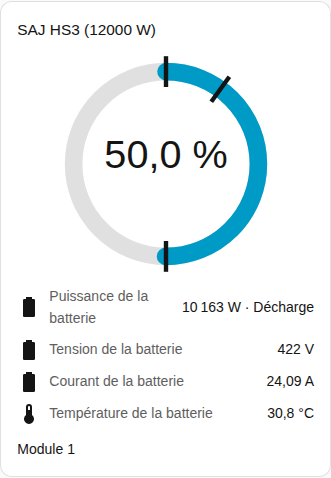
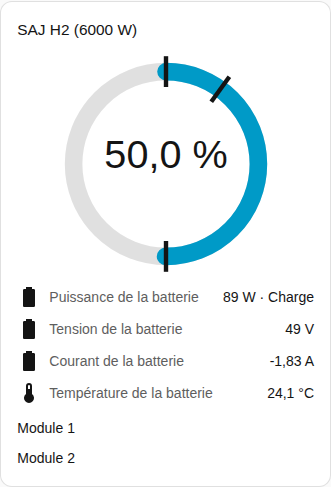

[en](../../../en-gb/user/cards/battery-card.md) | [de](../../../de/user/cards/battery-card.md) | [nl](../../../nl/user/cards/battery-card.md) | fr | [zh](../../../zh-hans/user/cards/battery-card.md) | [es](../../../es/user/cards/battery-card.md) | [it](../../../it/user/cards/battery-card.md) | [pl](../../../pl/user/cards/battery-card.md) | [sv](../../../sv/user/cards/battery-card.md)

# Carte de batterie

La page Carte de batterie explique la carte de batterie, qui affiche la charge, la puissance et les mesures de la batterie. La liste complète se trouve dans la section [Carte de batterie](../../../../frontend/docs/features.md#battery-card) de la liste des fonctionnalités des cartes. [Ajouter un élément](README.md#ajouter-un-élément) explique comment ajouter la carte et choisir un système.

## Ce que la carte affiche

- Un anneau affiche l'état de charge. Des repères sur l'anneau montrent la réserve, la limite de charge et la limite de décharge sur le réseau.
- La puissance de la batterie s'affiche avec l'indication que la batterie se charge ou se décharge, et sous la puissance la tension, le courant, la température et la capacité utilisable. Les sens suivent le [signe de la puissance](../entities-and-prefix.md#signe-de-la-puissance).
- Avec Afficher les modules de batterie activé, ce qui est la valeur par défaut, chaque module obtient un groupe de lignes avec l'état de charge, la santé, la tension, le courant, la température, les cycles, le défaut et l'avertissement. Une mesure de module n'apparaît que lorsque l'entité de la mesure est activée. La plupart des mesures de module sont créées désactivées, c'est pourquoi la capture d'écran n'affiche que le nom du module. Activez les entités que vous voulez dans Home Assistant. Les [entités des modules de batterie](../entities/battery-packs.md) figurent dans la référence des entités.
- Une ligne affiche le temps avant batterie pleine pendant que la batterie se charge et le temps avant batterie vide pendant que la batterie se décharge. La ligne disparaît quand la batterie est au repos ou quand le système n'a pas cette entité. Les [capteurs calculés](../entities-and-prefix.md#capteurs-calculés) expliquent les estimations.
- Un système sans batterie le dit.

## Différences entre les modèles

- **HS3 :** un module.
- **H2 :** un groupe de lignes pour chaque module que l'onduleur signale, jusqu'à cinq. La capture d'écran montre un H2 avec deux modules. Voir l'[équipement optionnel](../optional-equipment.md#modules-de-batterie).

La [carte des défauts](faults-card.md) liste le défaut et l'avertissement actifs de chaque module. Les entités de défaut et d'avertissement sont activées par défaut.

## Options

| Option dans l'éditeur | Clé YAML | Valeur par défaut |
| --- | --- | --- |
| Système | `device` | Le premier système |
| Afficher les modules de batterie | `show_packs` | Activé |

## Pas encore pris en charge

- Modifier un réglage de la batterie depuis la carte. La carte de batterie n'affiche que des mesures. Utilisez la [carte de contrôle](controls-card.md) pour les limites de la batterie.
