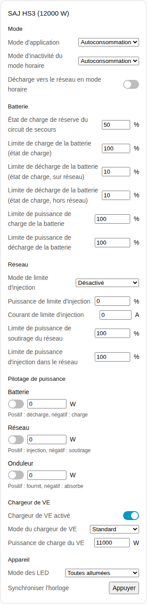
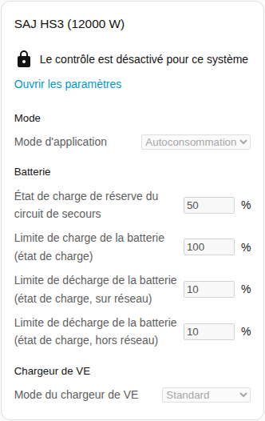
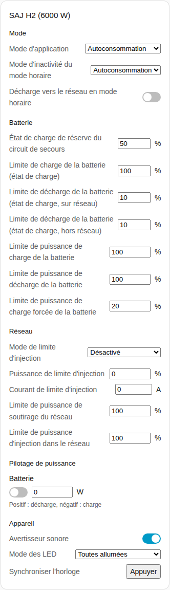

[en](../../../en-gb/user/cards/controls-card.md) | [de](../../../de/user/cards/controls-card.md) | [nl](../../../nl/user/cards/controls-card.md) | fr | [zh](../../../zh-hans/user/cards/controls-card.md) | [es](../../../es/user/cards/controls-card.md) | [it](../../../it/user/cards/controls-card.md) | [pl](../../../pl/user/cards/controls-card.md) | [sv](../../../sv/user/cards/controls-card.md)

# Carte de contrôle

La page Carte de contrôle explique la carte de contrôle, qui rassemble les réglages d'un système en sections pour que vous puissiez modifier les réglages depuis un tableau de bord. La liste complète se trouve dans la section [Carte de contrôle](../../../../frontend/docs/features.md#controls-card) de la liste des fonctionnalités des cartes. [Ajouter un élément](README.md#ajouter-un-élément) explique comment ajouter la carte et choisir un système. Les réglages derrière les commandes sont décrits dans [modifier les réglages](../changing-settings.md).

## Ce que la carte affiche

- Les sections sont Mode, Batterie, Réseau, Pilotage de puissance, Chargeur de VE et Appareil. Une section sans rien à afficher est omise.
- **Mode :** le mode d'application et les réglages du mode horaire.
- **Batterie :** la réserve et les limites de charge et de décharge.
- **Réseau :** les réglages de la limite d'injection et les limites de puissance du réseau.
- **Pilotage de puissance :** chaque fonction de [pilotage de puissance](../power-control.md) que le système a, avec un interrupteur, une puissance cible et une indication sur ce que font une puissance positive et une puissance négative.
- **Chargeur de VE :** l'interrupteur, le mode et la puissance de charge du chargeur.
- **Appareil :** l'avertisseur sonore, le mode des LED et la synchronisation de l'horloge.
- Chaque réglage utilise la commande qui lui convient : un curseur ou un champ numérique, une liste, un interrupteur, un champ d'heure ou un bouton.
- Une commande modifie l'onduleur une fois par décision, puis affiche la valeur que l'onduleur détient. Un changement refusé apparaît sous la commande.
- La carte n'a pas de bouton Redémarrer l'onduleur, pour qu'un appui sur un tableau de bord ne puisse pas redémarrer l'onduleur. Le redémarrage reste une entité.

## Quand le contrôle n'est pas autorisé

Tant qu'[Autoriser le contrôle](../changing-settings.md#autoriser-le-contrôle) est désactivé pour le système, chaque commande est désactivée. Un cadenas au-dessus des commandes renvoie vers les paramètres de l'intégration, où vous activez Autoriser le contrôle.

## Différences entre les modèles

- **HS3 uniquement :** la section Chargeur de VE, et les fonctions de pilotage de puissance Réseau et Onduleur.
- **H2 uniquement :** l'avertisseur sonore et la limite de puissance de charge forcée de la batterie. Le H2 n'a que la fonction de pilotage de puissance Batterie.

## Options

| Option dans l'éditeur | Clé YAML | Valeur par défaut |
| --- | --- | --- |
| Système | `device` | Le premier système |
| Sections | `sections`, une liste de `mode`, `battery`, `grid`, `power_control`, `ev_charger` et `device` | Toutes les sections |

## Pas encore pris en charge

- Un bouton Redémarrer l'onduleur. Le redémarrage reste une entité.
- Les programmes de pilotage de puissance. Configurez les programmes dans la page de l'intégration, voir le [pilotage de puissance](../power-control.md#suivre-un-programme).
