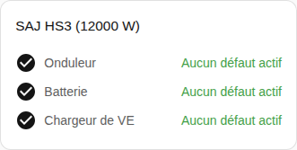

[en](../../../en-gb/user/cards/faults-card.md) | [de](../../../de/user/cards/faults-card.md) | [nl](../../../nl/user/cards/faults-card.md) | fr | [zh](../../../zh-hans/user/cards/faults-card.md) | [es](../../../es/user/cards/faults-card.md) | [it](../../../it/user/cards/faults-card.md) | [pl](../../../pl/user/cards/faults-card.md) | [sv](../../../sv/user/cards/faults-card.md)

# Carte des défauts

La page Carte des défauts explique la carte des défauts, qui liste les défauts actifs de chaque équipement. La liste complète se trouve dans la section [Carte des défauts](../../../../frontend/docs/features.md#faults-card) de la liste des fonctionnalités des cartes. [Ajouter un élément](README.md#ajouter-un-élément) explique comment ajouter la carte et choisir un système. Les défauts viennent des [entités de défaut de l'équipement](../faults-and-repairs.md#défauts-de-léquipement).

## Ce que la carte affiche

- Les défauts sont regroupés par onduleur, batterie et chargeur de VE, et chaque défaut actif indique depuis combien de temps le défaut a commencé. Les défauts et les avertissements des modules de batterie sont dans le groupe de la batterie.
- Un défaut non reconnu invite à consulter le [téléchargement des diagnostics](../troubleshooting.md#télécharger-les-diagnostics) pour le registre et le bit.
- Un bouton Effacer le défaut se trouve sous les défauts actifs de l'onduleur. Le bouton envoie la commande Effacer le défaut en cours. Tant que le contrôle n'est pas autorisé pour le système, le bouton est désactivé et un cadenas renvoie vers les paramètres de l'intégration. Voir [Autoriser le contrôle](../changing-settings.md#autoriser-le-contrôle).
- Avec Afficher les groupes sans défaut activé, ce qui est la valeur par défaut, un groupe sans défaut actif s'affiche comme sans problème, comme sur la capture d'écran. Avec l'option désactivée, la carte n'affiche que les groupes ayant un défaut actif.

Un système sans batterie ni chargeur de VE n'a aucun défaut à afficher pour l'équipement manquant, la carte ne dessine donc pas le groupe de l'équipement.

## Options

| Option dans l'éditeur | Clé YAML | Valeur par défaut |
| --- | --- | --- |
| Système | `device` | Le premier système |
| Afficher les groupes sans défaut | `show_groups_without_faults` | Activé |

## Pas encore pris en charge

- Effacer les défauts de la batterie ou du chargeur de VE depuis la carte. Le bouton Effacer le défaut se trouve uniquement sous les défauts actifs de l'onduleur.
