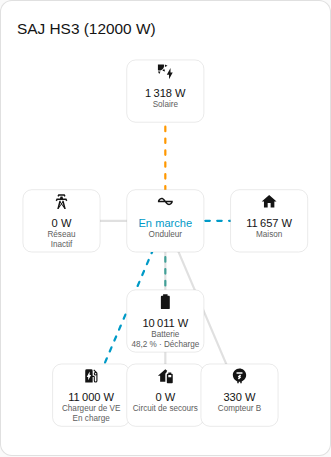
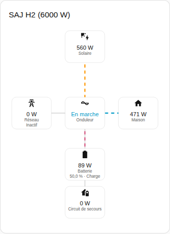

[en](../../../en-gb/user/cards/power-flow-card.md) | [de](../../../de/user/cards/power-flow-card.md) | [nl](../../../nl/user/cards/power-flow-card.md) | fr | [zh](../../../zh-hans/user/cards/power-flow-card.md) | [es](../../../es/user/cards/power-flow-card.md) | [it](../../../it/user/cards/power-flow-card.md) | [pl](../../../pl/user/cards/power-flow-card.md) | [sv](../../../sv/user/cards/power-flow-card.md)

# Carte de flux de puissance

La page Carte de flux de puissance explique la carte de flux de puissance, qui dessine la puissance en direct entre le solaire, la batterie, le réseau, la maison et l'équipement optionnel. La liste complète se trouve dans la section [Carte de flux de puissance](../../../../frontend/docs/features.md#power-flow-card) de la liste des fonctionnalités des cartes. [Ajouter un élément](README.md#ajouter-un-élément) explique comment ajouter la carte et choisir un système.



## Ce que la carte affiche

- Le solaire, la batterie, le réseau et la maison sont dessinés autour de l'onduleur, qui affiche l'état de fonctionnement.
- Chaque ligne montre le sens du flux et se déplace plus vite quand la puissance augmente. Une puissance de 10 W ou moins est dessinée comme inactive.
- La batterie affiche l'état de charge et si la batterie se charge ou se décharge. Le réseau indique si le système soutire ou injecte. Les sens suivent le [signe de la puissance](../entities-and-prefix.md#signe-de-la-puissance).
- Avec Afficher l'équipement optionnel activé, ce qui est la valeur par défaut, la carte dessine aussi le circuit de secours, le compteur B et le chargeur de VE quand le système a l'équipement. Le compteur B est une mesure sans sens.
- Avec Afficher les chaînes solaires activé, la puissance de chaque chaîne solaire est listée. L'option est désactivée par défaut.
- Périmètre choisit entre les mesures du système, ce qui est la valeur par défaut, et les mesures du système en parallèle. Un système sans mesures en parallèle affiche l'état vide avec le périmètre parallèle.

## Différences entre les modèles

- **HS3 uniquement :** le chargeur de VE, comme sur la capture d'écran ci-dessus.
- **H2 :** la carte dessine les parties de la carte du HS3, sauf le chargeur de VE. La capture d'écran ci-dessous montre un H2 qui charge la batterie.



## Options

| Option dans l'éditeur | Clé YAML | Valeur par défaut |
| --- | --- | --- |
| Système | `device` | Le premier système |
| Afficher les chaînes solaires | `show_strings` | Désactivé |
| Afficher l'équipement optionnel | `show_optional_equipment` | Activé |
| Périmètre | `scope` (`system` ou `parallel`) | `system` |

<!-- jscpd:ignore-start -->
```yaml
type: custom:saj-local-power-flow-card
device: 0123456789abcdef0123456789abcdef
show_strings: false
show_optional_equipment: true
scope: system
```
<!-- jscpd:ignore-end -->

La valeur `device` est l'ID de l'appareil dans Home Assistant. L'éditeur visuel renseigne la valeur pour vous. Les noms des entités derrière chaque partie figurent dans la [référence des entités](../entities/README.md).

## Pas encore pris en charge

- Un sens pour le compteur B. La carte dessine le compteur B comme une mesure sans sens.
