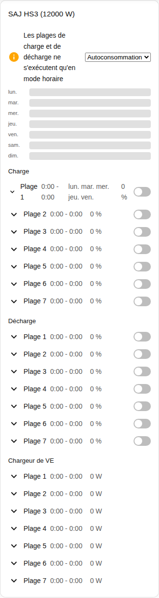
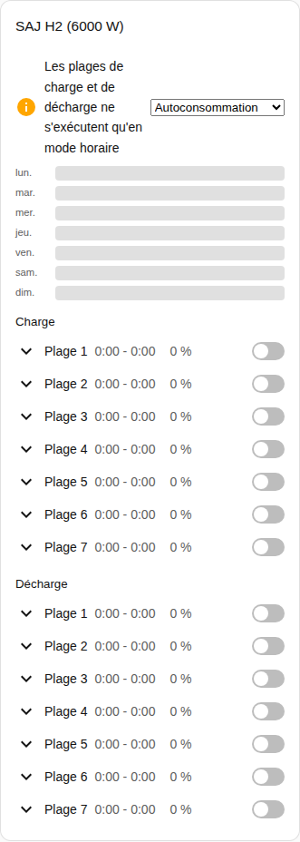

[en](../../../en-gb/user/cards/schedule-card.md) | [de](../../../de/user/cards/schedule-card.md) | [nl](../../../nl/user/cards/schedule-card.md) | fr | [zh](../../../zh-hans/user/cards/schedule-card.md) | [es](../../../es/user/cards/schedule-card.md) | [it](../../../it/user/cards/schedule-card.md) | [pl](../../../pl/user/cards/schedule-card.md) | [sv](../../../sv/user/cards/schedule-card.md)

# Carte de programme

La page Carte de programme explique la carte de programme, qui affiche et modifie les plages de charge, de décharge et de chargeur de VE. La liste complète se trouve dans la section [Carte de programme](../../../../frontend/docs/features.md#schedule-card) de la liste des fonctionnalités des cartes. [Ajouter un élément](README.md#ajouter-un-élément) explique comment ajouter la carte et choisir un système.

## Ce que la carte affiche

- Les plages de charge, de décharge et de chargeur de VE, chacune avec les heures, la puissance, les jours et si la plage est activée. L'option Types de plages choisit les types que la carte affiche.
- Avec Afficher la chronologie de la semaine activé, ce qui est la valeur par défaut, une chronologie de la semaine dessine chaque plage sous forme de barre. Appuyez sur une barre pour ouvrir la plage.
- Une plage ouverte a un éditeur pour le début, la fin, la puissance, les jours et les autres réglages de la plage.
- Une plage n'apparaît que lorsque chaque entité de la plage est activée, et la carte compte les plages qu'elle laisse de côté. Activer [Autoriser le contrôle](../changing-settings.md#lensemble-de-contrôle) active les entités des plages.
- Les plages de charge et de décharge ne s'exécutent qu'en mode d'application horaire. Quand le mode d'application est un autre mode, un avis le dit et affiche la liste des modes à côté de l'avis. Horaire et Horaire (BMS) comptent tous les deux.
- Tant que le contrôle n'est pas autorisé pour le système, chaque commande de la carte est désactivée et un cadenas renvoie vers les paramètres de l'intégration. Voir [Autoriser le contrôle](../changing-settings.md#autoriser-le-contrôle).

## Différences entre les modèles

- **HS3 uniquement :** les plages de chargeur de VE.
- **H2 :** plages de charge et de décharge uniquement, comme le montre la capture d'écran ci-dessous.

Les boutons de jour d'une plage sont les boutons de la [fonctionnalité de carte tuile Jours de la semaine](weekdays-feature.md).

## Options

| Option dans l'éditeur | Clé YAML | Valeur par défaut |
| --- | --- | --- |
| Système | `device` | Le premier système |
| Types de plages | `slot_kinds`, une liste de `charge`, `discharge` et `ev_charger` | Tous les types |
| Afficher la chronologie de la semaine | `show_timeline` | Activé |

## Pas encore pris en charge

- Les programmes de pilotage de puissance. Un programme de pilotage de puissance suit une entrée de programme horaire de Home Assistant, voir le [pilotage de puissance](../power-control.md#suivre-un-programme).
