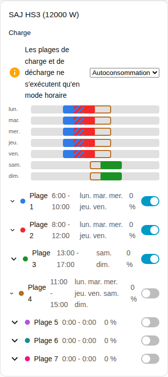
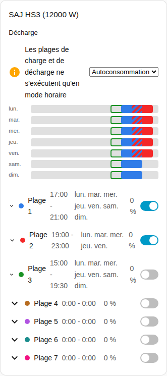
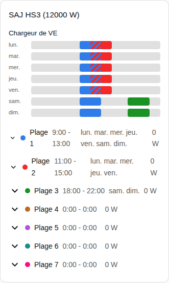

[en](../../../en-gb/user/cards/schedule-cards.md) | [de](../../../de/user/cards/schedule-cards.md) | [nl](../../../nl/user/cards/schedule-cards.md) | fr | [zh](../../../zh-hans/user/cards/schedule-cards.md) | [es](../../../es/user/cards/schedule-cards.md) | [it](../../../it/user/cards/schedule-cards.md) | [pl](../../../pl/user/cards/schedule-cards.md) | [sv](../../../sv/user/cards/schedule-cards.md)

# Cartes de programme

La page Cartes de programme explique les trois cartes de programme. Chaque carte affiche et modifie les plages d'un seul type : charge, décharge ou chargeur de VE. La liste complète se trouve dans la section [Schedule cards](../../../../frontend/docs/features.md#schedule-cards) de la liste des fonctionnalités des cartes. [Ajouter un élément](README.md#ajouter-un-élément) explique comment ajouter une carte et choisir un système.

## Ce que chaque carte de programme affiche

- Le titre de la carte et, sous le titre, un intitulé avec le type de la carte.
- Les plages du type, chacune avec les heures, la puissance, les jours et si la plage est activée.
- Une couleur pour chaque numéro de plage. La plage 1 a la même couleur sur les trois cartes. Chaque ligne de plage commence par un repère de couleur dans la couleur de la plage.
- Avec Afficher la chronologie de la semaine activé, ce qui est la valeur par défaut, une chronologie de la semaine dessine chaque plage sous forme de barre dans la couleur de la plage. Appuyez sur une barre pour ouvrir la plage.
- Une plage désactivée est un contour dans la couleur de la plage, sans remplissage. La barre d'une plage activée masque la partie d'un contour qu'elle croise. Là où deux plages activées ou plus se chevauchent un jour donné, la chronologie dessine le chevauchement sous forme de rayures dans les couleurs des plages concernées. Une plage désactivée ne crée aucun chevauchement. Appuyez sur un chevauchement pour ouvrir la plage concernée qui a le numéro le plus bas.
- Une plage ouverte a un éditeur pour le début, la fin, la puissance, les jours et les autres réglages de la plage.
- Une plage n'apparaît que lorsque chaque entité de la plage est activée, et la carte compte les plages qu'elle laisse de côté. Activer [Autoriser le contrôle](../changing-settings.md#lensemble-de-contrôle) active les entités des plages.
- Tant que le contrôle n'est pas autorisé pour le système, chaque commande de la carte est désactivée et un cadenas renvoie vers les paramètres de l'intégration. Voir [Autoriser le contrôle](../changing-settings.md#autoriser-le-contrôle).

Les boutons de jour d'une plage sont les boutons de la [fonctionnalité de carte tuile Jours de la semaine](weekdays-feature.md).

## Options

Les trois cartes ont les mêmes options.

| Option dans l'éditeur | Clé YAML | Valeur par défaut |
| --- | --- | --- |
| Système | `device` | Le premier système |
| Afficher la chronologie de la semaine | `show_timeline` | Activé |

## Carte de programme de charge

La Carte de programme de charge affiche les plages de charge.

Les plages de charge ne s'exécutent qu'en mode d'application horaire. Quand le mode d'application est un autre mode, un avis le dit et affiche la liste des modes à côté de l'avis. Horaire et Horaire (BMS) comptent tous les deux.

## Carte de programme de décharge

La Carte de programme de décharge affiche les plages de décharge.

Les plages de décharge ne s'exécutent qu'en mode d'application horaire, donc la carte affiche le même avis que la Carte de programme de charge.

## Carte de programme de chargeur de VE

La Carte de programme de chargeur de VE affiche les plages de chargeur de VE. La carte n'affiche pas d'avis sur le mode horaire.

## Différences entre les modèles

- **HS3 uniquement :** les plages de chargeur de VE. Sur un H2, la Carte de programme de chargeur de VE affiche l'état vide, qui dit quel type d'entité activer.
- **H2 :** plages de charge et de décharge uniquement.

## Pas encore pris en charge

- Les programmes de pilotage de puissance. Un programme de pilotage de puissance suit une entrée de programme horaire de Home Assistant, voir le [pilotage de puissance](../power-control.md#suivre-un-programme).
