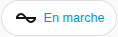

[en](../../../en-gb/user/cards/status-badge.md) | [de](../../../de/user/cards/status-badge.md) | [nl](../../../nl/user/cards/status-badge.md) | fr | [zh](../../../zh-hans/user/cards/status-badge.md) | [es](../../../es/user/cards/status-badge.md) | [it](../../../it/user/cards/status-badge.md) | [pl](../../../pl/user/cards/status-badge.md) | [sv](../../../sv/user/cards/status-badge.md)

# Badge d'état

La page Badge d'état explique le badge d'état, qui affiche l'état d'un système dans la rangée de badges d'un tableau de bord. La liste complète se trouve dans la section [Badge d'état](../../../../frontend/docs/features.md#status-badge) de la liste des fonctionnalités des cartes. [Ajouter un élément](README.md#ajouter-un-élément) explique comment ajouter le badge et choisir un système.



## Ce que le badge affiche

- L'état de fonctionnement, coloré selon la bonne santé de l'état, et le nombre d'équipements ayant un défaut actif. Le badge n'affiche le nombre que lorsqu'un défaut est actif, la capture d'écran montre donc l'état seul.
- Le badge indique Ne répond pas quand le système ne répond pas.
- Appuyer sur le badge ouvre les détails de l'état de fonctionnement.

## Options

| Option dans l'éditeur | Clé YAML | Valeur par défaut |
| --- | --- | --- |
| Système | `device` | Le premier système |

```yaml
type: custom:saj-local-status-badge
device: 0123456789abcdef0123456789abcdef
```

La valeur `device` est l'ID de l'appareil dans Home Assistant. L'éditeur visuel renseigne la valeur pour vous.

## Pas encore pris en charge

- Les options autres que le système.
