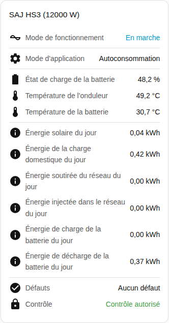

[en](../../../en-gb/user/cards/status-card.md) | [de](../../../de/user/cards/status-card.md) | [nl](../../../nl/user/cards/status-card.md) | fr | [zh](../../../zh-hans/user/cards/status-card.md) | [es](../../../es/user/cards/status-card.md) | [it](../../../it/user/cards/status-card.md) | [pl](../../../pl/user/cards/status-card.md) | [sv](../../../sv/user/cards/status-card.md)

# Carte d'état

La page Carte d'état explique la carte d'état, qui résume un système en un seul endroit. La liste complète se trouve dans la section [Carte d'état](../../../../frontend/docs/features.md#status-card) de la liste des fonctionnalités des cartes. [Ajouter un élément](README.md#ajouter-un-élément) explique comment ajouter la carte et choisir un système.

## Ce que la carte affiche

- L'état de fonctionnement, coloré selon la bonne santé de l'état, et le mode d'application.
- L'état de charge de la batterie, les températures de l'onduleur et de la batterie et le mode hors réseau.
- Avec Afficher l'énergie du jour activé, ce qui est la valeur par défaut, la carte affiche l'énergie du jour : solaire, consommation, soutirage du réseau, injection dans le réseau, charge de la batterie et décharge de la batterie.
- Le nombre d'équipements ayant un défaut actif, ou l'absence de défauts. Voir les [défauts de l'équipement](../faults-and-repairs.md#défauts-de-léquipement).
- Si le contrôle est autorisé pour le système. Voir [Autoriser le contrôle](../changing-settings.md#autoriser-le-contrôle).

## Différences entre les modèles

- **H2 uniquement :** quand le mode d'application que l'onduleur exécute diffère du mode que vous avez choisi, la carte affiche aussi le mode qui s'exécute maintenant. La ligne n'apparaît que lorsque l'entité Mode d'application (en vigueur) est activée. Cette entité est créée désactivée. Voir la [référence des entités](../entities/README.md).

## Options

| Option dans l'éditeur | Clé YAML | Valeur par défaut |
| --- | --- | --- |
| Système | `device` | Le premier système |
| Afficher l'énergie du jour | `show_energy` | Activé |

## Pas encore pris en charge

- Modifier un réglage depuis la carte. La carte d'état n'affiche que des informations. Utilisez la [carte de contrôle](controls-card.md) pour modifier les réglages.
