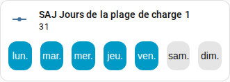

[en](../../../en-gb/user/cards/weekdays-feature.md) | [de](../../../de/user/cards/weekdays-feature.md) | [nl](../../../nl/user/cards/weekdays-feature.md) | fr | [zh](../../../zh-hans/user/cards/weekdays-feature.md) | [es](../../../es/user/cards/weekdays-feature.md) | [it](../../../it/user/cards/weekdays-feature.md) | [pl](../../../pl/user/cards/weekdays-feature.md) | [sv](../../../sv/user/cards/weekdays-feature.md)

# Fonctionnalité de carte tuile Jours de la semaine

La page Fonctionnalité de carte tuile Jours de la semaine explique la fonctionnalité Jours de la semaine, qui place sept boutons de jour sur une carte tuile pour régler les jours d'une plage. La liste complète se trouve dans la section [Fonctionnalité de carte tuile Jours de la semaine](../../../../frontend/docs/features.md#weekdays-tile-card-feature) de la liste des fonctionnalités des cartes. Les jours d'une plage sont les entités Jours des plages de charge, de décharge et de chargeur de VE, listées dans les domaines [Batterie](../entities/battery.md) et [Chargeur de VE](../entities/ev-charger.md) de la référence des entités.



## Ajouter la fonctionnalité

1. Ajoutez une carte tuile à un tableau de bord et choisissez l'entité Jours d'une plage comme entité de la carte tuile.
2. Ouvrez les fonctionnalités de la carte tuile, choisissez Ajouter une fonctionnalité et sélectionnez Jours de la semaine de SAJ Local.

La fonctionnalité n'est proposée que pour une carte tuile dont l'entité est l'entité Jours d'une plage. La fonctionnalité n'a aucune option.

```yaml
type: tile
entity: number.saj_charge_slot_1_days
features:
  - type: custom:saj-local-weekdays-feature
```

L'ID d'entité de l'exemple n'a pas de préfixe. Si vous définissez un [préfixe](../entities-and-prefix.md#le-préfixe), l'ID de l'entité a le préfixe après `saj_`.

## Comment fonctionnent les boutons

- Sept boutons de jour nommés commencent par votre premier jour de la semaine, qui vient des paramètres de Home Assistant ou de votre langue.
- SAJ Local envoie le changement 1,5 seconde après le dernier appui, pour que vous puissiez choisir plusieurs jours en un seul changement.
- L'onduleur stocke les jours sous la forme d'un seul nombre qui ne suit pas votre premier jour de la semaine. Le lundi est le bit le plus bas et le dimanche le plus haut sur chaque modèle, donc du lundi au vendredi vaut 31, comme sur la capture d'écran, et lundi, mercredi et vendredi vaut 21.
- Les boutons sont désactivés tant qu'[Autoriser le contrôle](../changing-settings.md#autoriser-le-contrôle) est désactivé pour le système.

La [carte de programme](schedule-card.md) utilise les boutons dans l'éditeur de plage.

## Pas encore pris en charge

- Toute entité autre que l'entité Jours d'une plage. SAJ Local ne propose pas la fonctionnalité pour d'autres cartes tuiles.
