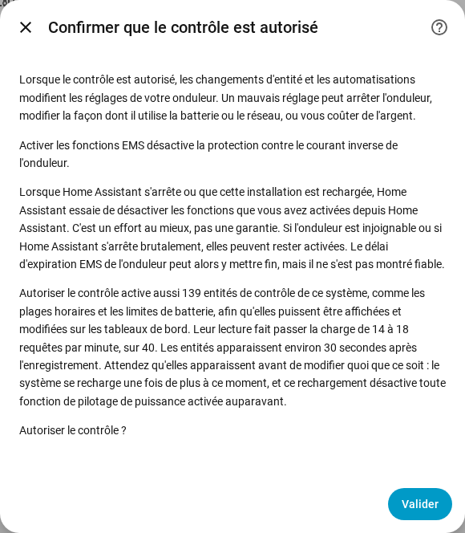

[en](../../en-gb/user/changing-settings.md) | [de](../../de/user/changing-settings.md) | [nl](../../nl/user/changing-settings.md) | fr | [zh](../../zh-hans/user/changing-settings.md) | [es](../../es/user/changing-settings.md) | [it](../../it/user/changing-settings.md) | [pl](../../pl/user/changing-settings.md) | [sv](../../sv/user/changing-settings.md)

# Modifier les réglages

La page Modifier les réglages explique comment autoriser SAJ Local à modifier les réglages de votre onduleur, ce qui arrive à un changement et quels changements sont toujours refusés. Les listes complètes se trouvent dans les sections [Modification des réglages](../../../custom_components/saj_local/docs/features.md#changing-settings) et [EMS](../../../custom_components/saj_local/docs/features.md#ems) de la liste des fonctionnalités de l'intégration. Les réglages et les commandes sont répartis dans les domaines de la [référence des entités](entities/README.md), principalement [Réglages](entities/settings.md) et [Batterie](entities/battery.md).

L'écriture dans l'onduleur est désactivée tant que vous n'autorisez pas le contrôle d'un système. Tant qu'Autoriser le contrôle est désactivé, les réglages affichent la valeur actuelle mais refusent tout changement, avec un message qui indique où activer le contrôle. Rien n'est envoyé à l'onduleur.

## Autoriser le contrôle

1. Ouvrez Configurer, l'engrenage sur la ligne du système dans la page de l'intégration SAJ Local. Vous pouvez aussi activer Autoriser le contrôle pendant que vous ajoutez le système.
2. Activez Autoriser le contrôle et choisissez Soumettre.
3. Lisez la confirmation, puis choisissez Soumettre de nouveau.

La confirmation avertit qu'un mauvais réglage peut arrêter l'onduleur, modifier la façon dont l'onduleur utilise la batterie ou le réseau, ou vous coûter de l'argent. La confirmation indique aussi :

- Activer les fonctions EMS désactive la protection contre le courant inverse de l'onduleur.
- Quand Home Assistant s'arrête, ou que le système se recharge, SAJ Local essaie de désactiver les fonctions que vous avez activées depuis Home Assistant. La désactivation est un effort au mieux et non une garantie.
- Autoriser le contrôle active les entités de contrôle, et leur lecture augmente la charge de requêtes. La boîte de dialogue montre le nombre d'entités et la charge avant et après.

HS3 uniquement : la confirmation à la configuration demande aussi le signal de vie EMS. Dans Configurer, le signal de vie est un champ du formulaire principal. Voir [EMS](#ems).

Désactiver Autoriser le contrôle ne demande aucune confirmation. Chaque système a un capteur binaire Contrôle autorisé, dans la catégorie diagnostic, qui est activé tant que le système accepte les changements. Les [cartes du tableau de bord](cards/README.md) lisent le capteur et verrouillent les commandes tant que le capteur est désactivé. Le capteur est en lecture seule, car un interrupteur sur un tableau de bord activerait l'écriture sans l'avertissement.

## L'ensemble de contrôle

La plupart des plages horaires et de nombreux réglages sont créés désactivés, une carte de tableau de bord n'aurait donc rien à afficher ni à modifier. Activer Autoriser le contrôle active donc aussi l'ensemble de contrôle du système :

- les plages de charge, de décharge et de chargeur de VE (les plages de chargeur de VE sont propres au HS3) ;
- le mode d'application et les réglages du mode horaire ;
- les limites de la batterie et les limites du réseau ;
- les réglages du chargeur de VE (HS3 uniquement) ;
- les interrupteurs et les cibles du pilotage de puissance, voir le [pilotage de puissance](power-control.md) ;
- le mode des LED, l'avertisseur sonore (H2 uniquement) et les boutons Synchroniser l'horloge et Effacer le défaut en cours.

Les mesures des modules de batterie et les autres entités en lecture seule ne font pas partie de l'ensemble.

- **Les entités apparaissent après environ 30 secondes.** Home Assistant recharge un système 30 secondes après l'activation d'une entité du système. Attendez que les entités apparaissent avant de modifier quoi que ce soit, car le rechargement désactive toute fonction de pilotage de puissance que vous avez activée entre-temps. Un autre rechargement suit quand un nouveau membre de l'ensemble apparaît plus tard, comme les plages de chargeur de VE après la détection d'un chargeur de VE.
- **Désactiver Autoriser le contrôle** désactive les entités que SAJ Local a activées, et aucun rechargement ne suit.
- **Votre choix l'emporte.** Une entité que vous avez désactivée avant d'activer le contrôle reste désactivée, et une entité que vous avez activée vous-même reste activée. Une carte compte une plage avec une entité désactivée comme laissée de côté.

## Ce qui arrive à un changement

SAJ Local vérifie un changement avant d'envoyer quoi que ce soit. SAJ Local refuse le changement, avec un message distinct pour chaque cas, quand :

- Autoriser le contrôle est désactivé ;
- le modèle est non vérifié. Un système dont le modèle n'a pas pu être vérifié n'est jamais écrit, voir la [prise en main](getting-started.md#quand-londuleur-nest-pas-reconnu) ;
- le réglage est un réglage de mise en service ;
- la valeur n'est pas valide ;
- l'onduleur est injoignable ;
- la limite d'écriture est atteinte. Pas plus de 20 changements vont vers une adresse d'onduleur en 60 secondes, et un changement au-delà de la limite est refusé et non mis en file d'attente.

Chaque message indique que l'onduleur n'a pas été modifié. Sinon, SAJ Local écrit le changement une fois et relit la valeur, et l'entité affiche la valeur que l'onduleur détient.

| Ce qui s'est passé | Ce que vous voyez |
| --- | --- |
| L'onduleur a refusé le changement | Le message donne le code d'exception. |
| L'onduleur n'a pas répondu | Le message indique que le changement a pu être appliqué ou non. SAJ Local n'envoie plus rien et relit l'onduleur après la reconnexion. |
| L'onduleur détient une valeur différente | L'entité affiche la valeur que l'onduleur détient, et le changement échoue. |

Un changement d'un seul réglage d'un registre qui contient plusieurs réglages laisse les autres réglages du registre inchangés.

## Ce que vous pouvez modifier

- Le mode d'application, sept plages de charge et sept plages de décharge (chacune avec début, fin, puissance, jours et activée ou désactivée), le mode inactif et la décharge vers le réseau du mode horaire, et la réserve du circuit de secours.
- Les limites de charge et de décharge de la batterie, le réveil automatique de la batterie, la limite d'injection, les limites de puissance de soutirage et d'injection du réseau et les puissances du mode passif.
- HS3 uniquement : les réglages du chargeur de VE et sept plages de chargeur de VE.
- H2 uniquement : l'avertisseur sonore et la limite de puissance de charge forcée de la batterie. Les deux modèles ont le mode des LED.
- Les commandes, sous forme de boutons créés désactivés : Effacer le défaut en cours, Redémarrer l'onduleur et Synchroniser l'horloge, qui envoie l'heure locale de Home Assistant. HS3 uniquement : Supprimer la limite de puissance solaire EMS.

Les [cartes du tableau de bord](cards/controls-card.md) proposent les réglages communs au même endroit. La carte de contrôle n'a pas de bouton de redémarrage, pour qu'un appui sur un tableau de bord ne puisse pas redémarrer l'onduleur.

## Réglages de mise en service

Les réglages de mise en service sont affichés et ne peuvent pas être modifiés depuis Home Assistant : le compteur, le RS485, le protocole de la batterie, le réseau et la liaison du chargeur de VE, et sur le H2 aussi le type de réseau, la configuration en parallèle, les modes d'entrée, les limites de protection et d'autres réglages d'installateur. Une mauvaise valeur peut couper l'onduleur du compteur, de la batterie, du chargeur ou de Home Assistant. Les réglages de mise en service sont des capteurs en lecture seule dans la catégorie diagnostic. Faites ces changements dans l'application SAJ elekeeper, voir l'[exigence](../../../custom_components/saj_local/docs/requirements.md#changing-settings).

## Pas encore pris en charge

- La réinitialisation d'usine et l'effacement de l'historique d'énergie. SAJ Local ne propose ni l'une ni l'autre.
- La modification des réglages de mise en service.
- La modification des réglages d'un système dont le modèle est non vérifié.

## EMS

HS3 uniquement : l'EMS place l'onduleur sous contrôle externe. Le H2 n'a aucune entité EMS. SAJ Local propose le délai d'expiration EMS et cinq limites sous forme d'entités : le courant de charge et de décharge de la batterie, la puissance de soutirage et d'injection de l'onduleur, et la puissance solaire. Les limites peuvent être réglées, et SAJ Local n'interroge pas les limites. Entre deux signaux de vie, les limites affichent la dernière valeur que SAJ Local a envoyée, et les limites sont inconnues avant le premier changement. Le [pilotage de puissance](power-control.md) active et désactive les fonctions EMS.

- **Le signal de vie maintient une fonction active.** SAJ Local lit la cible de chaque fonction EMS que vous avez activée depuis Home Assistant, ainsi que les limites, à chaque intervalle du signal de vie. La lecture compte comme une activité EMS, donc le signal de vie n'écrit rien.
- **L'intervalle est de 60 secondes par défaut.** Vous pouvez régler de 30 à 3600 secondes, dans la confirmation d'Autoriser le contrôle à la configuration et dans Configurer.
- **Le délai d'expiration doit être plus long que le signal de vie.** Une fonction ne peut pas être activée tant que le délai d'expiration EMS de l'onduleur n'est pas plus long que le signal de vie, et le délai d'expiration ne peut pas être réglé aussi bas.
- **Désactivation à l'arrêt.** Quand SAJ Local est déchargé ou que Home Assistant s'arrête, SAJ Local désactive les fonctions EMS que vous avez activées. Une fonction qui était déjà activée quand SAJ Local s'est chargé n'est pas touchée.
- **La désactivation est un effort au mieux.** Quand l'onduleur est injoignable, ou que Home Assistant s'arrête brutalement, les fonctions restent activées. Le délai d'expiration EMS de l'onduleur peut mettre fin aux fonctions, mais SAJ Local ne s'appuie pas sur le délai d'expiration, voir [testé sur du matériel](#testé-sur-du-matériel).

## Testé sur du matériel

Les notes ci-dessous indiquent quels réglages ont été essayés sur un vrai onduleur, et lesquels reposent sur des retours du terrain ou sur les seuls documents du protocole SAJ.

HS3, écrits un registre à la fois sur un vrai HS3 et relus :

- Le Mode d'application, l'État de charge de réserve du circuit de secours, la Puissance de charge de la batterie en mode passif, le Délai d'expiration EMS, les quatre bits d'activation EMS que le [pilotage de puissance](power-control.md) écrit, et les trois cibles EMS et cinq limites EMS.
- Sur le HS3, la Puissance de charge de la batterie en mode passif fixe la puissance du mode Secours.
- Le mode d'application EMS seul laisse l'onduleur inactif, avec la maison alimentée par le réseau, et l'onduleur ne quitte pas l'EMS de lui-même.
- Le délai d'expiration EMS a mis fin à l'EMS après 5 secondes, mais n'a pas mis fin à l'EMS à 20 ou 60 secondes pendant qu'un autre client interrogeait l'onduleur. SAJ Local ne s'appuie pas sur le délai d'expiration.
- La limite de puissance solaire n'a d'effet que pendant qu'une fonction EMS est activée.
- Quand une fonction EMS s'arrête, l'onduleur revient au mode d'application qu'il avait avant.
- Horaire (BMS) est le mode que le HS3 signale quand l'application SAJ sélectionne le mode TOU (BMS) de l'application, qui n'est pas le mode horaire de l'application. SAJ Local n'a jamais écrit Horaire (BMS) dans un onduleur.

H2, construit d'après des retours du terrain sur des appareils H2 et le document de protocole du H2, et non essayé par ce projet :

- Le pilotage de puissance, qui utilise le mode passif, les plages horaires, le mode d'application, les puissances du mode passif, les limites de la batterie, les limites de puissance du réseau et la limite d'injection.
- L'écrêtage des pointes : des retours du terrain montrent l'écrêtage des pointes sélectionné dans l'application SAJ, relu et écrit en Modbus. Le document de protocole du H2 ne liste pas l'écrêtage des pointes.
- Économie par IA est le mode que le H2 signale quand l'application SAJ sélectionne l'économie par IA. SAJ Local n'a jamais écrit Économie par IA dans un onduleur.

Jamais essayé sur un vrai onduleur :

- le mode des LED, l'avertisseur sonore du H2 et la limite de puissance de charge forcée de la batterie du H2 ;
- tous les autres réglages non nommés dans cette section ;
- tout changement qui écrit plus d'un registre ;
- toutes les commandes.
