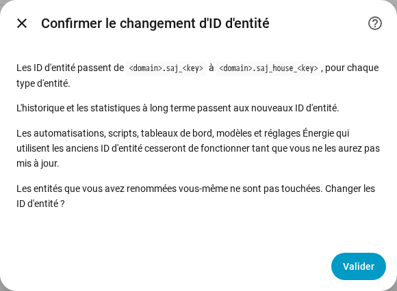

[en](../../en-gb/user/entities-and-prefix.md) | [de](../../de/user/entities-and-prefix.md) | [nl](../../nl/user/entities-and-prefix.md) | fr | [zh](../../zh-hans/user/entities-and-prefix.md) | [es](../../es/user/entities-and-prefix.md) | [it](../../it/user/entities-and-prefix.md) | [pl](../../pl/user/entities-and-prefix.md) | [sv](../../sv/user/entities-and-prefix.md)

# Entités et préfixe

La page Entités et préfixe explique ce que sont les entités d'un système, comment les ID d'entité sont formés et comment ajouter un préfixe aux ID d'entité. Les listes complètes se trouvent dans les sections [Appareils et entités](../../../custom_components/saj_local/docs/features.md#devices-and-entities) et [ID d'entité et préfixe](../../../custom_components/saj_local/docs/features.md#entity-ids-and-prefix) de la liste des fonctionnalités de l'intégration. Chaque nom d'entité, ID, modèle et valeur par défaut figure dans la [référence des entités](entities/README.md).

## Les entités d'un système

Chaque mesure, réglage et commande que SAJ Local connaît pour votre modèle est une entité de l'appareil du système. Chaque entité a le type que les utilisateurs de Home Assistant attendent pour la mesure ou le réglage : un capteur, un capteur binaire, un nombre, une sélection, un interrupteur, une heure ou un bouton. Un réglage s'affiche avec son vrai type de contrôle, donc une limite est un nombre et un réglage activé ou désactivé est un interrupteur.

- **Seul un ensemble essentiel est activé.** Les mesures de puissance, de tension, de température et d'état de charge, les compteurs d'énergie, les principales limites de la batterie et tous les défauts sont activés. Tout le reste est créé désactivé.
- **Une entité désactivée n'est pas lue.** Activer une entité ajoute l'entité à la lecture suivante. Désactiver une entité arrête la lecture du registre. L'[interrogation](polling.md) montre ce qu'un choix coûte à l'onduleur.
- **Un système n'obtient que les entités qui conviennent.** Un H2 avec une seule chaîne solaire n'a aucune entité de seconde chaîne. L'équipement qui n'est pas installé ne crée aucune entité, voir l'[équipement optionnel](optional-equipment.md).
- **Les réglages et les diagnostics sont regroupés.** Les réglages sont dans la catégorie configuration. Les versions, les réglages de mise en service et les réglages réseau sont dans la catégorie diagnostic.
- **Une option inconnue s'affiche comme inconnue.** Le code de l'option se trouve dans le [téléchargement des diagnostics](troubleshooting.md#télécharger-les-diagnostics), ce qui permet de signaler l'option.

Quand vous réglez le modèle à la main pour un onduleur qui n'est pas reconnu, le système obtient toutes les entités du modèle choisi, avec les entités au-delà d'une phase et de deux chaînes solaires désactivées. Voir la [prise en main](getting-started.md#quand-londuleur-nest-pas-reconnu).

## Signe de la puissance

La puissance de la batterie et la puissance du réseau utilisent un seul signe sur chaque modèle, une mesure a donc le même sens sur un HS3 et sur un H2.

- **La puissance de la batterie** est positive pendant que la batterie se décharge et négative pendant que la batterie se charge.
- **La puissance du réseau** est positive pendant que le système injecte et négative pendant que le système soutire. Le compteur A suit le signe du réseau.
- **Le compteur B** est positif pendant que l'onduleur solaire que le compteur B mesure produit.

Sur le HS3, la puissance du réseau est le total du compteur A, et la puissance par phase du réseau, la puissance apparente, le courant et le facteur de puissance viennent de la phase correspondante du compteur A, car les registres réseau du HS3 contiennent des valeurs de l'onduleur. Un HS3 sans compteur A n'a pas ces entités. La puissance de la charge du foyer est la somme des trois puissances de phase de sortie sur réseau.

Les cibles du [pilotage de puissance](power-control.md) suivent les signes des mesures.

## Capteurs calculés

Huit capteurs sont calculés à partir des mesures du système lui-même. Ils existent sur chaque modèle.

- **Temps avant batterie pleine** et **temps avant batterie vide** sont des durées en minutes. Chaque valeur divise l'énergie restante de la batterie par la puissance de la batterie moyennée sur les 10 dernières minutes. Une brève variation de la charge du foyer ne fait donc pas sauter la valeur. Le temps avant batterie pleine a une valeur seulement tant que la puissance moyenne charge la batterie, et le temps avant batterie vide seulement tant que la puissance moyenne décharge la batterie. La valeur est inconnue à puissance moyenne nulle et quand le résultat dépasse 48 heures. La moyenne repart de zéro après un rechargement ou un redémarrage.
- **Énergie stockée dans la batterie** et **énergie disponible dans la batterie** sont en kWh. L'énergie stockée est l'état de charge multiplié par l'énergie de la batterie. L'énergie disponible est l'énergie au-dessus de la limite de batterie vide, et jamais inférieure à 0.
- **Pleine et vide.** Pleine est la limite de charge. Vide est la réserve en mode secours et la limite de décharge sur le réseau dans les autres modes d'application. Hors réseau, vide est la limite de décharge hors réseau sur un modèle qui en a une.
- **Énergie de la batterie.** Le H2 indique une capacité utile, et SAJ Local la multiplie par la tension de la batterie. Le HS3 n'indique pas de capacité utile, donc SAJ Local apprend la capacité à partir de la puissance de la batterie et de la variation de l'état de charge. Sur un HS3, les quatre capteurs d'énergie de la batterie restent inconnus tant que l'état de charge n'a pas varié entre deux lectures. La capacité apprise devient plus précise quand la batterie se charge et se décharge. SAJ Local conserve la capacité apprise après un redémarrage.
- **Autosuffisance du jour** est la part de l'énergie de la charge du jour qui ne venait pas du réseau. **Autoconsommation du jour** est la part de l'énergie solaire du jour qui n'a pas été exportée. **Rendement aller-retour de la batterie** est l'énergie totale de décharge de la batterie divisée par l'énergie totale de charge de la batterie. Chaque valeur est un pourcentage de 0 à 100 et est inconnue quand le diviseur est 0.
- **Puissance du surplus solaire** est la puissance solaire moins la charge du foyer, en watts. La valeur est négative quand la charge dépasse la puissance solaire.
- **Valeurs par défaut.** Les quatre capteurs de batterie ci-dessus sont activés par défaut. Les quatre autres sont créés désactivés. Les capteurs de temps, d'énergie et de rendement aller-retour existent seulement quand une batterie est installée.
- **Lectures.** Activer un capteur calculé lit chaque mesure dont le capteur a besoin, même quand les entités de ces mesures sont désactivées. L'[interrogation](polling.md) compte ces lectures dans la charge.

## Le préfixe

Chaque ID d'entité a la forme `<type>.saj_<key>`, par exemple `sensor.saj_pv_power`. Renommer le nom affiché d'une entité ne change pas l'ID.

Un préfixe ajoute un mot après `saj_` dans chaque ID d'entité d'un système, par exemple `sensor.saj_house_pv_power`. Utilisez un préfixe quand vous avez plus d'un système SAJ, pour qu'aucun ID d'entité n'ait besoin d'un numéro ajouté.

- Utilisez uniquement des lettres minuscules et des chiffres, 32 caractères au maximum.
- Deux systèmes ne peuvent pas partager un préfixe, et un seul système peut être sans préfixe.
- Un préfixe qui entrerait en conflit avec un nom d'entité, comme `battery`, est refusé.
- La configuration est refusée quand un ID d'entité que le système créerait est déjà pris.

### Ajouter, modifier ou supprimer un préfixe

1. Ouvrez Configurer, l'engrenage sur la ligne du système dans la page de l'intégration SAJ Local.
2. Modifiez le champ Préfixe et choisissez Soumettre.
3. Lisez la confirmation, puis choisissez Soumettre de nouveau.

La confirmation montre l'ancien et le nouveau modèle. Les automatisations, scripts, tableaux de bord, modèles et réglages Énergie qui utilisent les anciens ID d'entité cessent de fonctionner tant que vous n'avez pas mis à jour les références.

Après votre confirmation :

- SAJ Local renomme chaque entité du système, activée ou désactivée, et Home Assistant déplace l'historique et les statistiques à long terme vers les nouveaux ID.
- Une entité que vous avez renommée vous-même n'est pas touchée.
- Les [cartes du tableau de bord](cards/README.md) continuent de fonctionner, car les cartes trouvent les entités par le registre des entités et non par l'ID.

SAJ Local refuse le changement et ne renomme rien quand un nouvel ID est déjà pris, ou quand Home Assistant conserve déjà des statistiques à long terme sous un nouvel ID, par exemple celles d'un système supprimé qui avait le préfixe.

Si une version ultérieure ajoute une entité dont l'ID est déjà pris, Home Assistant ajoute un numéro à l'ID, et un avertissement dans le journal nomme le type et la clé de l'entité.

## Pas encore pris en charge

- Choisir la partie clé d'un ID d'entité. SAJ Local fixe la clé, pour que les tableaux de bord et les automatisations fonctionnent de la même façon sur chaque modèle.
