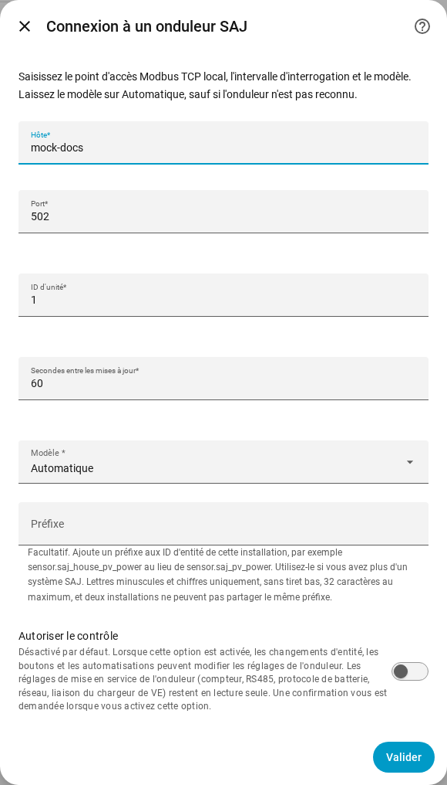
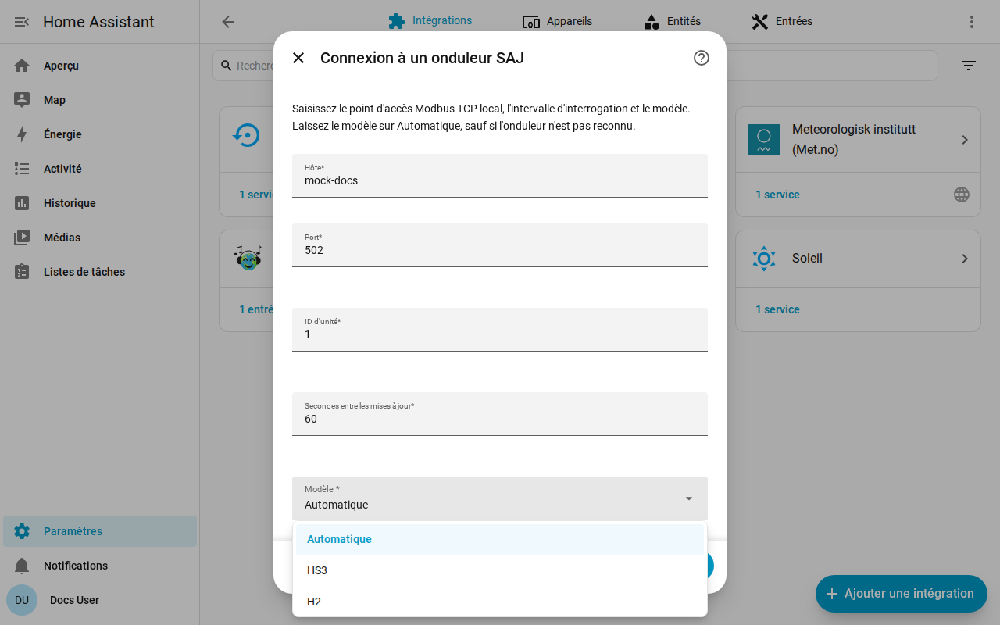

[en](../../en-gb/user/getting-started.md) | [de](../../de/user/getting-started.md) | [nl](../../nl/user/getting-started.md) | fr | [zh](../../zh-hans/user/getting-started.md) | [es](../../es/user/getting-started.md) | [it](../../it/user/getting-started.md) | [pl](../../pl/user/getting-started.md) | [sv](../../sv/user/getting-started.md)

# Prise en main

La page Prise en main ajoute votre système SAJ à Home Assistant et indique ce que vous obtenez ensuite. La liste complète de ce que fait la configuration se trouve dans la section [Configuration et détection](../../../custom_components/saj_local/docs/features.md#setup-and-detection) de la liste des fonctionnalités de l'intégration. [Installez SAJ Local](installation.md) d'abord, et vérifiez que votre onduleur figure dans les [équipements pris en charge](supported-equipment.md).

## Ajouter un système

1. Dans Home Assistant, ouvrez Paramètres, puis Appareils et services.
2. Choisissez Ajouter une intégration et cherchez SAJ Local.
3. Remplissez le formulaire et choisissez Soumettre.

| Champ | Ce qu'il faut saisir |
| --- | --- |
| Hôte | Le nom d'hôte ou l'adresse IP de l'onduleur. |
| Port | Le port Modbus TCP. La valeur par défaut est 502. |
| ID d'unité | L'ID d'unité Modbus, de 1 à 247. La valeur par défaut est 1. |
| Secondes entre les mises à jour | La fréquence de lecture de chaque entité activée. La valeur par défaut est 60 et la plus basse est 10. Voir l'[interrogation](polling.md). |
| Modèle | Laissez sur Automatique. SAJ Local reconnaît le HS3 et le H2 monophasé d'après le type d'appareil que l'onduleur signale. |
| Préfixe | Facultatif. Laissez vide pour le premier système. Voir [entités et préfixe](entities-and-prefix.md#le-préfixe). |
| Autoriser le contrôle | Désactivé par défaut, donc rien ne peut modifier un réglage. Voir [modifier les réglages](changing-settings.md). |

SAJ Local se connecte à l'onduleur, lit l'identité de l'onduleur et six mesures essentielles (mode de fonctionnement, état de charge de la batterie, puissance de la maison, puissance solaire, puissance de la batterie et puissance du réseau) et crée le système. Un registre qu'un appareil n'a pas n'arrête pas la configuration. Le système a pour titre SAJ suivi du numéro de série de l'onduleur.

Quand la configuration échoue, le formulaire indique ce qui s'est mal passé : pas de connexion, pas de réponse à temps, une lecture refusée, des données non valides, un appareil non reconnu ou un modèle qui ne correspond pas à l'onduleur. Rien n'est enregistré tant que la vérification n'a pas réussi.

## Ce que vous obtenez

- Un appareil Home Assistant nommé SAJ. Le modèle de l'appareil affiche le modèle et la puissance nominale, par exemple HS3 (12000 W).
- Les entités qui correspondent à votre modèle et à votre équipement. SAJ Local détecte pour vous la batterie, les compteurs et l'autre équipement, voir l'[équipement optionnel](optional-equipment.md).
- Seul un ensemble essentiel d'entités est activé. Tout le reste est créé désactivé, pour que l'onduleur ne soit pas lu pour des valeurs que vous n'avez pas demandées. Activez une entité dans Home Assistant et la lecture suivante inclut l'entité. Voir [entités et préfixe](entities-and-prefix.md).
- Les [cartes du tableau de bord](cards/README.md), sans rien à installer.

## Ajouter un deuxième système

Ajoutez de nouveau SAJ Local depuis Appareils et services. SAJ Local refuse un point d'accès ou un numéro de série d'onduleur déjà configuré. Donnez à chaque système un [préfixe](entities-and-prefix.md#le-préfixe) distinct, pour qu'aucun ID d'entité n'ait besoin d'un numéro ajouté.

## Quand l'onduleur n'est pas reconnu

Quand l'onduleur signale un type d'appareil que SAJ Local ne reconnaît pas, Automatique échoue avec une erreur qui vous demande de choisir le modèle à la main. Choisissez HS3 ou H2 dans le champ Modèle.

- Un choix qui contredit un onduleur reconnu est refusé. Choisissez le modèle que l'erreur nomme, ou Automatique.
- Pour un onduleur non reconnu, SAJ Local lit les registres obligatoires et vous demande de confirmer le modèle. Les registres doivent d'abord répondre.
- L'appareil affiche alors le modèle comme non vérifié. Les mesures peuvent être erronées, car SAJ Local ne peut pas les comparer au type d'appareil, et toute tentative de modifier un réglage est refusée.

## Modifier un système ensuite

Ouvrez Configurer, l'engrenage sur la ligne du système dans la page de l'intégration SAJ Local. Vous pouvez modifier l'hôte, le port, l'ID d'unité, l'intervalle de mise à jour, le modèle, le préfixe et Autoriser le contrôle, et régler chaque équipement. SAJ Local n'enregistre le changement qu'une fois que l'onduleur a répondu au nouveau point d'accès. [Remplacer l'onduleur](replacing-the-inverter.md) couvre un nouvel onduleur.

## Pas encore pris en charge

- Les produits autres que le HS3 et le H2 monophasé. Voir les [équipements pris en charge](supported-equipment.md).
- La recherche de l'onduleur sur le réseau. Vous saisissez l'adresse de l'onduleur.
