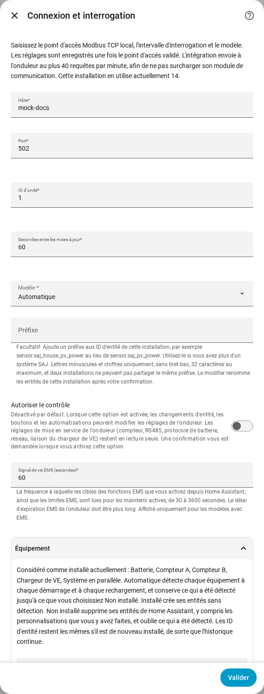

[en](../../en-gb/user/optional-equipment.md) | [de](../../de/user/optional-equipment.md) | [nl](../../nl/user/optional-equipment.md) | fr | [zh](../../zh-hans/user/optional-equipment.md) | [es](../../es/user/optional-equipment.md) | [it](../../it/user/optional-equipment.md) | [pl](../../pl/user/optional-equipment.md) | [sv](../../sv/user/optional-equipment.md)

# Équipement optionnel

La page Équipement optionnel explique comment SAJ Local découvre quel équipement optionnel votre onduleur possède et comment remplacer le résultat. La liste complète se trouve dans la section [Équipement optionnel](../../../custom_components/saj_local/docs/features.md#optional-equipment) de la liste des fonctionnalités de l'intégration. La page [équipements pris en charge](supported-equipment.md) indique quel modèle peut avoir quoi, et la [référence des entités](entities/README.md) indique quelles entités chaque équipement ajoute.

## Ce que SAJ Local détecte

La configuration ne pose aucune question sur l'équipement. Chaque fois que SAJ Local se charge, ce qui inclut chaque démarrage de Home Assistant et chaque rechargement, SAJ Local demande à l'onduleur ce qui est installé et ne crée des entités que pour cet équipement.

| Équipement | Modèles |
| --- | --- |
| Batterie | HS3 et H2 |
| Compteur A, le compteur du réseau | HS3 et H2 |
| Compteur B, le second compteur | HS3 et H2 |
| Système en parallèle | HS3 et H2 |
| Chargeur de VE | HS3 uniquement |

- **L'onduleur ne répond pas à la vérification :** SAJ Local suppose une batterie et le compteur A, et ne suppose pas l'autre équipement.
- **Un compteur est hors ligne pendant un redémarrage :** l'équipement détecté est mémorisé, l'équipement conserve donc ses entités.
- **Équipement installé plus tard :** SAJ Local prend l'équipement en compte au redémarrage ou au rechargement suivant.

## Quand l'équipement mémorisé n'est plus détecté

SAJ Local conserve les entités de l'équipement, pour que l'historique et les tableaux de bord restent inchangés, et déclenche un problème de réparation dans Home Assistant. Le problème nomme l'équipement et le système. Vérifiez l'équipement, ou réglez l'équipement sur Non installé comme décrit ci-dessous. Le problème disparaît au chargement suivant qui détecte de nouveau l'équipement, ou quand vous modifiez le réglage.

## Remplacer la détection

1. Ouvrez Configurer, l'engrenage sur la ligne du système dans la page de l'intégration SAJ Local.
2. Développez la section Équipement.
3. Réglez chaque équipement sur Automatique, Installé ou Non installé, puis choisissez Soumettre.

La section liste aussi ce que SAJ Local considère comme installé actuellement.

| Réglage | Ce que fait le réglage |
| --- | --- |
| Automatique | Détecte l'équipement à chaque démarrage et à chaque rechargement, et conserve ce qui a été détecté jusqu'à ce que vous choisissiez Non installé. Automatique est la valeur par défaut. |
| Installé | Crée les entités de l'équipement sans détecter l'équipement. |
| Non installé | Supprime les entités de l'équipement de Home Assistant, y compris les changements que vous avez faits aux entités, comme un nouveau nom. SAJ Local oublie ce qui a été détecté. |

Les ID d'entité restent inchangés, l'historique continue donc si vous réglez de nouveau l'équipement sur Installé ou Automatique. Les entités d'un équipement non installé ne peuvent être ni lues, ni interrogées, ni écrites.

La section ne liste que l'équipement que votre modèle peut avoir. HS3 uniquement : le chargeur de VE.

## Modules de batterie

- **H2 :** un H2 signale combien de modules de batterie il possède, jusqu'à cinq. SAJ Local crée les entités de module pour ce nombre de modules. Un nombre de 0 conserve les entités de chaque module. SAJ Local mémorise le nombre le plus élevé que SAJ Local a vu. Chaque module a des entités d'identité, créées désactivées.
- **HS3 :** un HS3 a des entités pour un module de batterie.

## Chargeur de VE

HS3 uniquement : un HS3 avec un chargeur de VE obtient aussi les mesures, les réglages, les plages de charge et les commandes de charge EMS du chargeur. La plupart sont créés désactivés. Activer Autoriser le contrôle active les réglages et les plages, voir [modifier les réglages](changing-settings.md#lensemble-de-contrôle).

## Pas encore pris en charge

- L'équipement que SAJ Local ne détecte pas. L'équipement du tableau est la liste complète.
- La détection d'un chargeur de VE sur un H2.
