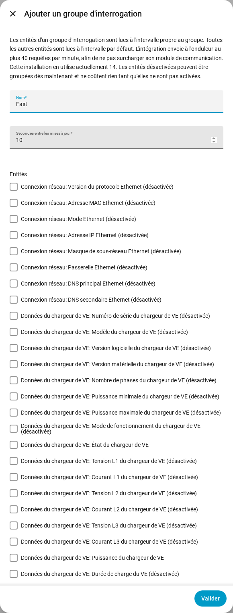

[en](../../en-gb/user/polling.md) | [de](../../de/user/polling.md) | [nl](../../nl/user/polling.md) | fr | [zh](../../zh-hans/user/polling.md) | [es](../../es/user/polling.md) | [it](../../it/user/polling.md) | [pl](../../pl/user/polling.md) | [sv](../../sv/user/polling.md)

# Interrogation

La page Interrogation explique à quelle fréquence SAJ Local lit l'onduleur et comment lire certaines entités plus vite ou plus lentement. La liste complète se trouve dans la section [Interrogation](../../../custom_components/saj_local/docs/features.md#polling) de la liste des fonctionnalités de l'intégration. Les limites qui s'appliquent à chaque requête sont décrites dans [protéger l'onduleur](protecting-the-inverter.md).

SAJ Local lit l'onduleur en Modbus TCP sur votre réseau local, selon un calendrier que vous contrôlez. Rien ne quitte votre réseau.

## L'intervalle par défaut

Chaque entité activée est lue toutes les 60 secondes par défaut. Modifiez le champ Secondes entre les mises à jour dans Configurer, l'engrenage sur la ligne du système dans la page de l'intégration SAJ Local. L'intervalle n'est jamais inférieur à 10 secondes.

Seules les entités activées sont lues. Désactivez une entité dans Home Assistant et le registre de l'entité n'est plus lu.

## Groupes d'interrogation

Un groupe d'interrogation lit des entités choisies plus vite ou plus lentement que la valeur par défaut. Utilisez un groupe, par exemple, pour lire la puissance de la maison, du solaire, de la batterie et du réseau toutes les 10 secondes pendant que tout le reste reste à 60.

1. Ouvrez le menu sur la ligne du système dans la page de l'intégration SAJ Local et choisissez Ajouter un groupe d'interrogation. Le bouton Ajouter un groupe d'interrogation en haut de la page ouvre aussi le formulaire Ajouter un groupe d'interrogation.
2. Saisissez un nom, les secondes entre les mises à jour (au moins 10) et les entités du groupe.
3. Choisissez Soumettre, lisez la vérification, puis choisissez Enregistrer le groupe.

- **N'importe quelle entité :** un groupe peut contenir des entités de n'importe quel type. Une entité désactivée peut aussi être choisie, et ne coûte rien tant que vous n'activez pas l'entité.
- **Un seul groupe au plus :** une entité appartient à un groupe au plus. Chaque entité sans groupe reste sur l'intervalle par défaut.
- **Ordre des registres :** le formulaire liste les entités dans l'ordre des registres, chacune avec le bloc de registres dans lequel l'entité est lue, de sorte que les entités qui peuvent partager une requête sont côte à côte.
- **Modifier ou supprimer :** ouvrez le groupe d'interrogation depuis la page de l'intégration. Modifier ou supprimer un groupe conserve les entités, les noms des entités et l'historique des entités.

Tous les intervalles d'un système partagent une seule horloge, donc les entités qui arrivent à échéance ensemble sont lues ensemble. Une lecture qui dépasse son temps n'est pas rattrapée. Les cycles manqués sont abandonnés et l'interrogation reprend au cycle suivant.

## La charge de requêtes

SAJ Local envoie à un onduleur au plus 40 requêtes en 60 secondes. Le formulaire montre ce que coûte votre choix, en requêtes par minute par rapport à cette limite. Le formulaire ci-dessus montre une charge actuelle de 14 requêtes par minute à titre d'exemple.

- **Avant d'enregistrer un groupe :** l'étape de vérification montre combien de requêtes une lecture du groupe demande, ainsi que la charge avant et après l'enregistrement.
- **Au-delà de la limite :** vous pouvez quand même enregistrer le groupe. La vérification avertit que les lectures sont plus lentes que ce que vous avez configuré, car SAJ Local n'envoie jamais plus que la limite.
- **Un nouvel intervalle par défaut :** Configurer vous demande de confirmer quand le nouvel intervalle fait dépasser la limite à la charge.
- **Moins de requêtes :** les entités qui se trouvent ensemble dans un même bloc de registres coûtent une requête. Les entités de blocs différents coûtent une requête chacune.

Un formulaire ne peut pas intercepter l'activation d'une entité dans Home Assistant. Le [téléchargement des diagnostics](troubleshooting.md#télécharger-les-diagnostics) liste la charge prévue par rapport à la limite pour ce cas.

## Pas encore pris en charge

- Un groupe d'interrogation avec un intervalle inférieur à 10 secondes.
