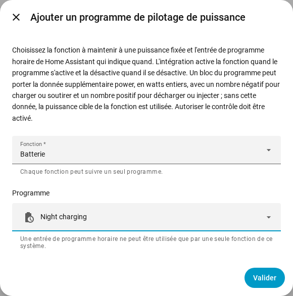

[en](../../en-gb/user/power-control.md) | [de](../../de/user/power-control.md) | [nl](../../nl/user/power-control.md) | fr | [zh](../../zh-hans/user/power-control.md) | [es](../../es/user/power-control.md) | [it](../../it/user/power-control.md) | [pl](../../pl/user/power-control.md) | [sv](../../sv/user/power-control.md)

# Pilotage de puissance

La page Pilotage de puissance explique comment maintenir la batterie, le point de raccordement au réseau ou l'onduleur à une puissance fixée, à la main ou avec un programme de Home Assistant. La liste complète se trouve dans la section [Pilotage de puissance](../../../custom_components/saj_local/docs/features.md#power-control) de la liste des fonctionnalités de l'intégration. Les interrupteurs et les cibles figurent dans les [entités que l'intégration ajoute](entities/added-by-the-integration.md) de la référence des entités.

Le pilotage de puissance fonctionne de la même façon sur chaque modèle qui propose une fonction. Le pilotage de puissance ne fait rien tant qu'[Autoriser le contrôle](changing-settings.md#autoriser-le-contrôle) est désactivé ou que le modèle est non vérifié.

| Fonction | Ce que la fonction maintient à la puissance fixée | HS3 | H2 |
| --- | --- | --- | --- |
| Batterie | La batterie se charge ou se décharge. | Oui | Oui |
| Réseau | Le point de raccordement au réseau soutire ou injecte. Nécessite le compteur A. | Oui | Non |
| Onduleur | L'onduleur absorbe ou fournit de la puissance. | Oui | Non |

Une puissance positive décharge, injecte ou fournit. Une puissance négative charge, soutire ou absorbe. Les signes suivent le [signe de la puissance](entities-and-prefix.md#signe-de-la-puissance) des mesures.

## Maintenir une fonction à une puissance

Chaque fonction a un interrupteur et une puissance cible en watts entiers. Les deux sont créés désactivés et se trouvent dans la catégorie configuration. Activer Autoriser le contrôle active les interrupteurs et les cibles, voir [l'ensemble de contrôle](changing-settings.md#lensemble-de-contrôle).

1. Réglez la puissance cible de la fonction. La cible est arrondie au pas le plus proche que l'onduleur prend en charge, et affiche la puissance que l'onduleur maintient.
2. Activez la fonction. Une fonction a besoin d'une puissance cible avant de pouvoir être activée.
3. Pour arrêter, désactivez la fonction.

- La cible est conservée d'un redémarrage à l'autre et est envoyée au démarrage de la fonction. Modifier la cible pendant que la fonction s'exécute envoie aussitôt la nouvelle puissance.
- Une seule fonction s'exécute à la fois. Activer une fonction pendant qu'une autre s'exécute est refusé, et le message nomme la fonction en cours.
- L'interrupteur est activé tant que l'onduleur signale que la fonction s'exécute, même quand la fonction a été démarrée en dehors de Home Assistant.
- Un démarrage qui échoue est annulé. Un arrêt qui échoue est renvoyé à chaque intervalle du signal de vie, jusqu'à ce que l'onduleur signale que la fonction est arrêtée.
- La [carte de contrôle du tableau de bord](cards/controls-card.md) affiche chaque fonction avec un interrupteur, une cible et une indication sur le signe.

### Quand Home Assistant s'arrête

Une fonction que vous avez activée depuis Home Assistant est désactivée quand SAJ Local est déchargé et quand Home Assistant s'arrête. Une fonction qui s'exécutait déjà quand SAJ Local s'est chargé continue de s'exécuter.

- HS3 uniquement : le signal de vie EMS maintient la fonction active. Après un arrêt brutal, le délai d'expiration EMS de l'onduleur peut mettre fin à la fonction, mais SAJ Local ne s'appuie pas sur le délai d'expiration. Voir [EMS](changing-settings.md#ems).
- H2 uniquement : une fonction laissée en cours par un arrêt brutal continue de s'exécuter jusqu'à ce que vous désactiviez la fonction.

## Suivre un programme

Un programme de pilotage de puissance fait suivre à une fonction une entrée de programme horaire de Home Assistant. La fonction est activée tant que le programme est activé et désactivée quand le programme se désactive.

1. Créez une entrée de programme horaire dans Home Assistant : Paramètres, Appareils et services, Entrées, Créer une entrée, Programme horaire. Réglez les heures et les jours de la semaine du programme.
2. Ouvrez le menu sur la ligne du système dans la page de l'intégration SAJ Local et choisissez Ajouter un programme de pilotage de puissance.
3. Choisissez la fonction et l'entrée de programme horaire, puis choisissez Soumettre.

Un bloc de l'entrée de programme horaire peut porter la donnée supplémentaire `power`, en watts entiers avec le signe ci-dessus, par exemple `power: -600` pour charger la batterie à 600 W. Sans `power`, SAJ Local utilise la puissance cible de la fonction.

- Chaque fonction suit un seul programme, et une entrée de programme horaire pilote une seule fonction d'un système.
- Le programme suit un renommage de l'entrée. Une entrée qui n'est pas dans le registre des entités est refusée, choisissez donc une entrée que vous avez créée dans l'interface.
- SAJ Local refuse un programme tant qu'Autoriser le contrôle est désactivé.
- Modifiez ou supprimez un programme depuis la page de l'intégration. Le système se recharge quand vous le faites.

### Ce que fait un programme

| Situation | Ce qui se passe |
| --- | --- |
| Le programme s'active et aucune fonction ne s'exécute | SAJ Local fixe la puissance d'après le bloc, ou utilise la puissance cible, puis démarre la fonction. |
| Le bloc n'a pas de `power` et la fonction n'a pas de puissance cible | Rien ne démarre. L'action reste en attente, avec un avertissement. |
| La fonction s'exécute déjà | SAJ Local modifie la puissance quand le bloc en a une, et prend la fonction en charge. |
| Une autre fonction s'exécute | Rien n'est écrit. L'action reste en attente. |
| Le démarrage est refusé ou échoue | L'action reste en attente. SAJ Local réessaie à chaque intervalle du signal de vie. |
| Le `power` du bloc n'est pas un nombre entier dans la plage de la cible | Rien ne démarre. L'action reste en attente, avec un avertissement. |
| Le programme passe à un bloc avec un autre `power` | SAJ Local modifie la puissance. |
| Vous désactivez la fonction à la main pendant que le programme est activé | La fonction reste désactivée jusqu'à la prochaine activation du programme. |
| Le programme se désactive et SAJ Local avait démarré la fonction | SAJ Local arrête la fonction. |

Quand rien n'est voulu et que rien n'est en attente, SAJ Local n'envoie rien. Le [téléchargement des diagnostics](troubleshooting.md#télécharger-les-diagnostics) liste chaque fonction, chaque programme et l'action en attente.

## Pas encore pris en charge

- Le pilotage de puissance du réseau et de l'onduleur sur le H2.
- Plus d'une fonction à la fois.
- Plus d'un programme pour une même fonction.
