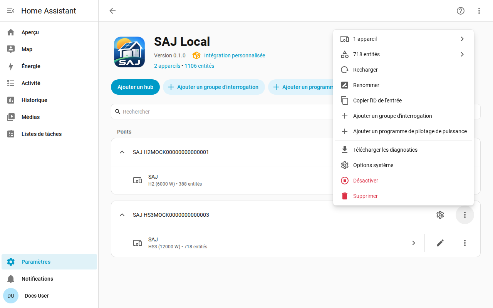

[en](../../en-gb/user/troubleshooting.md) | [de](../../de/user/troubleshooting.md) | [nl](../../nl/user/troubleshooting.md) | fr | [zh](../../zh-hans/user/troubleshooting.md) | [es](../../es/user/troubleshooting.md) | [it](../../it/user/troubleshooting.md) | [pl](../../pl/user/troubleshooting.md) | [sv](../../sv/user/troubleshooting.md)

# Dépannage

La page Dépannage montre comment télécharger les diagnostics, activer la journalisation de débogage et lire les problèmes courants. La liste complète se trouve dans la section [Diagnostics et journalisation de débogage](../../../custom_components/saj_local/docs/features.md#diagnostics-and-debug-logging) de la liste des fonctionnalités de l'intégration.

Le téléchargement des diagnostics et le journal de débogage montrent ce que l'onduleur renvoie et ce que SAJ Local a fait des mesures, sans révéler qui vous êtes ni où vous êtes. Les deux utilisent les outils de Home Assistant, rien n'est donc à installer et rien n'est envoyé nulle part.

## Commencer par les entités et les réparations

- Consultez [Paramètres puis Réparations](faults-and-repairs.md#problèmes-de-réparation) pour un problème de réparation du système. Chaque problème indique ce qui ne va pas et ce qu'il faut faire.
- Consultez les [défauts de l'équipement](faults-and-repairs.md#défauts-de-léquipement) quand l'onduleur signale un problème.
- Les entités qui sont indisponibles après un refus sont décrites dans [protéger l'onduleur](protecting-the-inverter.md#quand-londuleur-refuse-une-lecture).

## Télécharger les diagnostics

1. Ouvrez Paramètres, puis Appareils et services, puis SAJ Local.
2. Ouvrez le menu sur la ligne du système et choisissez Télécharger les diagnostics.

Le fichier contient :

- les entités activées, les intervalles avec les requêtes que chacun demande, et la charge prévue par rapport à la limite de 40 requêtes par minute ;
- les entités refusées et suspendues ;
- les défauts actifs avec les mots bruts des défauts, et les bits de défaut non reconnus sous forme de registre et de bit ;
- les problèmes de réparation ouverts, et depuis combien de temps l'onduleur est en échec ;
- les fonctions de pilotage de puissance, laquelle s'exécute, laquelle SAJ Local possède et l'action en attente pour chaque programme ;
- un instantané des mots bruts de chaque registre que SAJ Local a lu depuis le chargement du système, avec l'ancienneté de chacun, pour qu'un mainteneur puisse comparer une mesure à l'appareil réel ;
- chaque requête qui n'a reçu aucune réponse utilisable, avec la raison. Une requête qui a expiré se distingue d'une requête que l'onduleur a refusée, et la différence compte quand un autre client tient la connexion de l'onduleur. Chaque entité refusée, chaque requête en échec et chaque ligne du journal de débogage nomme la fonction Modbus de la requête.

L'instantané n'ajoute aucune requête vers l'onduleur. L'instantané repart de zéro à chaque chargement du système.

## Activer la journalisation de débogage

1. Ouvrez la page de l'intégration SAJ Local.
2. Ouvrez le menu à trois points de la page de l'intégration et choisissez Activer la journalisation de débogage.
3. Quand la configuration du système a échoué, rechargez le système depuis le menu du système, pour que le journal couvre la configuration.
4. Reproduisez le problème.
5. Choisissez Désactiver la journalisation de débogage. Home Assistant télécharge le journal.

La journalisation de débogage enregistre chaque connexion, interrogation, requête, écriture, signal de vie et changement de programme, une ligne par événement. Chaque ligne de journal commence par le titre du système et le numéro de série masqué jusqu'aux trois derniers caractères, pour que les lignes de deux systèmes puissent être distinguées. Un titre qui contient le numéro de série a le numéro masqué sur place, par exemple `SAJ xxxxx123`.

## Ce que le fichier et le journal omettent

Les diagnostics et les journaux ne contiennent jamais l'hôte, le port, l'ID d'unité, le numéro de série complet, l'adresse MAC, les adresses réseau, le numéro de série du chargeur de VE, le préfixe ou les noms des groupes d'interrogation. Dans l'instantané des registres, les mots des registres qui contiennent les adresses réseau et les numéros de série sont remplacés par le marqueur de masquage de Home Assistant, pour que vous voyiez que le registre a répondu sans voir ce que le registre disait.

## Problèmes courants

| Ce que vous voyez | Ce qu'il faut vérifier |
| --- | --- |
| La configuration échoue sans connexion ou sans réponse | L'hôte, le port et l'ID d'unité. Assurez-vous qu'aucun autre client Modbus ne tient la connexion de l'onduleur. |
| La configuration indique que l'appareil n'est pas reconnu | Choisissez le modèle à la main. Voir la [prise en main](getting-started.md#quand-londuleur-nest-pas-reconnu). |
| Un réglage refuse un changement | Autoriser le contrôle est désactivé, le modèle est non vérifié ou le réglage est un réglage de mise en service. Le message indique lequel. Voir [modifier les réglages](changing-settings.md). |
| Les lectures sont plus lentes que l'intervalle que vous avez réglé | La charge dépasse la limite de 40 requêtes par minute. Voir l'[interrogation](polling.md#la-charge-de-requêtes). |
| Une entité que vous avez activée n'a pas encore de valeur | Home Assistant recharge le système environ 30 secondes après l'activation d'une entité, et l'entité est lue à partir de la lecture suivante. |
| Les ID d'entité ont gagné un numéro | L'ID que l'entité voulait était pris. Voir [entités et préfixe](entities-and-prefix.md#le-préfixe). |
| Des entités sont absentes | L'équipement n'est pas détecté ou est réglé sur Non installé. Voir l'[équipement optionnel](optional-equipment.md). |

## Aide et retours

Les questions, les rapports de bogue et les idées sont les bienvenus sur le [suivi des tickets](https://github.com/Counterphase-Labs/ha-saj-local/issues). Ouvrez le formulaire Bug report pour un problème avec l'intégration et le formulaire Card bug report pour un problème avec une carte du tableau de bord. Le formulaire Bug report exige le téléchargement des diagnostics. Signalez un problème de sécurité en privé, voir la [politique de sécurité](../../../SECURITY.md).
