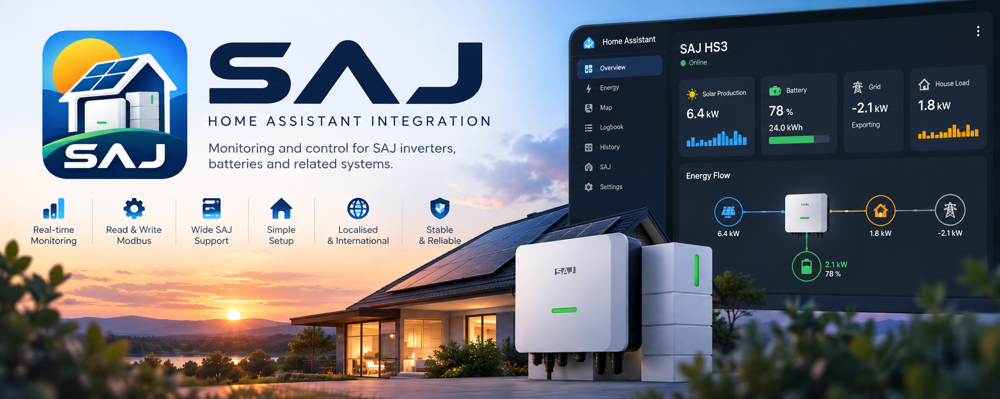

[en](../../README.md) | [de](../de/README.md) | [nl](../nl/README.md) | [fr](../fr/README.md) | [zh](../zh-hans/README.md) | [es](../es/README.md) | it | [pl](../pl/README.md) | [sv](../sv/README.md)

# Integrazione SAJ Local per Home Assistant

⭐ [Metti una stella al progetto su GitHub](https://github.com/Counterphase-Labs/ha-saj-local): il tuo sostegno è una vera motivazione! 🙏😊

Il tuo impianto solare SAJ in Home Assistant, letto direttamente dall'inverter attraverso la tua rete. Nessun account cloud, nessuna app del produttore di mezzo e un metodo di polling pensato per essere delicato con l'hardware.

Questa è un'integrazione non ufficiale, creata dalla comunità. Non è realizzata, supportata né approvata da SAJ. Vedi l'[esclusione di responsabilità](user/README.md#esclusione-di-responsabilità).

> **Stato: in sviluppo attivo e non ancora rilasciata.** Non esiste ancora una versione pubblicata.

## Perché SAJ Local

- **Sensata per impostazione predefinita.** Aggiungi il tuo inverter e ottieni una configurazione funzionante senza dover scorrere pagine di opzioni. L'inverter, la batteria e le apparecchiature correlate vengono rilevati automaticamente.
- **Delicata con il tuo inverter.** Una sola connessione e una richiesta alla volta, e un tetto rigido di richieste che nessuna impostazione, ricaricamento o guasto può superare. Scegli tu che cosa viene letto e con quale frequenza.
- **Sola lettura, salvo diversa indicazione.** La scrittura è facoltativa per ogni installazione, quindi nulla cambia sul tuo inverter per errore.
- **Gli stessi nomi su ogni modello.** Plance e automazioni si scrivono una volta sola e continuano a funzionare su tutti i modelli SAJ, e sopravvivono al passaggio da un H2 a un HS3.
- **Più sistemi.** Collega più di un sistema SAJ allo stesso Home Assistant.
- **Schede per la plancia.** Schede per consultare le informazioni e per modificare la configurazione, aggiunte dal selettore delle schede.
- **Errori chiari e diagnostica sicura.** Quando qualcosa va storto ti viene detto che cosa e perché, e i dump di debug sono pensati per essere sicuri da condividere.
- **Completamente locale.** Tutto comunica con il tuo inverter attraverso la tua rete. Nulla viene inviato a un servizio cloud.

## Apparecchiature supportate

Sono supportati l'SAJ HS3 e l'SAJ H2 monofase. Vedi le [apparecchiature supportate](user/supported-equipment.md) per l'elenco completo e per ciò che non è ancora supportato.

## Documentazione

- [Documentazione utente](user/README.md): installa, configura e usa SAJ Local.
- [Documentazione per sviluppatori](developer/README.md): come SAJ Local viene costruito, controllato e rilasciato.
- [Contribuire](../../CONTRIBUTING.md): prepara una copia di lavoro e invia una modifica.

## Aiuto e feedback

Domande, segnalazioni di errori e idee sono benvenute nel [tracker delle segnalazioni](https://github.com/Counterphase-Labs/ha-saj-local/issues).

Segnala un problema di sicurezza in privato, vedi la [politica di sicurezza](../../SECURITY.md).

## Licenza

[MIT](../../LICENSE)
