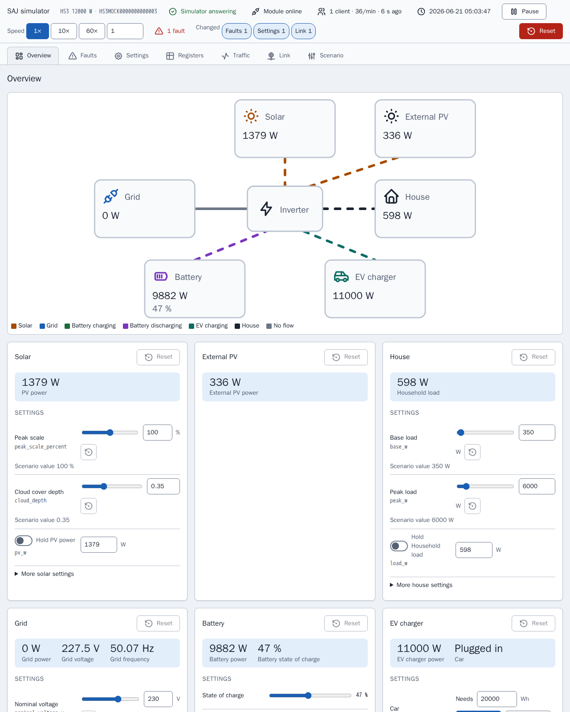

[en](../../en-gb/developer/README.md) | [de](../../de/developer/README.md) | [nl](../../nl/developer/README.md) | [fr](../../fr/developer/README.md) | [zh](../../zh-hans/developer/README.md) | [es](../../es/developer/README.md) | it | [pl](../../pl/developer/README.md) | [sv](../../sv/developer/README.md)

# Documentazione per sviluppatori di SAJ Local

Come SAJ Local viene costruito, controllato e rilasciato, e dove si trova la verità su ogni parte. La documentazione spiega perché il progetto è costruito così e rimanda al file che contiene ogni fatto. Versioni, elenchi di comandi e mappe dei registri vivono nel codice e nella configurazione, non qui.

Per ottenere una copia di lavoro funzionante e inviare una modifica, inizia da [CONTRIBUTING.md](../../../CONTRIBUTING.md). SAJ Local è un'integrazione Home Assistant solo locale: SAJ Local comunica con l'inverter sulla rete locale e non aggiunge alcun servizio cloud né SDK complementare.

## Sviluppare senza un inverter

Il simulatore è un dispositivo SAJ sostitutivo, quindi la maggior parte del lavoro non richiede hardware. Ogni simulatore serve una pagina che mostra che cosa sta facendo il sistema simulato e permette a uno sviluppatore di cambiare il sistema mentre Home Assistant interroga, senza modificare uno scenario e riavviare.

[Simulatore Modbus](simulator.md) spiega a che cosa serve il simulatore e come eseguire uno scenario. [Pagina del simulatore](simulator-page.md) mostra ogni vista della pagina.

## Pagine

- [Simulatore Modbus](simulator.md): a che cosa serve il simulatore, gli scenari e come eseguire un altro sistema.
- [Pagina del simulatore](simulator-page.md): ogni vista della pagina, l'ispettore dei registri, il registro del traffico, i guasti del collegamento, i preset e lo stato salvato.
- [Ambiente](environment.md): preparare una copia di lavoro ed eseguire l'Home Assistant di sviluppo con i simulatori.
- [Controlli](checks.md): i target make, la soglia di copertura e come restringere un'esecuzione.
- [Architettura](architecture.md): la libreria SAJ e l'integrazione, i profili, il catalogo, il polling e i nomi stabili.
- [Frontend](frontend.md): i sorgenti delle schede, la build e le plance di dimostrazione.
- [Documentazione](documentation.md): come queste pagine, il riferimento delle entità generato e le schermate vengono create e controllate.
- [Rilascio](releasing.md): l'aggiornamento della versione di Home Assistant e i passaggi prima di un rilascio.

La documentazione utente è nella [documentazione utente](../user/README.md).

## Dove si trova la verità

| Domanda | Autorità |
| --- | --- |
| Che cosa deve fare il progetto? | [Requisiti globali](../../../.github/work/requirements.md), [requisiti dell'integrazione](../../../custom_components/saj_local/docs/requirements.md), [requisiti delle schede](../../../frontend/docs/requirements.md), [requisiti del simulatore](../../../mock/docs/requirements.md) |
| Che cosa fa oggi ogni parte? | [Funzionalità dell'integrazione](../../../custom_components/saj_local/docs/features.md), [funzionalità delle schede](../../../frontend/docs/features.md), [funzionalità del simulatore](../../../mock/docs/features.md) |
| Come si scrivono codice, test e documentazione? | [code-style.md](../../../.github/work/code-style.md) |
| Quali regole vincolano chiunque lavori qui? | [AGENTS.md](../../../AGENTS.md) |
| Che cosa è stato costruito, e perché? | [done/index.md](../../../.github/work/done/index.md) |
| Che cosa è pianificato? | [.github/work/future/](../../../.github/work/future/) |
| Quali comandi esistono? | [Makefile](../../../Makefile) |
| Che cosa esegue la CI? | [ci.yml](../../../.github/workflows/ci.yml) |
| Dipendenze Python e impostazioni degli strumenti | [pyproject.toml](../../../pyproject.toml) |
| Dipendenze e script del frontend | [frontend/package.json](../../../frontend/package.json) |
| Servizi di sviluppo | [compose.yaml](../../../compose.yaml) |

Il codice esistente non ha alcuna autorità sui requisiti. Dove non concordano, il codice è sbagliato o il responsabile cambia il requisito.

## Stile del codice

[code-style.md](../../../.github/work/code-style.md) è l'autorità. La regola sulla documentazione di code-style.md dà forma a queste pagine: spiega perché, non come, e lascia che nomi e tipi descrivano il resto.
