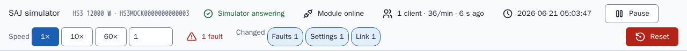
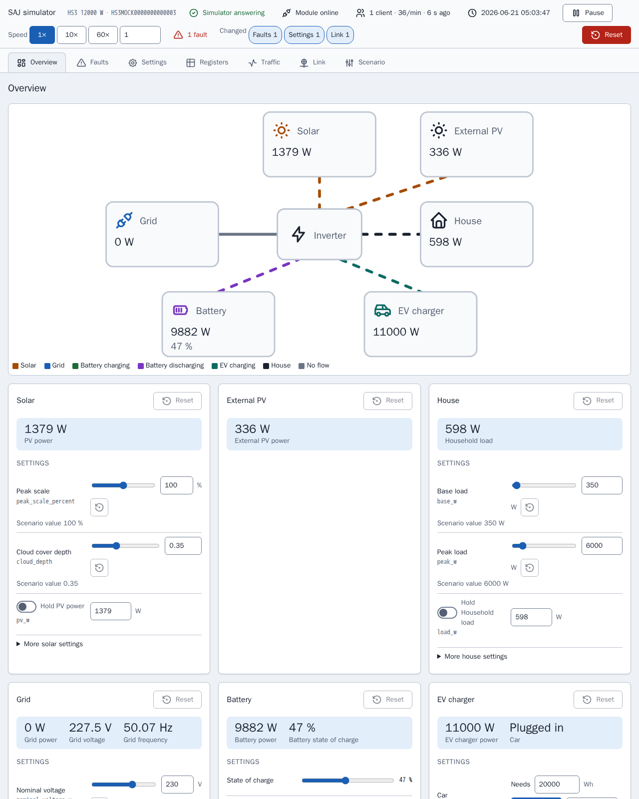
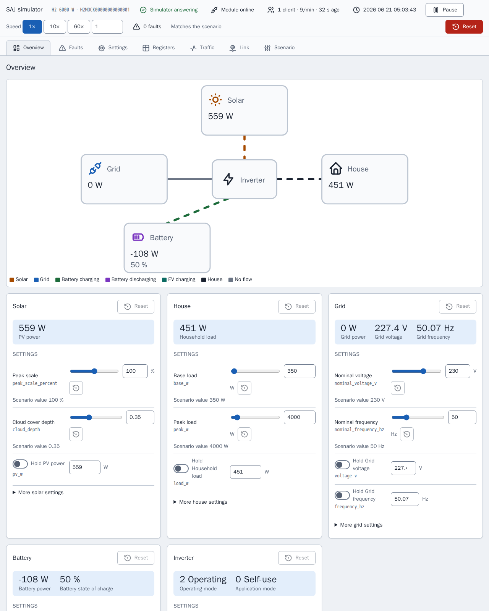
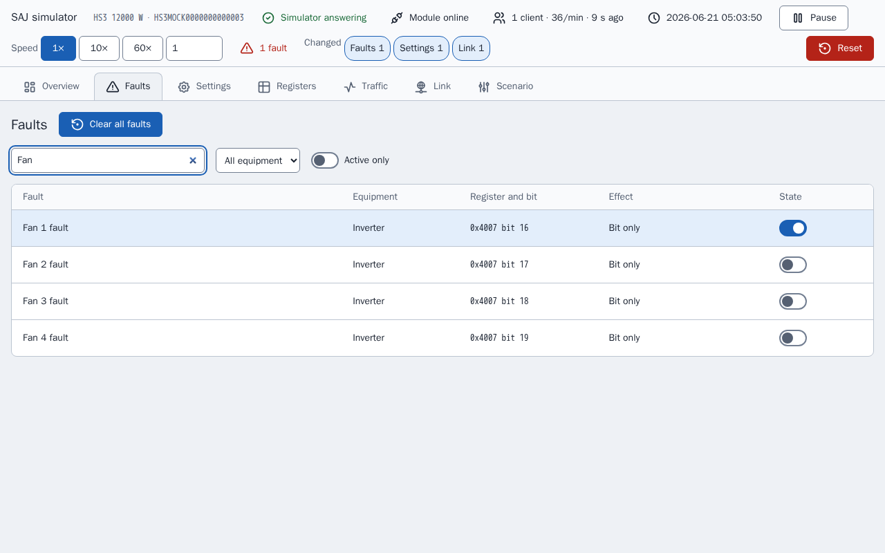
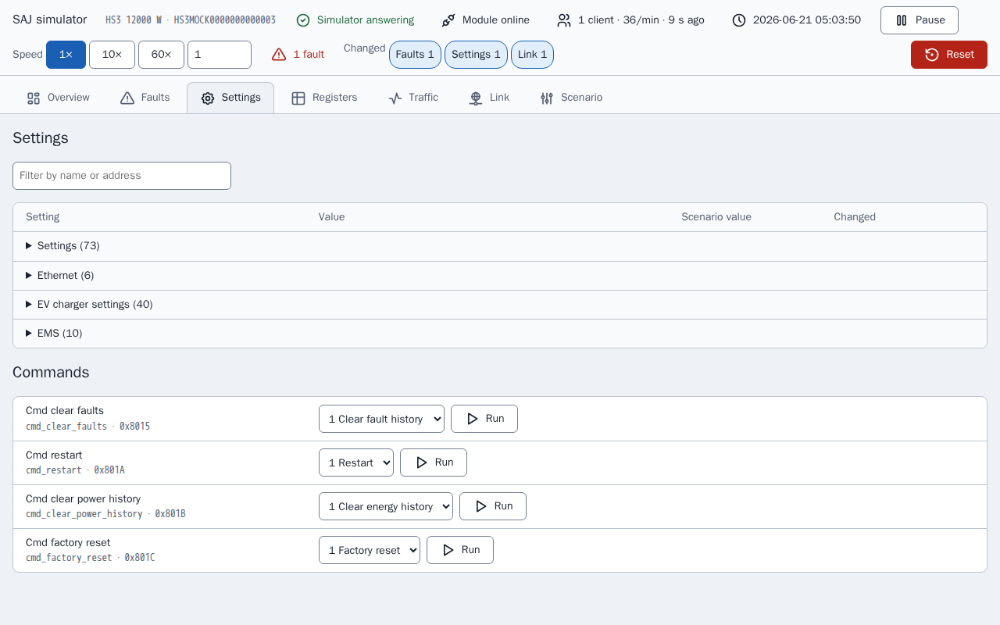
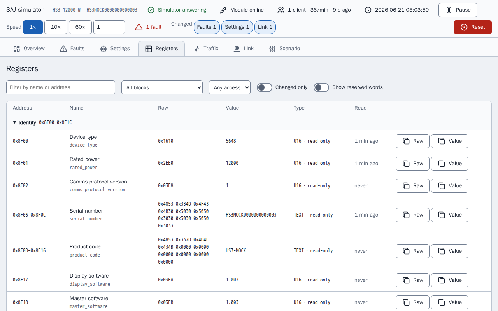
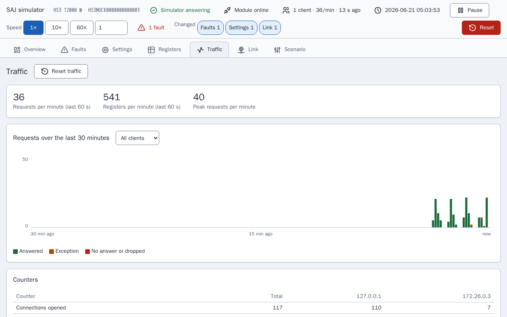
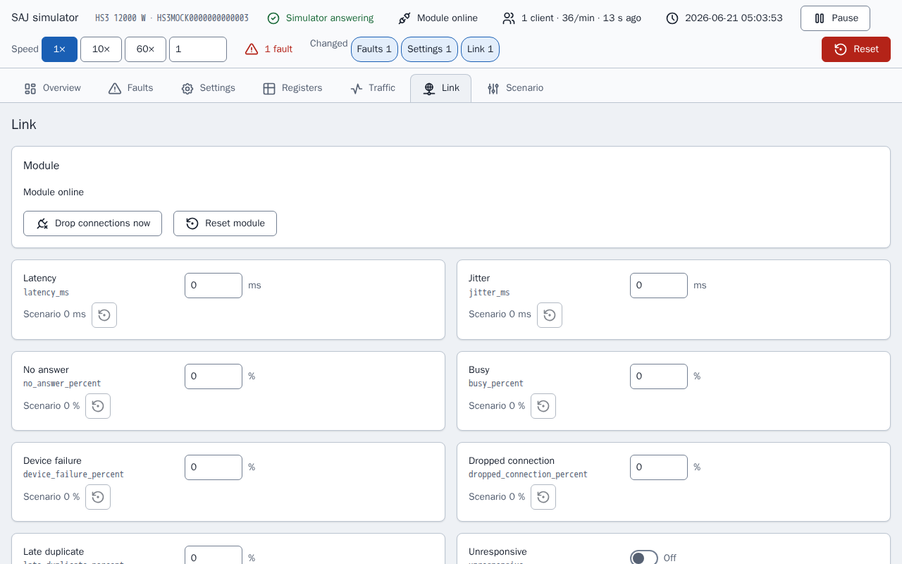
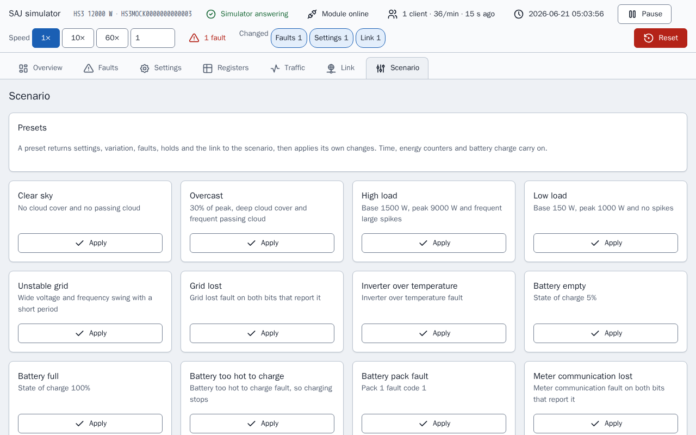
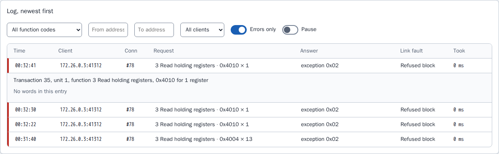

[en](../../en-gb/developer/simulator-page.md) | [de](../../de/developer/simulator-page.md) | [nl](../../nl/developer/simulator-page.md) | [fr](../../fr/developer/simulator-page.md) | [zh](../../zh-hans/developer/simulator-page.md) | [es](../../es/developer/simulator-page.md) | it | [pl](../../pl/developer/simulator-page.md) | [sv](../../sv/developer/simulator-page.md)

# Pagina del simulatore

La pagina di controllo di un simulatore: viste, ispettore dei registri, registro del traffico, guasti del collegamento, effetti dei guasti, preset e stato salvato. La pagina stessa è solo in inglese, quindi i suoi nomi compaiono in inglese in questa descrizione.

L'elenco completo di ciò che la pagina copre è nelle sezioni dell'elenco delle funzionalità [Pagina di controllo](../../../mock/docs/features.md#control-page), [Stato e preset](../../../mock/docs/features.md#state-and-presets), [Ispettore dei registri e registro del traffico](../../../mock/docs/features.md#register-inspector-and-traffic-log), [Guasti del collegamento](../../../mock/docs/features.md#link-faults).

Ogni simulatore serve una pagina web su `http://localhost:<panel port>/`: `5080` per l'HS3 e `5081` per l'H2 avviati da `make up` (`SAJ_MOCK_PANEL_HOST_PORT` e `SAJ_MOCK_H2_PANEL_HOST_PORT` le cambiano). Dentro il contenitore la pagina ascolta su `server.panel_port`, 8080 per impostazione predefinita. Non c'è autenticazione: il simulatore è uno strumento di sviluppo.

La pagina esiste perché uno sviluppatore possa vedere che cosa sta facendo il sistema simulato e mettere il sistema in una situazione senza modificare uno scenario e riavviare. La pagina costruisce ogni controllo dalla descrizione del dispositivo, quindi la pagina elenca solo le apparecchiature installate.
La pagina interroga lo stato ogni 3 secondi, quindi una modifica fatta da Home Assistant compare, e le viste Registers e Traffic si aggiornano anche ogni secondo mentre sono aperte. Un controllo che ha il focus non viene sovrascritto. Due client possono modificare le cose contemporaneamente: vince l'ultima scrittura, come su un dispositivo reale. Ogni modifica mostra una breve conferma e ogni rifiuto il suo motivo.

Una barra di stato su ogni vista risponde alla domanda se il simulatore sta funzionando secondo il suo scenario o è stato modificato: se il modulo è online, i client connessi e la loro frequenza di richieste, il tempo simulato, avvio e pausa, la velocità, i guasti attivi e un'etichetta per ogni tipo di modifica rispetto allo scenario in vigore. Lo stesso riepilogo (`changes` nello stato) segna le righe e le schede modificate. Pause imposta la velocità a 0 e play ripristina la velocità precedente, quindi mettere in pausa non fa perdere la velocità.



La vista corrente è nel frammento dell'URL (`#registers`), quindi un ricaricamento mantiene la vista. Nel browser non viene memorizzato nulla. Le schermate delle viste qui sotto sono create dopo aver impostato un guasto, «Fan 1 fault», e dopo che il simulatore ha rifiutato un registro, quindi ogni vista mostra una modifica rispetto allo scenario.

La pagina ricava nomi leggibili dai nomi dei campi e arrotonda ogni valore scalato ai decimali della sua scala, quindi un 65535 grezzo con scala 0,0001 si legge 6,5535 invece di mostrare rumore in virgola mobile.

## Viste

### Panoramica (Overview)

Un diagramma del flusso di potenza delle apparecchiature installate, colorato e animato in base alla direzione, sopra una scheda per ogni apparecchiatura. Una scheda contiene la lettura in tempo reale, i controlli che impostano la lettura e i guasti dell'apparecchiatura, con un ripristino allo scenario per quella scheda.



La pagina dell'H2 ha meno schede della pagina dell'HS3 qui sopra, perché lo scenario dell'H2 installa meno apparecchiature.



Una scheda tiene separato ciò che un controllo imposta dalla lettura che il controllo produce, perché i due valori differiscono ogni volta che entrano in gioco un blocco, un guasto o lo stato di carica: una scala di picco del 100% non significa il 100% della potenza solare. Il ripristino di una scheda riporta la variazione, i blocchi e i bit di guasto della scheda e lascia stare lo stato di carica, l'auto, l'orologio e i contatori di energia, per lo stesso motivo dei preset. Una scheda con un guasto attivo è segnata, come nella scheda qui sotto.


### Guasti (Faults)

Ogni bit di guasto delle apparecchiature installate, con ricerca, e che cosa fa il simulatore quando il bit è impostato. I bit che il documento non nomina sono elencati come riservati, così si può provare il percorso dei guasti non riconosciuti dell'integrazione.

L'immagine mostra la ricerca «Fan», con i quattro guasti delle ventole e l'interruttore del guasto impostato, «Fan 1 fault», acceso.



### Impostazioni (Settings)

Le impostazioni scrivibili e i comandi, con nomi per i valori grezzi e il valore dello scenario di ciascuno.



### Registri (Registers)

L'ispettore dei registri, descritto più avanti.



### Traffico (Traffic)

Il registro del traffico, descritto più avanti.



### Collegamento (Link)

I guasti del collegamento e lo stato del modulo, descritti più avanti.



### Scenario (Scenario)

Preset, tempo simulato, contatori di energia, ripristino ed esportazione.



## Ispettore dei registri

`GET /api/registers` elenca ogni blocco del dispositivo e, per ogni campo di un blocco che risponde, le parole grezze, il valore decodificato con la sua etichetta, l'accesso (sola lettura, scrivibile o comando) e quando un client ha letto per ultimo il campo. La vista Registers mostra l'elenco come una tabella con un filtro, un interruttore «changed only» e un'evidenziazione su un valore appena cambiato, quindi l'effetto di un guasto o di una scrittura sui registri è visibile senza un client Modbus.

L'ispettore si limita a mostrare. L'ispettore legge il dispositivo senza l'osservatore del dispositivo, quindi guardare un registro non è una lettura del client: la consultazione non conta come keep-alive, non tocca il campo che toccherebbe una lettura e non viene registrata nel traffico. Un registro viene scritto solo tramite i controlli che passano per la stessa convalida di una scrittura Modbus.

## Registro del traffico

Il server Modbus segnala a un registratore (`traffic.py`) ogni evento di connessione e ogni richiesta, con la sua risposta. `GET /api/traffic?after=<sequence>` restituisce le voci dopo un numero di sequenza, quindi la pagina chiede solo ciò che è nuovo, insieme ai contatori e a uno storico di 30 minuti in intervalli di 10 secondi; `POST /api/traffic/reset` li azzera. La vista Traffic mostra la frequenza di richieste in tempo reale, un grafico delle richieste nel tempo, i contatori per client e il registro, che si può filtrare e aprire per vedere le parole lette o scritte. L'immagine mostra il registro con elencati solo gli errori e una richiesta rifiutata aperta: una richiesta rifiutata non ha parole, quindi la voce lo dice e nomina il guasto del collegamento che ha rifiutato la richiesta.



I contatori contano richieste e registri, perché i rapporti dal campo descrivono così il carico del modulo, e vengono mostrati entrambi perché non si sa se conti anche la dimensione delle richieste. Il registratore conserva in memoria le ultime 2000 voci e non le salva: il registro descrive ciò che è successo nell'esecuzione corrente del simulatore, e un riavvio è una nuova esecuzione.

## Guasti del collegamento

La vista Link e la sezione `link` di uno scenario impostano come il modulo simulato si comporta male. Ogni impostazione riproduce un guasto che i rapporti dal campo descrivono per i moduli di comunicazione SAJ, e nessuna è impostata a meno che uno scenario o la pagina la imposti.

| Chiave | Effetto |
| --- | --- |
| `latency_ms`, `jitter_ms` | Ogni risposta attende la latenza più o meno al massimo il jitter, da 0 a 60000 ms |
| `no_answer_percent` | La richiesta viene letta e non riceve mai risposta, e la connessione resta aperta |
| `busy_percent`, `device_failure_percent` | La risposta è l'eccezione `0x06` o `0x04` |
| `dropped_connection_percent` | Il modulo chiude la connessione invece di rispondere |
| `late_duplicate_percent` | Dopo una risposta di eccezione, lo stesso frame viene inviato di nuovo subito prima della risposta successiva su quella connessione |
| `refused_blocks` | Un elenco di `start`, `end` e `code` (da 0 a 255). Una richiesta che tocca il blocco riceve quel codice come risposta, quindi si possono servire dispositivi che inviano codici non standard, compreso 0 |
| `unresponsive` | Le connessioni vengono accettate e non si risponde mai a nulla |
| `offline` | Il modulo smette di ascoltare e chiude ogni connessione |
| `offline_seconds`, `offline_period_seconds` | Offline per i primi `offline_seconds` di ogni periodo, che deve essere almeno altrettanto lungo |
| `lockout_requests`, `lockout_window_seconds`, `lockout_whole_port` | Un client che invia più di `lockout_requests` richieste entro la finestra vede chiusa la propria connessione e rifiutato il proprio indirizzo, oppure ogni client quando `lockout_whole_port` è impostato, finché il modulo non viene reimpostato. Una finestra è obbligatoria quando è impostata una soglia |

<!-- jscpd:ignore-start -->
```yaml
link:
  latency_ms: 800
  jitter_ms: 400
  busy_percent: 10
  refused_blocks:
    - {start: 0x4000, end: 0x40FF, code: 0}
```
<!-- jscpd:ignore-end -->

Le percentuali vanno da 0 a 100. Un valore sbagliato, o una combinazione che non può funzionare, ferma il simulatore all'avvio e nomina la chiave, come `link.offline_seconds`.

Le decisioni sono prese in `link.py` ed eseguite dal trasporto, che interroga il collegamento prima di accettare una connessione e prima di rispondere. Decide il primo controllo che si applica, in quest'ordine: offline, nessuna risposta del modulo (`unresponsive`), blocco, connessione interrotta, nessuna risposta, blocco rifiutato, guasto del dispositivo, occupato. La latenza si applica a ogni risposta inviata. Se una probabilità si applica viene estratto dal seme della simulazione e dal numero di sequenza della richiesta, quindi lo stesso seme e le stesse richieste danno gli stessi guasti, e un guasto trovato durante il debug può essere riprodotto. La latenza, il periodo offline e la finestra di blocco funzionano sul tempo reale, non sul tempo simulato, perché le impostazioni descrivono il collegamento come lo vede il client e la velocità dell'orologio non deve cambiarle.

Le impostazioni del collegamento e un blocco vengono conservati tra i riavvii ed esportati con lo scenario. Un blocco viene cancellato solo da «Reset module», da Reset o da un preset, perché i rapporti dal campo descrivono un blocco che è durato finché al modulo non è stato dato un nuovo indirizzo, e «Reset module» sta per il nuovo indirizzo. «Drop connections now» chiude una volta ogni connessione aperta. Le route sono `POST /api/link`, `/api/link/drop` e `/api/link/reset`.

Il registratore del traffico mostra quale guasto è stato applicato a ogni richiesta, quindi l'effetto di un'impostazione sul client si può leggere dal registro.

## Effetti dei guasti

Alcuni guasti fanno più che impostare il proprio bit, dove lo farebbe un sistema reale. Un guasto che nomina una condizione di rete, solare, bus DC, porta della batteria, temperatura, relè, sensore o isolamento ferma l'inverter, la rete persa fa funzionare l'inverter fuori rete, la comunicazione con il contatore persa mette a tacere il Contatore A, alcuni guasti della batteria fermano la carica o la scarica, qualsiasi codice di guasto di un modulo batteria diverso da 0 ferma entrambe, e un guasto del caricatore EV ferma il caricatore. Ogni altro guasto, e ogni bit riservato, imposta solo il bit. Le tabelle sono in `mock/saj_local_mock/profiles/fault_tables.py` e gli effetti sono applicati da `simulation/faults.py`.

## Preset, stato salvato ed esportazione

I **preset** riportano prima allo scenario le impostazioni, la variazione, il seme, i guasti e i blocchi, poi applicano le proprie modifiche, quindi ognuno dà le stesse condizioni comunque sia stato lasciato il simulatore. Il tempo simulato, la velocità dell'orologio, i contatori di energia e lo stato di carica della batteria proseguono a meno che il preset imposti i valori, così Home Assistant non vede l'orologio tornare indietro né i totali complessivi diminuire. **Reset** è l'azione che riavvolge tutto. Le apparecchiature non installate non hanno preset, e nemmeno un modello le cui tabelle non nominano il guasto. Un preset riporta inoltre il collegamento allo scenario, poi imposta le proprie modifiche del collegamento, e un blocco viene cancellato. I preset del collegamento sono offerti su ogni modello: Slow link, Flaky link, Busy module, Module offline e Module locked out. Nessun rapporto dal campo indica il carico al quale un modulo si blocca, quindi la soglia di Module locked out è un punto di partenza da cambiare nella pagina, e non è ricavata da alcun limite dell'integrazione.

**Stato salvato.** Le modifiche vengono conservate tra i riavvii in `/data/state.json`, in una cartella montata con bind per ogni servizio in [compose.yaml](../../../compose.yaml): `mock/state/hs3/` e `mock/state/h2/`, ripristinate eliminando il contenuto della cartella. Le impostazioni del collegamento e un blocco vengono salvati con lo stato. Uno stato salvato per uno scenario diverso viene ignorato, e registrato una volta nel log, perché applicarlo a un altro sistema sarebbe sbagliato. Uno stato che non si può leggere viene ignorato allo stesso modo e il file viene conservato. Vengono salvate solo le impostazioni che un client può scrivere, quindi una modifica a un registro fisso nel codice non viene mai mascherata da un vecchio file, e i contatori di energia vengono salvati con il punto in cui è iniziato ogni giorno, mese e anno, quindi un riavvio non è un azzeramento dei contatori. Senza una cartella montata il simulatore registra una riga nel log per dire che le modifiche non saranno conservate e continua a funzionare. **Reset** elimina il file e torna allo scenario. Lo stack di Playwright non monta alcuna cartella, quindi ogni esecuzione parte dallo scenario.

L'**esportazione** scarica come scenario il seme, la variazione, i guasti, il collegamento e l'orologio in esecuzione, così uno stato messo a punto può essere sottoposto a commit ed eseguito di nuovo in un simulatore nuovo con la stessa variazione.

## Icone

Le icone della pagina sono incluse dal set di icone Tabler sotto `mock/static/vendor/tabler/`, perché il simulatore deve essere autonomo e non caricare nulla dall'esterno. Vengono conservate solo le icone che la pagina usa, come file SVG originali, così il set può essere controllato rispetto alla fonte. La cartella contiene anche la `LICENSE` del set e un `README.md` che nomina la versione delle icone. La pagina inserisce le icone direttamente nel codice perché le icone prendano il colore del testo; non si usano né un font di icone né emoji. Qualsiasi set con licenza MIT o ISC può essere incluso in questo modo, con la propria licenza accanto.
