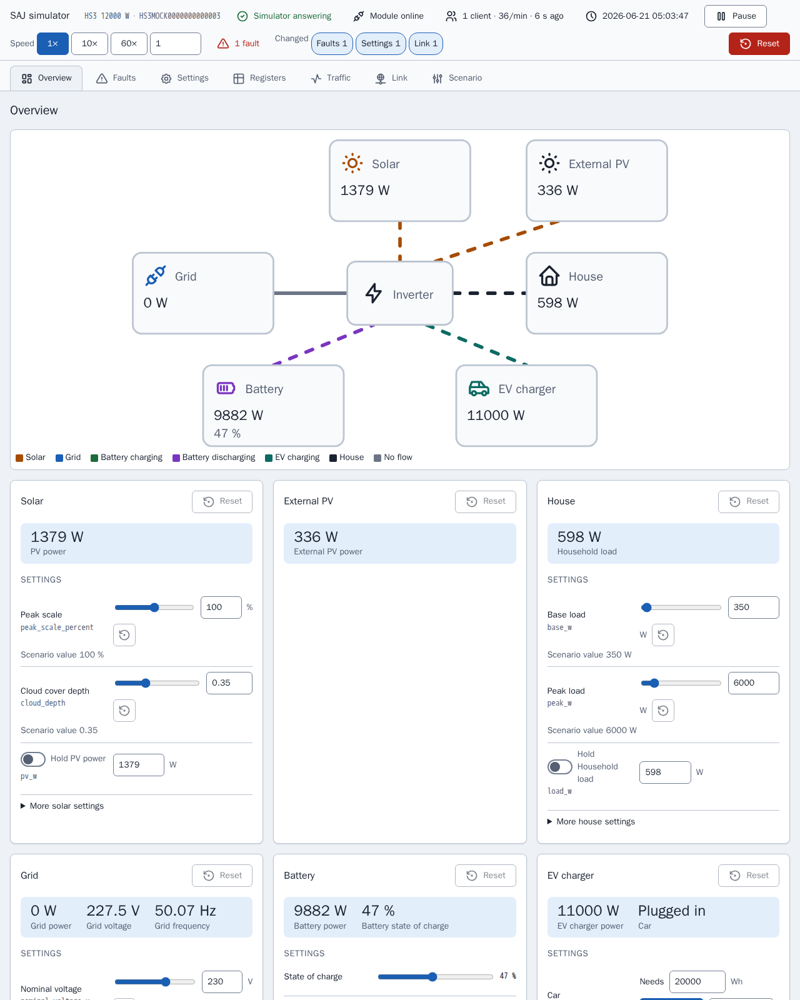

[en](../../en-gb/developer/simulator.md) | [de](../../de/developer/simulator.md) | [nl](../../nl/developer/simulator.md) | [fr](../../fr/developer/simulator.md) | [zh](../../zh-hans/developer/simulator.md) | [es](../../es/developer/simulator.md) | it | [pl](../../pl/developer/simulator.md) | [sv](../../sv/developer/simulator.md)

# Simulatore Modbus



A che cosa serve il simulatore, come eseguire e configurare uno scenario e come estendere il simulatore.

L'elenco completo di ciò che il simulatore copre è nelle sezioni dell'elenco delle funzionalità [Modelli simulati](../../../mock/docs/features.md#simulated-models), [Scenari](../../../mock/docs/features.md#scenarios), [Variazione](../../../mock/docs/features.md#variation).

Il simulatore è un dispositivo SAJ sostitutivo a cui Home Assistant o qualsiasi client Modbus può connettersi, così l'integrazione può essere sviluppata senza possedere l'hardware e senza rischiare l'hardware. Il simulatore punta a test smoke credibili, non a un'emulazione esatta, e non è un server Modbus generico. Il pacchetto è `mock/saj_local_mock/` e ogni simulatore gira nel proprio contenitore.

## Decisioni di progettazione

- **Autonomo.** Il simulatore non condivide codice con l'integrazione, e un contratto di import-linter vieta al simulatore di importare Home Assistant o `custom_components`. Se entrambe le parti usassero le stesse definizioni dei registri, un errore nelle definizioni sarebbe invisibile.
- **Un proprio livello Modbus.** I dispositivi SAJ reali violano lo standard: codici di eccezione strani, blocchi che rifiutano letture oltre la propria fine, un limite basso per i client. L'integrazione deve far fronte a tali guasti, quindi i guasti sono incorporati.
- **Un contenitore, un dispositivo.** Ogni istanza conserva il proprio stato, nella propria cartella sotto `mock/state/`, quindi le istanze non si influenzano mai a vicenda.
- **Modificabile durante l'esecuzione.** Lo scenario è il punto di partenza, non l'unico input. La pagina del simulatore e le richieste in arrivo cambiano il sistema in esecuzione, e lo scenario resta lo stato noto a cui tornare.
- **Deterministico.** Meteo e carico dipendono solo dal seme e dal tempo simulato. Lo stesso scenario, lo stesso istante e le stesse scritture danno gli stessi valori, per quante volte un client interroghi.
- **Un solo bilancio energetico.** Vengono generati solo l'irraggiamento e il carico; tutto il resto è derivato, quindi i registri non si contraddicono mai.
- **Le scritture hanno effetto.** Le impostazioni vengono memorizzate, rilette e applicate. Una scrittura dalla pagina passa per la stessa convalida e la stessa gestione di una scrittura Modbus, quindi l'integrazione non distingue le due e la pagina non può mettere il dispositivo in uno stato che un client non potrebbe raggiungere.
- **La pagina non sa nulla dei modelli.** La pagina si costruisce dalla descrizione che il dispositivo fornisce, quindi un nuovo modello non richiede modifiche alla pagina. La pagina è uno strumento di sviluppo, quindi la pagina è fatta di semplici file HTML, CSS e JavaScript in `mock/static/` serviti così come sono, senza librerie, senza passaggio di build e senza test propri della pagina, mentre il Python dietro la pagina è testato come il resto. Vedi la [pagina del simulatore](simulator-page.md).
- **Il modulo fa parte della simulazione.** Il server Modbus rappresenta il modulo di comunicazione a cui si connette un client, quindi i guasti che i rapporti dal campo descrivono per tali moduli (risposte lente o assenti, codici di eccezione strani, connessioni interrotte, un blocco) sono impostazioni del simulatore e non casi particolari sparsi nel dispositivo.
- **Il comportamento delle scritture viene dai documenti SAJ.** Le scritture sono specificate dai documenti del protocollo SAJ e dalle letture reali, non dal simulatore. Se il simulatore si discosta dal comportamento documentato di `0x06` e `0x10`, lo scostamento è un difetto del simulatore da segnalare, non qualcosa attorno a cui adattare l'integrazione.

## Orientarsi

| Per | Dove guardare |
| --- | --- |
| Perché il simulatore è costruito così | Il lavoro completato [Costruzione del simulatore Modbus SAJ](../../../.github/work/done/build-saj-modbus-mock-simulator.md), [Aggiunta del pannello di controllo del simulatore](../../../.github/work/done/add-simulator-control-panel.md) e [Riprogettazione del pannello del simulatore con ispettore e guasti del collegamento](../../../.github/work/done/redesign-simulator-panel-with-inspector-and-link-faults.md) |
| Sistemi già pronti | [mock/scenarios/](../../../mock/scenarios/) |
| Chiavi di scenario valide e valori predefiniti | `mock/saj_local_mock/scenario.py` |
| Che cosa supporta ogni modello | `mock/saj_local_mock/models.py` |
| Registri | `mock/saj_local_mock/profiles/` |
| Come evolvono i valori | `mock/saj_local_mock/simulation/` |
| Servizi e porte | [compose.yaml](../../../compose.yaml) |
| Pagina del simulatore | `panel.py` (route), `description.py`, `presets.py` e la pagina in [mock/static/](../../../mock/static/) |
| Guasti del collegamento | `mock/saj_local_mock/link.py` (impostazioni, limiti, decisioni) e `transport.py` (esecuzione delle decisioni) |
| Registrazione del traffico | `mock/saj_local_mock/traffic.py` |
| Bit di guasto per modello | `mock/saj_local_mock/profiles/fault_tables.py` |
| Stato salvato | `mock/saj_local_mock/persistence.py` |

Il trasporto non sa nulla di SAJ, il dispositivo possiede gli indirizzi e le regole di accesso, un profilo collega i registri alle grandezze simulate, e la simulazione non sa come i valori vengono trasportati. Tenere separati i livelli è ciò che permette di testare ogni livello da solo con test unitari.

## Parlare con il simulatore da un terminale

`make up` avvia i simulatori. Home Assistant raggiunge ciascuno tramite il nome del servizio Compose sulla porta propria del simulatore; dalla tua macchina usa `localhost` e la porta pubblicata in `compose.yaml`.

Gli esempi usano [mbpoll](https://github.com/epsilonrt/mbpoll) sulla porta pubblicata del simulatore HS3. `-0` fa corrispondere gli indirizzi alle mappe dei registri, `-1` legge una volta, `-t 4` seleziona i registri di mantenimento e `-a` è l'ID unità.

Leggi il tipo di dispositivo e la potenza nominale (registri `0x8F00` e `0x8F01`):

<!-- jscpd:ignore-start -->
```bash
mbpoll -m tcp -p 5020 -a 1 -0 -1 -t 4:hex -r 0x8F00 -c 2 localhost
```
<!-- jscpd:ignore-end -->

Un HS3 e un H2 rispondono con tipi di dispositivo diversi, che è il modo più rapido per confermare quale sistema una porta sta simulando.

Scrivi un'impostazione e rileggila (qui la modalità applicazione a `0x3647`):

<!-- jscpd:ignore-start -->
```bash
mbpoll -m tcp -p 5020 -a 1 -0 -t 4 -r 0x3647 localhost 1
mbpoll -m tcp -p 5020 -a 1 -0 -1 -t 4 -r 0x3647 localhost
```
<!-- jscpd:ignore-end -->

Guarda come il simulatore rifiuta una richiesta, per esempio un indirizzo fuori da ogni blocco:

<!-- jscpd:ignore-start -->
```bash
mbpoll -m tcp -p 5020 -a 1 -0 -1 -t 4 -r 0x0001 localhost
```
<!-- jscpd:ignore-end -->

Guarda un valore cambiare togliendo `-1`; mbpoll allora interroga una volta al secondo finché non viene fermato.

Esegui il controllo di integrità del simulatore stesso, che non richiede alcun client installato:

<!-- jscpd:ignore-start -->
```bash
docker compose exec mock python -m saj_local_mock healthcheck; echo $?
```
<!-- jscpd:ignore-end -->

Le scritture sono conservate tra i riavvii in `mock/state/`, che Git ignora, e si ripristinano dalla pagina del simulatore o eliminando il contenuto della cartella, vedi [Stato salvato](simulator-page.md#preset-stato-salvato-ed-esportazione). Gli indirizzi vengono dai profili; i tre qui sopra sono solo punti di partenza.

## Configurare uno scenario

Uno scenario è un file YAML montato in `/config/config.yaml`. Solo `device.model` è obbligatorio, quindi un file indica solo ciò che differisce dai valori predefiniti:

<!-- jscpd:ignore-start -->
```yaml
device:
  model: hs3
simulation:
  start: "2026-06-21T12:00:00"
  speed: 600
battery:
  modules: 4
```
<!-- jscpd:ignore-end -->

Nell'esempio, `simulation.speed` è il numero di secondi simulati per secondo reale, quindi lo scenario esegue dieci minuti simulati ogni secondo a partire da mezzogiorno di piena estate: utile per osservare un'intera giornata di carica e scarica in pochi minuti. `simulation.seed` sceglie il meteo e il carico.

Due sezioni modellano il comportamento casuale e i guasti all'avvio; una terza, `link`, è descritta in [Guasti del collegamento](simulator-page.md#guasti-del-collegamento). `variation` imposta i limiti, la profondità e il periodo dei generatori di solare, carico e rete (il livello del carico resta in `site.load`), e `faults` elenca i bit di guasto attivi per apparecchiatura per registro e bit, più i codici dei moduli batteria:

<!-- jscpd:ignore-start -->
```yaml
variation:
  cloud_depth: 0.9
faults:
  inverter:
    - {register: 0x4005, bit: 23}
  packs:
    - {pack: 1, fault: 1}
```
<!-- jscpd:ignore-end -->

Una chiave sbagliata o una combinazione impossibile ferma il simulatore all'avvio e nomina la chiave. Il simulatore scrive la riga sull'output di errore ed esce:

```text
invalid scenario: ev_charger.installed: not available on h2
```

## Eseguire un sistema diverso o aggiuntivo

**Prova uno scenario una volta**, senza toccare alcun file. Il simulatore gira in primo piano sulla propria porta finché non lo fermi:

<!-- jscpd:ignore-start -->
```bash
docker compose run --rm --no-deps -p 5030:502 \
  -v ./mock/scenarios/hs3-off-grid.yaml:/config/config.yaml:ro \
  -v ./mock/state/off-grid:/data \
  mock
```
<!-- jscpd:ignore-end -->

Il secondo `-v` è necessario perché il servizio `mock` altrimenti porta con sé il montaggio `/data` di `mock/state/hs3/`, e la prima modifica nell'esecuzione off-grid sostituirebbe lo `state.json` dell'HS3 di sviluppo con lo stato off-grid. L'esecuzione off-grid conserva il proprio stato in `mock/state/off-grid/` tra un'esecuzione e l'altra.

Punta il primo `-v` al tuo file per eseguire uno scenario che hai scritto.

**Cambia ciò che `make up` avvia** in `compose.override.yaml`. Montare un altro file sullo stesso percorso sostituisce lo scenario; un nuovo servizio aggiunge un sistema:

<!-- jscpd:ignore-start -->
```yaml
services:
  mock:
    volumes:
      - ./mock/scenarios/hs3-ev.yaml:/config/config.yaml:ro

  mock-off-grid:
    build:
      context: ./mock
    volumes:
      - ./mock/scenarios/hs3-off-grid.yaml:/config/config.yaml:ro
    ports:
      - "5022:502"
```
<!-- jscpd:ignore-end -->

Ogni servizio è un dispositivo indipendente con il proprio stato. Home Assistant raggiunge il nuovo servizio come `mock-off-grid`, quindi si possono aggiungere più sistemi a un solo Home Assistant uno accanto all'altro.

## Estendere il simulatore

- **Nuovo scenario:** un file in `mock/scenarios/`. `make mock-smoke` esegue ogni file della cartella.
- **Nuovo modello:** una voce in `models.py`, un profilo in `profiles/` e l'accettazione da parte della convalida dello scenario in `scenario.py`.
- **Nuova stranezza:** nel livello che la possiede. Framing e connessioni nel trasporto, indirizzi e accesso nel dispositivo, comportamento del modello nel profilo.

Il simulatore supera gli stessi controlli dell'integrazione, vedi la [pagina dei controlli](checks.md).
