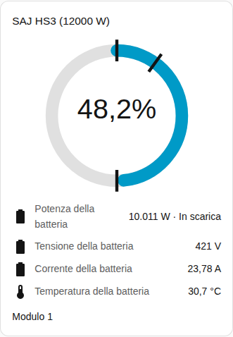
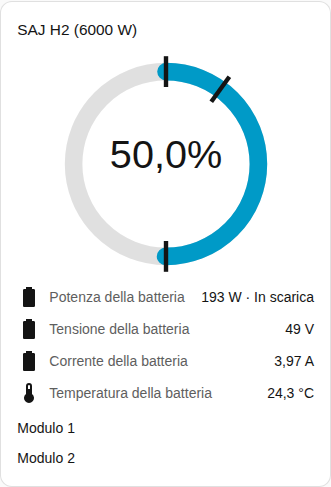

[en](../../../en-gb/user/cards/battery-card.md) | [de](../../../de/user/cards/battery-card.md) | [nl](../../../nl/user/cards/battery-card.md) | [fr](../../../fr/user/cards/battery-card.md) | [zh](../../../zh-hans/user/cards/battery-card.md) | [es](../../../es/user/cards/battery-card.md) | it | [pl](../../../pl/user/cards/battery-card.md) | [sv](../../../sv/user/cards/battery-card.md)

# Scheda batteria

La pagina Scheda batteria spiega la scheda batteria, che mostra la carica, la potenza e le letture della batteria. L'elenco completo è nella sezione [Scheda batteria](../../../../frontend/docs/features.md#battery-card) dell'elenco delle funzionalità delle schede. [Aggiungere un elemento](README.md#aggiungere-un-elemento) spiega come aggiungere la scheda e scegliere un sistema.

## Che cosa mostra la scheda

- Un anello mostra lo stato di carica. I segni sull'anello indicano la riserva per il backup, il limite di carica e il limite di scarica con rete collegata.
- La potenza della batteria appare con l'indicazione se la batteria è in carica o in scarica, e sotto la potenza la tensione, la corrente, la temperatura e la capacità utilizzabile. Le direzioni seguono il [segno della potenza](../entities-and-prefix.md#segno-della-potenza).
- Con Mostra i moduli batteria attivo, che è il valore predefinito, ogni modulo ha un gruppo di righe con lo stato di carica, la salute, la tensione, la corrente, la temperatura, i cicli, il guasto e l'avviso. La lettura di un modulo compare solo quando l'entità della lettura è abilitata. La maggior parte delle letture dei moduli viene creata disabilitata, ed è per questo che la schermata mostra solo il nome del modulo. Abilita in Home Assistant le entità che vuoi. Le [entità dei moduli batteria](../entities/battery-packs.md) sono nel riferimento delle entità.
- Una riga mostra il tempo alla batteria piena mentre la batteria si carica e il tempo alla batteria scarica mentre la batteria si scarica. La riga manca quando la batteria è ferma o quando il sistema non ha quell'entità. I [sensori calcolati](../entities-and-prefix.md#sensori-calcolati) spiegano le stime.
- Un sistema senza batteria lo dice.

## Differenze tra i modelli

- **HS3:** un modulo.
- **H2:** un gruppo di righe per ogni modulo comunicato dall'inverter, fino a cinque. La schermata mostra un H2 con due moduli. Vedi le [apparecchiature opzionali](../optional-equipment.md#moduli-batteria).

La [scheda guasti](faults-card.md) elenca il guasto e l'avviso attivi di ogni modulo. Le entità di guasto e di avviso sono abilitate per impostazione predefinita.

## Opzioni

| Opzione nell'editor | Chiave YAML | Valore predefinito |
| --- | --- | --- |
| Sistema | `device` | Il primo sistema |
| Mostra i moduli batteria | `show_packs` | Attivo |

## Non ancora supportato

- La modifica di un'impostazione della batteria dalla scheda. La scheda batteria mostra solo letture. Usa la [scheda controlli](controls-card.md) per i limiti della batteria.
