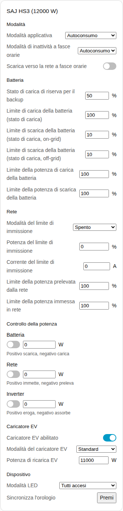
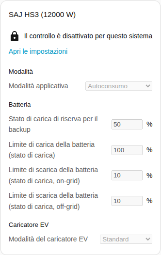
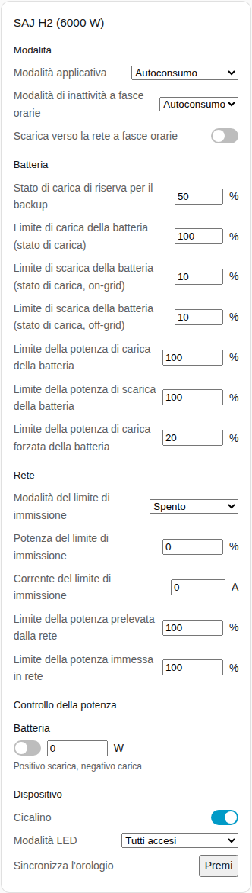

[en](../../../en-gb/user/cards/controls-card.md) | [de](../../../de/user/cards/controls-card.md) | [nl](../../../nl/user/cards/controls-card.md) | [fr](../../../fr/user/cards/controls-card.md) | [zh](../../../zh-hans/user/cards/controls-card.md) | [es](../../../es/user/cards/controls-card.md) | it | [pl](../../../pl/user/cards/controls-card.md) | [sv](../../../sv/user/cards/controls-card.md)

# Scheda controlli

La pagina Scheda controlli spiega la scheda controlli, che raccoglie le impostazioni di un sistema in sezioni, così puoi cambiarle da una plancia. L'elenco completo è nella sezione [Scheda controlli](../../../../frontend/docs/features.md#controls-card) dell'elenco delle funzionalità delle schede. [Aggiungere un elemento](README.md#aggiungere-un-elemento) spiega come aggiungere la scheda e scegliere un sistema. Le impostazioni dietro i controlli sono descritte nella [modifica delle impostazioni](../changing-settings.md).

## Che cosa mostra la scheda

- Le sezioni sono Modalità, Batteria, Rete, Controllo della potenza, Caricatore EV e Dispositivo. Una sezione senza nulla da mostrare viene esclusa.
- **Modalità:** la modalità applicativa e le impostazioni a fasce orarie.
- **Batteria:** la riserva per il backup e i limiti di carica e di scarica.
- **Rete:** le impostazioni del limite di immissione e i limiti di potenza della rete.
- **Controllo della potenza:** ogni funzione di [controllo della potenza](../power-control.md) che il sistema ha, con un interruttore, un obiettivo di potenza e un suggerimento su che cosa fanno una potenza positiva e una negativa.
- **Caricatore EV:** l'interruttore, la modalità e la potenza di ricarica del caricatore.
- **Dispositivo:** il cicalino, la modalità LED e la sincronizzazione dell'orologio.
- Ogni impostazione usa il controllo adatto all'impostazione: un cursore o un campo numerico, un elenco, un interruttore, un campo dell'ora o un pulsante.
- Un controllo modifica l'inverter una volta per decisione, poi mostra il valore che l'inverter contiene. Una modifica rifiutata compare sotto il controllo.
- La scheda non ha un pulsante Riavvia l'inverter, quindi un tocco su una plancia non può riavviare l'inverter. Il riavvio resta un'entità.

## Quando il controllo non è consentito

Finché [Consenti controllo](../changing-settings.md#consentire-il-controllo) è disattivato per il sistema, ogni controllo è disabilitato. Un lucchetto sopra i controlli rimanda alle impostazioni dell'integrazione, dove attivi Consenti controllo.

## Differenze tra i modelli

- **Solo HS3:** la sezione del caricatore EV, e le funzioni di controllo della potenza Rete e Inverter.
- **Solo H2:** il cicalino e il limite della potenza di carica forzata della batteria. L'H2 ha solo la funzione di controllo della potenza Batteria.

## Opzioni

| Opzione nell'editor | Chiave YAML | Valore predefinito |
| --- | --- | --- |
| Sistema | `device` | Il primo sistema |
| Sezioni | `sections`, un elenco di `mode`, `battery`, `grid`, `power_control`, `ev_charger` e `device` | Tutte le sezioni |

## Non ancora supportato

- Un pulsante Riavvia l'inverter. Il riavvio resta un'entità.
- Le pianificazioni del controllo della potenza. Configura le pianificazioni nella pagina dell'integrazione, vedi il [controllo della potenza](../power-control.md#seguire-una-pianificazione).
