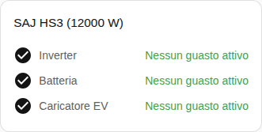

[en](../../../en-gb/user/cards/faults-card.md) | [de](../../../de/user/cards/faults-card.md) | [nl](../../../nl/user/cards/faults-card.md) | [fr](../../../fr/user/cards/faults-card.md) | [zh](../../../zh-hans/user/cards/faults-card.md) | [es](../../../es/user/cards/faults-card.md) | it | [pl](../../../pl/user/cards/faults-card.md) | [sv](../../../sv/user/cards/faults-card.md)

# Scheda guasti

La pagina Scheda guasti spiega la scheda guasti, che elenca i guasti attivi di ogni apparecchiatura. L'elenco completo è nella sezione [Scheda guasti](../../../../frontend/docs/features.md#faults-card) dell'elenco delle funzionalità delle schede. [Aggiungere un elemento](README.md#aggiungere-un-elemento) spiega come aggiungere la scheda e scegliere un sistema. I guasti provengono dalle [entità di guasto dell'apparecchiatura](../faults-and-repairs.md#guasti-dellapparecchiatura).

## Che cosa mostra la scheda

- I guasti sono raggruppati per inverter, batteria e caricatore EV, e ogni guasto attivo mostra da quanto tempo è iniziato. I guasti e gli avvisi dei moduli batteria sono nel gruppo della batteria.
- Un guasto non riconosciuto indica di cercare il registro e il bit nel [download della diagnostica](../troubleshooting.md#download-della-diagnostica).
- Un pulsante Cancella guasto si trova sotto i guasti attivi dell'inverter. Il pulsante invia il comando Cancella il guasto attuale. Finché il controllo non è consentito per il sistema, il pulsante è disabilitato e un lucchetto rimanda alle impostazioni dell'integrazione. Vedi [Consenti controllo](../changing-settings.md#consentire-il-controllo).
- Con Mostra i gruppi senza guasti attivo, che è il valore predefinito, un gruppo senza guasti attivi appare come libero, come nella schermata. Con l'opzione disattivata, la scheda mostra solo i gruppi con un guasto attivo.

Un sistema senza batteria o senza caricatore EV non ha guasti da mostrare per l'apparecchiatura mancante, quindi la scheda non disegna il gruppo dell'apparecchiatura.

## Opzioni

| Opzione nell'editor | Chiave YAML | Valore predefinito |
| --- | --- | --- |
| Sistema | `device` | Il primo sistema |
| Mostra i gruppi senza guasti | `show_groups_without_faults` | Attivo |

## Non ancora supportato

- La cancellazione dei guasti della batteria o del caricatore EV dalla scheda. Il pulsante Cancella guasto si trova solo sotto i guasti attivi dell'inverter.
