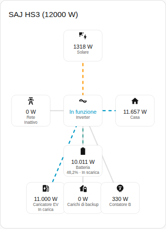
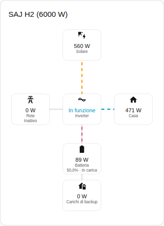

[en](../../../en-gb/user/cards/power-flow-card.md) | [de](../../../de/user/cards/power-flow-card.md) | [nl](../../../nl/user/cards/power-flow-card.md) | [fr](../../../fr/user/cards/power-flow-card.md) | [zh](../../../zh-hans/user/cards/power-flow-card.md) | [es](../../../es/user/cards/power-flow-card.md) | it | [pl](../../../pl/user/cards/power-flow-card.md) | [sv](../../../sv/user/cards/power-flow-card.md)

# Scheda flusso di potenza

La pagina Scheda flusso di potenza spiega la scheda flusso di potenza, che disegna la potenza in tempo reale tra solare, batteria, rete, casa e apparecchiature opzionali. L'elenco completo è nella sezione [Scheda flusso di potenza](../../../../frontend/docs/features.md#power-flow-card) dell'elenco delle funzionalità delle schede. [Aggiungere un elemento](README.md#aggiungere-un-elemento) spiega come aggiungere la scheda e scegliere un sistema.



## Che cosa mostra la scheda

- Solare, batteria, rete e casa sono disegnati intorno all'inverter, che mostra lo stato di funzionamento.
- Ogni linea mostra la direzione del flusso e si muove più velocemente al crescere della potenza. Una potenza di 10 W o meno viene disegnata come inattiva.
- La batteria mostra lo stato di carica e se la batteria è in carica o in scarica. La rete mostra se il sistema è in prelievo o in immissione. Le direzioni seguono il [segno della potenza](../entities-and-prefix.md#segno-della-potenza).
- Con Mostra le apparecchiature opzionali attivo, che è il valore predefinito, la scheda disegna anche i carichi di backup, il Contatore B e il caricatore EV quando il sistema ha l'apparecchiatura. Il Contatore B è una lettura senza direzione.
- Con Mostra le stringhe solari attivo, viene elencata la potenza di ogni stringa solare. L'opzione è disattivata per impostazione predefinita.
- Ambito sceglie tra le letture del sistema, che è il valore predefinito, e le letture del sistema in parallelo. Un sistema senza letture in parallelo mostra lo stato vuoto con l'ambito in parallelo.

## Differenze tra i modelli

- **Solo HS3:** il caricatore EV, come nella schermata sopra.
- **H2:** la scheda disegna le parti della scheda dell'HS3, tranne il caricatore EV. La schermata qui sotto mostra un H2 che sta caricando la batteria.



## Opzioni

| Opzione nell'editor | Chiave YAML | Valore predefinito |
| --- | --- | --- |
| Sistema | `device` | Il primo sistema |
| Mostra le stringhe solari | `show_strings` | Disattivato |
| Mostra le apparecchiature opzionali | `show_optional_equipment` | Attivo |
| Ambito | `scope` (`system` o `parallel`) | `system` |

<!-- jscpd:ignore-start -->
```yaml
type: custom:saj-local-power-flow-card
device: 0123456789abcdef0123456789abcdef
show_strings: false
show_optional_equipment: true
scope: system
```
<!-- jscpd:ignore-end -->

Il valore `device` è l'ID del dispositivo in Home Assistant. L'editor visuale lo compila per te. I nomi delle entità dietro ogni parte sono nel [riferimento delle entità](../entities/README.md).

## Non ancora supportato

- Una direzione per il Contatore B. La scheda disegna il Contatore B come una lettura senza direzione.
