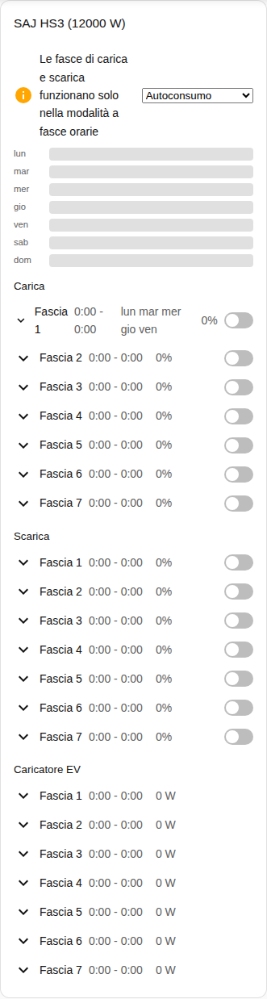
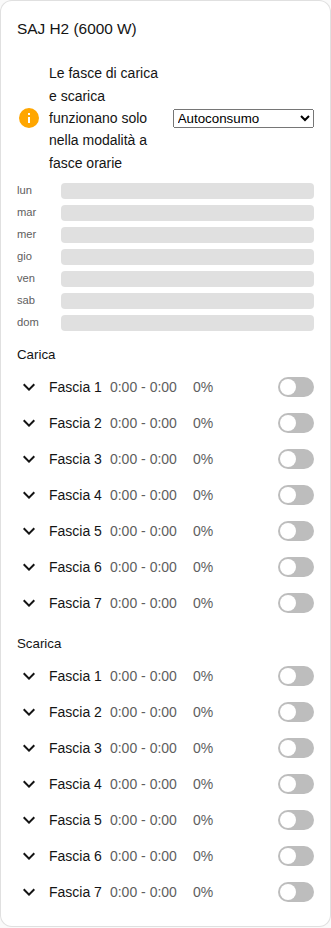

[en](../../../en-gb/user/cards/schedule-card.md) | [de](../../../de/user/cards/schedule-card.md) | [nl](../../../nl/user/cards/schedule-card.md) | [fr](../../../fr/user/cards/schedule-card.md) | [zh](../../../zh-hans/user/cards/schedule-card.md) | [es](../../../es/user/cards/schedule-card.md) | it | [pl](../../../pl/user/cards/schedule-card.md) | [sv](../../../sv/user/cards/schedule-card.md)

# Scheda pianificazione

La pagina Scheda pianificazione spiega la scheda pianificazione, che mostra e modifica le fasce di carica, di scarica e del caricatore EV. L'elenco completo è nella sezione [Scheda pianificazione](../../../../frontend/docs/features.md#schedule-card) dell'elenco delle funzionalità delle schede. [Aggiungere un elemento](README.md#aggiungere-un-elemento) spiega come aggiungere la scheda e scegliere un sistema.

## Che cosa mostra la scheda

- Le fasce di carica, di scarica e del caricatore EV, ciascuna con gli orari, la potenza, i giorni e se la fascia è attiva. L'opzione Tipi di fascia sceglie quali tipi mostra la scheda.
- Con Mostra la linea temporale settimanale attivo, che è il valore predefinito, una linea temporale settimanale disegna ogni fascia come una barra. Tocca una barra per aprire la fascia.
- Una fascia aperta ha un editor per l'inizio, la fine, la potenza, i giorni e le altre impostazioni della fascia.
- Una fascia compare solo quando ogni entità della fascia è abilitata, e la scheda conta le fasce che esclude. Attivare [Consenti controllo](../changing-settings.md#linsieme-dei-controlli) abilita le entità delle fasce.
- Le fasce di carica e di scarica funzionano solo in una modalità applicativa a fasce orarie. Quando la modalità applicativa è un'altra modalità, un avviso lo dice e mostra accanto all'avviso l'elenco delle modalità. Contano sia Fasce orarie sia Fasce orarie (BMS).
- Finché il controllo non è consentito per il sistema, ogni controllo della scheda è disabilitato e un lucchetto rimanda alle impostazioni dell'integrazione. Vedi [Consenti controllo](../changing-settings.md#consentire-il-controllo).

## Differenze tra i modelli

- **Solo HS3:** le fasce del caricatore EV.
- **H2:** solo fasce di carica e di scarica, come mostra la schermata qui sotto.

I pulsanti dei giorni di una fascia sono i pulsanti della [funzione giorni della settimana per la scheda tile](weekdays-feature.md).

## Opzioni

| Opzione nell'editor | Chiave YAML | Valore predefinito |
| --- | --- | --- |
| Sistema | `device` | Il primo sistema |
| Tipi di fascia | `slot_kinds`, un elenco di `charge`, `discharge` e `ev_charger` | Tutti i tipi |
| Mostra la linea temporale settimanale | `show_timeline` | Attivo |

## Non ancora supportato

- Le pianificazioni del controllo della potenza. Una pianificazione del controllo della potenza segue un aiutante di pianificazione di Home Assistant, vedi il [controllo della potenza](../power-control.md#seguire-una-pianificazione).
