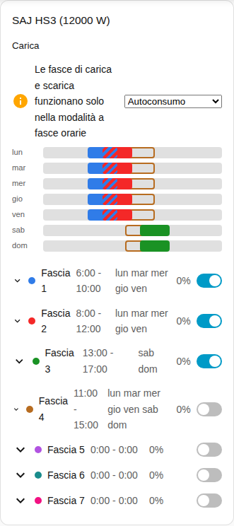
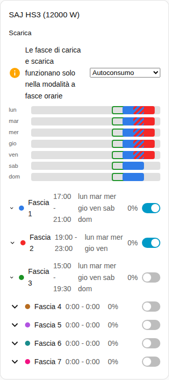
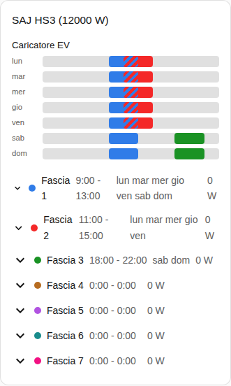

[en](../../../en-gb/user/cards/schedule-cards.md) | [de](../../../de/user/cards/schedule-cards.md) | [nl](../../../nl/user/cards/schedule-cards.md) | [fr](../../../fr/user/cards/schedule-cards.md) | [zh](../../../zh-hans/user/cards/schedule-cards.md) | [es](../../../es/user/cards/schedule-cards.md) | it | [pl](../../../pl/user/cards/schedule-cards.md) | [sv](../../../sv/user/cards/schedule-cards.md)

# Schede pianificazione

La pagina Schede pianificazione spiega le tre schede pianificazione. Ogni scheda mostra e modifica le fasce di un solo tipo: carica, scarica o caricatore EV. L'elenco completo è nella sezione [Schedule cards](../../../../frontend/docs/features.md#schedule-cards) dell'elenco delle funzionalità delle schede. [Aggiungere un elemento](README.md#aggiungere-un-elemento) spiega come aggiungere una scheda e scegliere un sistema.

## Che cosa mostra ogni scheda pianificazione

- Il titolo della scheda e, sotto il titolo, un'intestazione con il tipo della scheda.
- Le fasce del tipo, ciascuna con gli orari, la potenza, i giorni e se la fascia è attiva.
- Un colore per ogni numero di fascia. La fascia 1 ha lo stesso colore su tutte e tre le schede. Ogni riga di fascia inizia con un indicatore colorato nel colore della fascia.
- Con Mostra la linea temporale settimanale attivo, che è il valore predefinito, una linea temporale settimanale disegna ogni fascia come una barra nel colore della fascia. Tocca una barra per aprire la fascia.
- Una fascia disattivata è un contorno nel colore della fascia, senza riempimento. La barra di una fascia attivata nasconde la parte di un contorno che attraversa. Dove due o più fasce attivate si sovrappongono in un giorno, la linea temporale disegna la sovrapposizione come strisce nei colori delle fasce sovrapposte. Una fascia disattivata non crea alcuna sovrapposizione. Tocca una sovrapposizione per aprire la fascia sovrapposta con il numero più basso.
- Una fascia aperta ha un editor per l'inizio, la fine, la potenza, i giorni e le altre impostazioni della fascia.
- Una fascia compare solo quando ogni entità della fascia è abilitata, e la scheda conta le fasce che esclude. Attivare [Consenti controllo](../changing-settings.md#linsieme-dei-controlli) abilita le entità delle fasce.
- Finché il controllo non è consentito per il sistema, ogni controllo della scheda è disabilitato e un lucchetto rimanda alle impostazioni dell'integrazione. Vedi [Consenti controllo](../changing-settings.md#consentire-il-controllo).

I pulsanti dei giorni di una fascia sono i pulsanti della [funzione giorni della settimana per la scheda tile](weekdays-feature.md).

## Opzioni

Le tre schede hanno le stesse opzioni.

| Opzione nell'editor | Chiave YAML | Valore predefinito |
| --- | --- | --- |
| Sistema | `device` | Il primo sistema |
| Mostra la linea temporale settimanale | `show_timeline` | Attivo |

## Scheda pianificazione di carica

La Scheda pianificazione di carica mostra le fasce di carica.

Le fasce di carica funzionano solo in una modalità applicativa a fasce orarie. Quando la modalità applicativa è un'altra modalità, un avviso lo dice e mostra accanto all'avviso l'elenco delle modalità. Contano sia Fasce orarie sia Fasce orarie (BMS).

## Scheda pianificazione di scarica

La Scheda pianificazione di scarica mostra le fasce di scarica.

Le fasce di scarica funzionano solo in una modalità applicativa a fasce orarie, quindi la scheda mostra lo stesso avviso della Scheda pianificazione di carica.

## Scheda pianificazione del caricatore EV

La Scheda pianificazione del caricatore EV mostra le fasce del caricatore EV. La scheda non mostra alcun avviso sulla modalità a fasce orarie.

## Differenze tra i modelli

- **Solo HS3:** le fasce del caricatore EV. Su un H2, la Scheda pianificazione del caricatore EV mostra lo stato vuoto, che dice quale tipo di entità abilitare.
- **H2:** solo fasce di carica e di scarica.

## Non ancora supportato

- Le pianificazioni del controllo della potenza. Una pianificazione del controllo della potenza segue un aiutante di pianificazione di Home Assistant, vedi il [controllo della potenza](../power-control.md#seguire-una-pianificazione).
