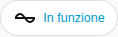

[en](../../../en-gb/user/cards/status-badge.md) | [de](../../../de/user/cards/status-badge.md) | [nl](../../../nl/user/cards/status-badge.md) | [fr](../../../fr/user/cards/status-badge.md) | [zh](../../../zh-hans/user/cards/status-badge.md) | [es](../../../es/user/cards/status-badge.md) | it | [pl](../../../pl/user/cards/status-badge.md) | [sv](../../../sv/user/cards/status-badge.md)

# Badge di stato

La pagina Badge di stato spiega il badge di stato, che mostra lo stato di un sistema nella riga dei badge di una plancia. L'elenco completo è nella sezione [Badge di stato](../../../../frontend/docs/features.md#status-badge) dell'elenco delle funzionalità delle schede. [Aggiungere un elemento](README.md#aggiungere-un-elemento) spiega come aggiungere il badge e scegliere un sistema.



## Che cosa mostra il badge

- Lo stato di funzionamento, colorato in base a quanto lo stato è sano, e il numero di apparecchiature con un guasto attivo. Il badge mostra il numero solo quando un guasto è attivo, quindi la schermata mostra solo lo stato.
- Il badge dice Non risponde quando il sistema non risponde.
- Toccare il badge apre i dettagli dello stato di funzionamento.

## Opzioni

| Opzione nell'editor | Chiave YAML | Valore predefinito |
| --- | --- | --- |
| Sistema | `device` | Il primo sistema |

```yaml
type: custom:saj-local-status-badge
device: 0123456789abcdef0123456789abcdef
```

Il valore `device` è l'ID del dispositivo in Home Assistant. L'editor visuale lo compila per te.

## Non ancora supportato

- Opzioni diverse dal sistema.
