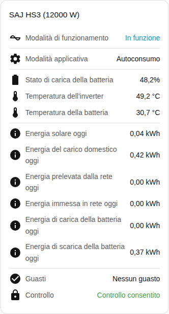

[en](../../../en-gb/user/cards/status-card.md) | [de](../../../de/user/cards/status-card.md) | [nl](../../../nl/user/cards/status-card.md) | [fr](../../../fr/user/cards/status-card.md) | [zh](../../../zh-hans/user/cards/status-card.md) | [es](../../../es/user/cards/status-card.md) | it | [pl](../../../pl/user/cards/status-card.md) | [sv](../../../sv/user/cards/status-card.md)

# Scheda stato

La pagina Scheda stato spiega la scheda stato, che riassume un sistema in un unico posto. L'elenco completo è nella sezione [Scheda stato](../../../../frontend/docs/features.md#status-card) dell'elenco delle funzionalità delle schede. [Aggiungere un elemento](README.md#aggiungere-un-elemento) spiega come aggiungere la scheda e scegliere un sistema.

## Che cosa mostra la scheda

- Lo stato di funzionamento, colorato in base a quanto lo stato è sano, e la modalità applicativa.
- Lo stato di carica della batteria, le temperature dell'inverter e della batteria e la modalità off-grid.
- Con Mostra l'energia di oggi attivo, che è il valore predefinito, la scheda mostra l'energia di oggi solare, della casa, prelevata dalla rete, immessa nella rete, di carica della batteria e di scarica della batteria.
- Il numero di apparecchiature con un guasto attivo, oppure che non ci sono guasti. Vedi i [guasti dell'apparecchiatura](../faults-and-repairs.md#guasti-dellapparecchiatura).
- Se il controllo è consentito per il sistema. Vedi [Consenti controllo](../changing-settings.md#consentire-il-controllo).

## Differenze tra i modelli

- **Solo H2:** quando la modalità applicativa che l'inverter esegue differisce dalla modalità che hai scelto, la scheda mostra anche la modalità in esecuzione ora. La riga compare solo quando l'entità Modalità applicativa (in vigore) è abilitata. Quell'entità viene creata disabilitata. Vedi il [riferimento delle entità](../entities/README.md).

## Opzioni

| Opzione nell'editor | Chiave YAML | Valore predefinito |
| --- | --- | --- |
| Sistema | `device` | Il primo sistema |
| Mostra l'energia di oggi | `show_energy` | Attivo |

## Non ancora supportato

- La modifica di un'impostazione dalla scheda. La scheda stato mostra soltanto. Usa la [scheda controlli](controls-card.md) per cambiare le impostazioni.
