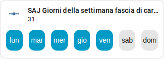

[en](../../../en-gb/user/cards/weekdays-feature.md) | [de](../../../de/user/cards/weekdays-feature.md) | [nl](../../../nl/user/cards/weekdays-feature.md) | [fr](../../../fr/user/cards/weekdays-feature.md) | [zh](../../../zh-hans/user/cards/weekdays-feature.md) | [es](../../../es/user/cards/weekdays-feature.md) | it | [pl](../../../pl/user/cards/weekdays-feature.md) | [sv](../../../sv/user/cards/weekdays-feature.md)

# Funzione giorni della settimana per la scheda tile

La pagina Funzione giorni della settimana per la scheda tile spiega la funzione giorni della settimana, che pone sette pulsanti dei giorni su una scheda tile per impostare i giorni di una fascia. L'elenco completo è nella sezione [Funzione giorni della settimana per la scheda tile](../../../../frontend/docs/features.md#weekdays-tile-card-feature) dell'elenco delle funzionalità delle schede. I giorni di una fascia sono le entità Giorni della settimana delle fasce di carica, di scarica e del caricatore EV, elencate nelle aree [Batteria](../entities/battery.md) e [Caricatore EV](../entities/ev-charger.md) del riferimento delle entità.



## Aggiungere la funzione

1. Aggiungi una scheda tile a una plancia e scegli l'entità Giorni della settimana di una fascia come entità della scheda tile.
2. Apri le funzioni della scheda tile, scegli Aggiungi funzione e seleziona Giorni della settimana SAJ Local.

La funzione viene offerta solo per una scheda tile la cui entità è l'entità dei giorni della settimana di una fascia. La funzione non ha opzioni.

```yaml
type: tile
entity: number.saj_charge_slot_1_days
features:
  - type: custom:saj-local-weekdays-feature
```

L'ID entità nell'esempio non ha prefisso. Se imposti un [prefisso](../entities-and-prefix.md#il-prefisso), l'ID dell'entità ha il prefisso dopo `saj_`.

## Come funzionano i pulsanti

- Sette pulsanti dei giorni con nome iniziano dal tuo primo giorno della settimana, che deriva dalle impostazioni di Home Assistant o dalla tua lingua.
- SAJ Local invia la modifica 1,5 secondi dopo l'ultima pressione, così puoi scegliere più giorni in una sola modifica.
- L'inverter memorizza i giorni come un solo numero che non si sposta con il tuo primo giorno della settimana. Il lunedì è il bit più basso e la domenica il più alto su ogni modello, quindi da lunedì a venerdì è 31, come nella schermata, e lunedì, mercoledì e venerdì è 21.
- I pulsanti sono disabilitati finché [Consenti controllo](../changing-settings.md#consentire-il-controllo) è disattivato per il sistema.

La [scheda pianificazione](schedule-card.md) usa i pulsanti nell'editor delle fasce.

## Non ancora supportato

- Qualsiasi entità diversa dall'entità dei giorni della settimana di una fascia. SAJ Local non offre la funzione per altre schede tile.
