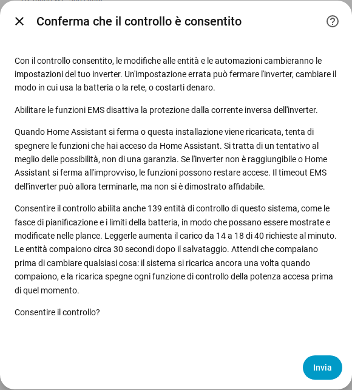

[en](../../en-gb/user/changing-settings.md) | [de](../../de/user/changing-settings.md) | [nl](../../nl/user/changing-settings.md) | [fr](../../fr/user/changing-settings.md) | [zh](../../zh-hans/user/changing-settings.md) | [es](../../es/user/changing-settings.md) | it | [pl](../../pl/user/changing-settings.md) | [sv](../../sv/user/changing-settings.md)

# Modifica delle impostazioni

La pagina Modifica delle impostazioni spiega come consentire a SAJ Local di cambiare le impostazioni del tuo inverter, che cosa succede a una modifica e quali modifiche vengono sempre rifiutate. Gli elenchi completi sono nelle sezioni [Modifica delle impostazioni](../../../custom_components/saj_local/docs/features.md#changing-settings) ed [EMS](../../../custom_components/saj_local/docs/features.md#ems) dell'elenco delle funzionalità dell'integrazione. Le impostazioni e i comandi sono distribuiti nelle aree del [riferimento delle entità](entities/README.md), soprattutto [Impostazioni](entities/settings.md) e [Batteria](entities/battery.md).

La scrittura sull'inverter è disattivata finché non consenti il controllo per un sistema. Finché Consenti controllo è disattivato, le impostazioni mostrano il valore attuale ma rifiutano ogni modifica, con un messaggio che indica dove attivare il controllo. Non viene inviato nulla all'inverter.

## Consentire il controllo

1. Apri Configura, l'ingranaggio sulla riga del sistema nella pagina dell'integrazione SAJ Local. Puoi anche attivare Consenti controllo mentre aggiungi il sistema.
2. Attiva Consenti controllo e scegli Invia.
3. Leggi la conferma, poi scegli di nuovo Invia.

La conferma avverte che un'impostazione errata può fermare l'inverter, cambiare il modo in cui l'inverter usa la batteria o la rete, o costarti denaro. La conferma dice anche che:

- Abilitare le funzioni EMS disattiva la protezione dalla corrente inversa dell'inverter.
- Quando Home Assistant si ferma, o il sistema viene ricaricato, SAJ Local tenta di spegnere le funzioni che hai acceso da Home Assistant. Lo spegnimento è un tentativo al meglio delle possibilità e non una garanzia.
- Consentire il controllo abilita le entità di controllo, e la lettura delle entità aumenta il carico di richieste. La finestra mostra il numero di entità e il carico prima e dopo.

Solo HS3: la conferma durante la configurazione chiede anche l'heartbeat EMS. In Configura l'heartbeat è un campo del modulo principale. Vedi [EMS](#ems).

Disattivare Consenti controllo non richiede conferma. Ogni sistema ha un sensore binario Controllo consentito, nella categoria diagnostica, che è acceso finché il sistema accetta modifiche. Le [schede della plancia](cards/README.md) leggono il sensore e bloccano i controlli finché il sensore è spento. Il sensore è di sola lettura, perché un interruttore in una plancia attiverebbe la scrittura senza l'avvertenza.

## L'insieme dei controlli

La maggior parte delle fasce di pianificazione e molte impostazioni vengono create disabilitate, quindi una scheda della plancia non avrebbe nulla da mostrare o modificare. Attivare Consenti controllo abilita quindi anche l'insieme dei controlli del sistema:

- le fasce di carica, di scarica e del caricatore EV (le fasce del caricatore EV sono solo HS3);
- la modalità applicativa e le impostazioni a fasce orarie;
- i limiti della batteria e i limiti della rete;
- le impostazioni del caricatore EV (solo HS3);
- gli interruttori e gli obiettivi del controllo della potenza, vedi il [controllo della potenza](power-control.md);
- la modalità LED, il cicalino (solo H2) e i pulsanti Sincronizza l'orologio e Cancella il guasto attuale.

Le letture dei moduli batteria e le altre entità di sola lettura non fanno parte dell'insieme.

- **Le entità compaiono dopo circa 30 secondi.** Home Assistant ricarica un sistema 30 secondi dopo che un'entità del sistema è stata abilitata. Attendi che le entità compaiano prima di cambiare qualsiasi cosa, perché la ricarica spegne ogni funzione di controllo della potenza che hai acceso nel frattempo. Segue un'altra ricarica quando più tardi compare un nuovo elemento dell'insieme, come le fasce del caricatore EV dopo il rilevamento di un caricatore EV.
- **Disattivare Consenti controllo** disabilita le entità che SAJ Local ha abilitato, e non segue alcuna ricarica.
- **Vince la tua scelta.** Un'entità che hai disabilitato prima di attivare il controllo resta disabilitata, e un'entità che hai abilitato tu resta abilitata. Una scheda considera esclusa una fascia con un'entità disabilitata.

## Che cosa succede a una modifica

SAJ Local controlla una modifica prima di inviare qualsiasi cosa. SAJ Local rifiuta la modifica, con un messaggio distinto per ogni caso, quando:

- Consenti controllo è disattivato;
- il modello non è verificato. Un sistema con un modello che non è stato possibile verificare non viene mai scritto, vedi [inizia](getting-started.md#quando-linverter-non-viene-riconosciuto);
- l'impostazione è un'impostazione di messa in servizio;
- il valore non è valido;
- l'inverter non è raggiungibile;
- il limite di scrittura è raggiunto. Non più di 20 modifiche vanno a un indirizzo di inverter in 60 secondi, e una modifica oltre il limite viene rifiutata e non messa in coda.

Ogni messaggio dice che l'inverter non è stato modificato. Altrimenti SAJ Local scrive la modifica una volta e rilegge il valore, e l'entità mostra il valore che l'inverter contiene.

| Che cosa è successo | Che cosa vedi |
| --- | --- |
| L'inverter ha rifiutato la modifica | Il messaggio indica il codice di eccezione. |
| L'inverter non ha risposto | Il messaggio dice che la modifica può essere stata applicata oppure no. SAJ Local non invia nulla di nuovo e rilegge l'inverter dopo la riconnessione. |
| L'inverter contiene un valore diverso | L'entità mostra il valore che l'inverter contiene, e la modifica fallisce. |

Una modifica a una sola impostazione di un registro che ne contiene diverse lascia invariate le altre impostazioni del registro.

## Che cosa puoi cambiare

- La modalità applicativa, sette fasce di carica e sette fasce di scarica (ciascuna con inizio, fine, potenza, giorni e acceso o spento), la modalità di inattività a fasce orarie e la scarica verso la rete, e la riserva per il backup.
- I limiti di carica e di scarica della batteria, il risveglio automatico della batteria, il limite di immissione, i limiti di potenza di prelievo e di immissione dalla rete e le potenze della modalità passiva.
- Solo HS3: le impostazioni del caricatore EV e sette fasce del caricatore EV.
- Solo H2: il cicalino e il limite della potenza di carica forzata della batteria. Entrambi i modelli hanno la modalità LED.
- Comandi, come pulsanti creati disabilitati: Cancella il guasto attuale, Riavvia l'inverter e Sincronizza l'orologio, che invia l'ora locale di Home Assistant. Solo HS3: Rimuovi il limite EMS della potenza solare.

Le [schede della plancia](cards/controls-card.md) offrono le impostazioni condivise in un unico posto. La scheda controlli non ha un pulsante di riavvio, quindi un tocco su una plancia non può riavviare l'inverter.

## Impostazioni di messa in servizio

Le impostazioni di messa in servizio vengono mostrate e non possono essere cambiate da Home Assistant: il contatore, RS485, il protocollo della batteria, la rete e il collegamento del caricatore EV, e sull'H2 anche il tipo di rete, la configurazione in parallelo, le modalità di ingresso, i limiti di protezione e altre impostazioni dell'installatore. Un valore errato può isolare l'inverter dal contatore, dalla batteria, dal caricatore o da Home Assistant. Le impostazioni di messa in servizio sono sensori di sola lettura nella categoria diagnostica. Esegui tali modifiche nell'app SAJ elekeeper, vedi il [requisito](../../../custom_components/saj_local/docs/requirements.md#changing-settings).

## Non ancora supportato

- Il ripristino di fabbrica e la cancellazione della cronologia dell'energia. SAJ Local non offre né l'uno né l'altra.
- La modifica delle impostazioni di messa in servizio.
- La modifica delle impostazioni su un sistema con un modello non verificato.

## EMS

Solo HS3: EMS pone l'inverter sotto controllo esterno. L'H2 non ha entità EMS. SAJ Local offre come entità il timeout EMS e cinque limiti: la corrente di carica e di scarica della batteria, la potenza di prelievo e di immissione dell'inverter e la potenza solare. I limiti si possono impostare, e SAJ Local non esegue il polling dei limiti. Tra un heartbeat e l'altro i limiti mostrano l'ultimo valore che SAJ Local ha inviato, e prima della prima modifica i limiti sono sconosciuti. Il [controllo della potenza](power-control.md) accende e spegne le funzioni EMS.

- **L'heartbeat mantiene attiva una funzione.** SAJ Local legge l'obiettivo di ogni funzione EMS che hai acceso da Home Assistant, e i limiti, a ogni intervallo di heartbeat. La lettura conta come attività EMS, quindi l'heartbeat non scrive nulla.
- **L'intervallo è di 60 secondi per impostazione predefinita.** Puoi impostare da 30 a 3600 secondi, nella conferma di Consenti controllo durante la configurazione e in Configura.
- **Il timeout deve essere più lungo dell'heartbeat.** Una funzione non può essere accesa finché il timeout EMS dell'inverter non è più lungo dell'heartbeat, e il timeout non può essere impostato così basso.
- **Spegnimento all'arresto.** Quando SAJ Local viene scaricato o Home Assistant si ferma, SAJ Local spegne le funzioni EMS che hai acceso. Una funzione che era già accesa quando SAJ Local è stato caricato viene lasciata com'è.
- **Lo spegnimento è un tentativo al meglio delle possibilità.** Quando l'inverter non è raggiungibile, o Home Assistant si ferma all'improvviso, le funzioni restano accese. Il timeout EMS dell'inverter può terminare le funzioni, ma SAJ Local non fa affidamento sul timeout, vedi [testato su hardware reale](#testato-su-hardware-reale).

## Testato su hardware reale

Le note qui sotto indicano quali impostazioni sono state provate su un inverter reale, e quali si basano solo su segnalazioni sul campo o sui documenti del protocollo SAJ.

HS3, scritte un registro alla volta su un HS3 reale e rilette:

- La Modalità applicativa, lo Stato di carica di riserva per il backup, la Potenza di carica della batteria in modalità passiva, il Timeout EMS, i quattro bit di abilitazione EMS che il [controllo della potenza](power-control.md) scrive, e i tre obiettivi EMS e i cinque limiti EMS.
- Sull'HS3, la Potenza di carica della batteria in modalità passiva imposta la potenza della modalità Backup.
- La modalità applicativa EMS da sola lascia l'inverter inattivo, con la casa alimentata dalla rete, e l'inverter non esce da EMS da solo.
- Il timeout EMS ha terminato EMS dopo 5 secondi, ma non ha terminato EMS a 20 o 60 secondi mentre un altro client interrogava l'inverter. SAJ Local non fa affidamento sul timeout.
- Il limite di potenza solare ha effetto solo mentre una funzione EMS è accesa.
- Quando una funzione EMS si ferma, l'inverter torna alla modalità applicativa in cui funzionava prima.
- Fasce orarie (BMS) è la modalità che l'HS3 comunica quando l'app SAJ seleziona la modalità TOU (BMS) dell'app, che non è la modalità a fasce orarie dell'app. SAJ Local non ha mai scritto Fasce orarie (BMS) su un inverter.

H2, costruito da segnalazioni sul campo di unità H2 e dal documento del protocollo H2, e non provato da questo progetto:

- Il controllo della potenza, che usa la modalità passiva, le fasce di pianificazione, la modalità applicativa, le potenze della modalità passiva, i limiti della batteria, i limiti di potenza della rete e il limite di immissione.
- Riduzione dei picchi: le segnalazioni sul campo mostrano Riduzione dei picchi selezionata nell'app SAJ, rilevata e scritta tramite Modbus. Il documento del protocollo H2 non elenca la Riduzione dei picchi.
- Risparmio AI è la modalità che l'H2 comunica quando l'app SAJ seleziona il risparmio AI. SAJ Local non ha mai scritto Risparmio AI su un inverter.

Mai provato su un inverter reale:

- la modalità LED, il cicalino dell'H2 e il limite della potenza di carica forzata della batteria dell'H2;
- ogni altra impostazione non citata in questa sezione;
- ogni modifica che scrive più di un registro;
- ogni comando.
