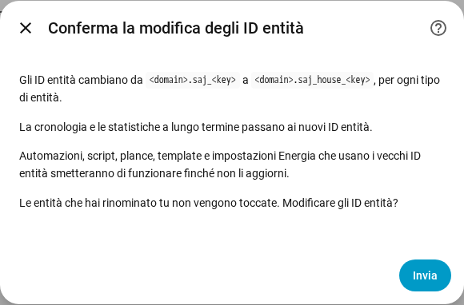

[en](../../en-gb/user/entities-and-prefix.md) | [de](../../de/user/entities-and-prefix.md) | [nl](../../nl/user/entities-and-prefix.md) | [fr](../../fr/user/entities-and-prefix.md) | [zh](../../zh-hans/user/entities-and-prefix.md) | [es](../../es/user/entities-and-prefix.md) | it | [pl](../../pl/user/entities-and-prefix.md) | [sv](../../sv/user/entities-and-prefix.md)

# Entità e prefisso

La pagina Entità e prefisso spiega che cosa sono le entità di un sistema, come si formano gli ID entità e come aggiungere un prefisso agli ID entità. Gli elenchi completi sono nelle sezioni [Dispositivi ed entità](../../../custom_components/saj_local/docs/features.md#devices-and-entities) ed [ID entità e prefisso](../../../custom_components/saj_local/docs/features.md#entity-ids-and-prefix) dell'elenco delle funzionalità dell'integrazione. Ogni nome di entità, ID, modello e impostazione predefinita è nel [riferimento delle entità](entities/README.md).

## Le entità di un sistema

Ogni lettura, impostazione e comando che SAJ Local conosce per il tuo modello è un'entità del dispositivo del sistema. Ogni entità ha il tipo che gli utenti di Home Assistant si aspettano per la lettura o l'impostazione: un sensore, un sensore binario, un numero, una selezione, un interruttore, un'ora o un pulsante. Un'impostazione appare con il vero tipo di controllo dell'impostazione, quindi un limite è un numero e un'impostazione acceso o spento è un interruttore.

- **Solo un insieme essenziale è abilitato.** Le letture di potenza, tensione, temperatura e stato di carica, i contatori di energia, i principali limiti della batteria e ogni guasto sono abilitati. Tutto il resto viene creato disabilitato.
- **Un'entità disabilitata non viene letta.** Abilitare un'entità aggiunge l'entità alla lettura successiva. Disabilitare un'entità ferma la lettura del registro. Il [polling](polling.md) mostra quanto costa una scelta all'inverter.
- **Un sistema riceve solo le entità adatte.** Un H2 con una sola stringa solare non ha entità della seconda stringa. Le apparecchiature non installate non creano entità, vedi le [apparecchiature opzionali](optional-equipment.md).
- **Impostazioni e diagnostica sono raggruppate.** Le impostazioni sono nella categoria configurazione. Versioni, impostazioni di messa in servizio e impostazioni di rete sono nella categoria diagnostica.
- **Un'opzione sconosciuta appare come sconosciuta.** Il codice dell'opzione è nel [download della diagnostica](troubleshooting.md#download-della-diagnostica), così l'opzione può essere segnalata.

Quando imposti il modello a mano per un inverter non riconosciuto, il sistema riceve ogni entità del modello scelto, con le entità oltre una fase e due stringhe solari disabilitate. Vedi [inizia](getting-started.md#quando-linverter-non-viene-riconosciuto).

## Segno della potenza

La potenza della batteria e la potenza della rete usano un solo segno su ogni modello, quindi una lettura ha un solo significato su un HS3 e su un H2.

- **La potenza della batteria** è positiva mentre la batteria scarica ed è negativa mentre la batteria carica.
- **La potenza della rete** è positiva mentre il sistema immette ed è negativa mentre il sistema preleva. Il Contatore A segue il segno della rete.
- **Il Contatore B** è positivo mentre produce l'inverter solare che il Contatore B misura.

Gli obiettivi del [controllo della potenza](power-control.md) seguono i segni delle letture.

## Il prefisso

Ogni ID entità ha la forma `<type>.saj_<key>`, per esempio `sensor.saj_pv_power`. Rinominare il nome visualizzato di un'entità non cambia l'ID.

Un prefisso aggiunge una parola dopo `saj_` in ogni ID entità di un sistema, per esempio `sensor.saj_house_pv_power`. Usa un prefisso quando hai più di un sistema SAJ, così nessun ID entità richiede l'aggiunta di un numero.

- Usa solo lettere minuscole e cifre, fino a 32 caratteri.
- Due sistemi non possono condividere un prefisso, e un solo sistema può non averne.
- Un prefisso che sarebbe in conflitto con il nome di un'entità, come `battery`, viene rifiutato.
- La configurazione viene rifiutata quando un ID entità che il sistema creerebbe è già in uso.

### Aggiungere, cambiare o rimuovere un prefisso

1. Apri Configura, l'ingranaggio sulla riga del sistema nella pagina dell'integrazione SAJ Local.
2. Cambia il campo Prefisso e scegli Invia.
3. Leggi la conferma, poi scegli di nuovo Invia.

La conferma mostra il vecchio e il nuovo schema. Automazioni, script, plance, template e impostazioni Energia che usano i vecchi ID entità smettono di funzionare finché non aggiorni i riferimenti.

Dopo la conferma:

- SAJ Local rinomina ogni entità del sistema, abilitata o disabilitata, e Home Assistant sposta la cronologia e le statistiche a lungo termine sui nuovi ID.
- Un'entità che hai rinominato tu viene lasciata com'è.
- Le [schede della plancia](cards/README.md) continuano a funzionare, perché le schede trovano le entità tramite il registro delle entità e non tramite l'ID.

SAJ Local rifiuta la modifica e non rinomina nulla quando un nuovo ID è già in uso, o quando Home Assistant contiene già statistiche a lungo termine con un nuovo ID, per esempio da un sistema che hai eliminato e che aveva il prefisso.

Se una versione successiva aggiunge un'entità e l'ID dell'entità è già in uso, Home Assistant aggiunge un numero all'ID, e un avviso nel log indica il tipo e la chiave dell'entità.

## Non ancora supportato

- La scelta della parte chiave di un ID entità. SAJ Local fissa la chiave, così plance e automazioni funzionano in modo identico su ogni modello.
