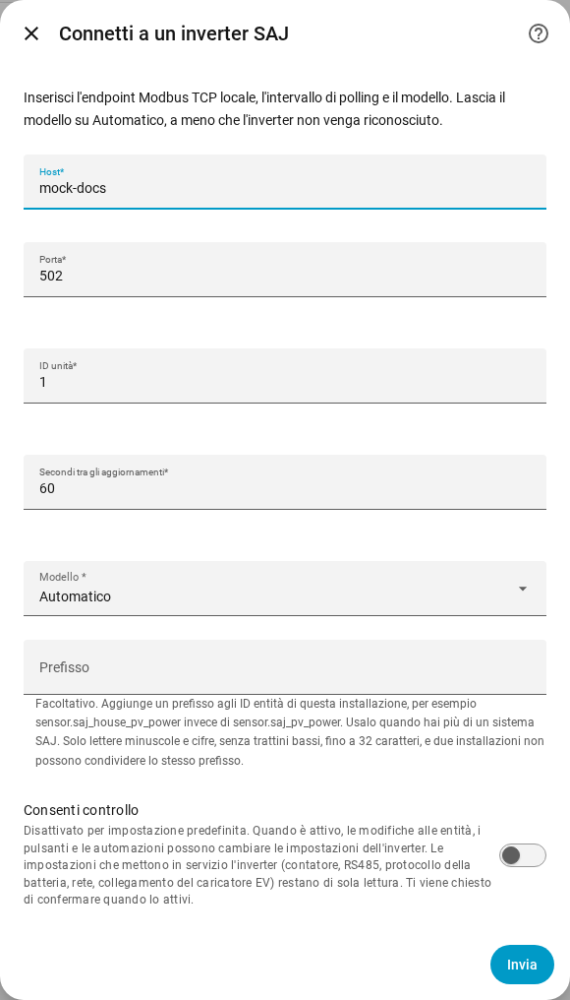
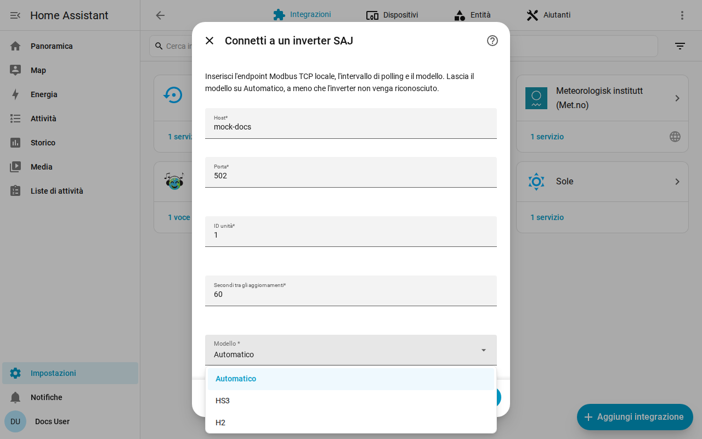

[en](../../en-gb/user/getting-started.md) | [de](../../de/user/getting-started.md) | [nl](../../nl/user/getting-started.md) | [fr](../../fr/user/getting-started.md) | [zh](../../zh-hans/user/getting-started.md) | [es](../../es/user/getting-started.md) | it | [pl](../../pl/user/getting-started.md) | [sv](../../sv/user/getting-started.md)

# Inizia

La pagina Inizia aggiunge il tuo sistema SAJ a Home Assistant e spiega che cosa ottieni dopo. L'elenco completo di ciò che fa la configurazione è nella sezione [Configurazione e rilevamento](../../../custom_components/saj_local/docs/features.md#setup-and-detection) dell'elenco delle funzionalità dell'integrazione. [Installa prima SAJ Local](installation.md) e controlla che il tuo inverter sia tra le [apparecchiature supportate](supported-equipment.md).

## Aggiungere un sistema

1. In Home Assistant, apri Impostazioni, poi Dispositivi e servizi.
2. Scegli Aggiungi integrazione e cerca SAJ Local.
3. Compila il modulo e scegli Invia.

| Campo | Che cosa inserire |
| --- | --- |
| Host | Il nome host o l'indirizzo IP dell'inverter. |
| Porta | La porta Modbus TCP. Il valore predefinito è 502. |
| ID unità | L'ID unità Modbus, da 1 a 247. Il valore predefinito è 1. |
| Secondi tra gli aggiornamenti | Ogni quanto viene letta ogni entità abilitata. Il valore predefinito è 60 e il minimo è 10. Vedi il [polling](polling.md). |
| Modello | Lascia su Automatico. SAJ Local riconosce l'HS3 e l'H2 monofase dal tipo di dispositivo comunicato dall'inverter. |
| Prefisso | Facoltativo. Lascia vuoto per il primo sistema. Vedi [entità e prefisso](entities-and-prefix.md#il-prefisso). |
| Consenti controllo | Disattivato per impostazione predefinita, quindi nulla può cambiare un'impostazione. Vedi [modifica delle impostazioni](changing-settings.md). |

SAJ Local si connette all'inverter, legge l'identità dell'inverter e sei letture principali (modalità di funzionamento, stato di carica della batteria, potenza della casa, potenza solare, potenza della batteria e potenza della rete) e crea il sistema. Un registro che manca a un'unità non interrompe la configurazione. Il sistema ha come titolo SAJ seguito dal numero di serie dell'inverter.

Quando la configurazione non riesce, il modulo indica che cosa è andato storto: nessuna connessione, nessuna risposta in tempo, una lettura rifiutata, dati non validi, un dispositivo non riconosciuto o un modello che non corrisponde all'inverter. Non viene salvato nulla finché il controllo non viene superato.

## Che cosa ottieni

- Un dispositivo Home Assistant di nome SAJ. Il modello del dispositivo mostra il modello e la potenza nominale, per esempio HS3 (12000 W).
- Le entità adatte al tuo modello e alle tue apparecchiature. SAJ Local rileva per te la batteria, i contatori e le altre apparecchiature, vedi le [apparecchiature opzionali](optional-equipment.md).
- Solo un insieme essenziale di entità è abilitato. Tutto il resto viene creato disabilitato, così l'inverter non viene letto per valori che non hai chiesto. Abilita un'entità in Home Assistant e la lettura successiva include l'entità. Vedi [entità e prefisso](entities-and-prefix.md).
- Le [schede della plancia](cards/README.md), senza nulla da installare.

## Aggiungere un secondo sistema

Aggiungi di nuovo SAJ Local da Dispositivi e servizi. SAJ Local rifiuta un endpoint o un numero di serie dell'inverter già configurato. Dai a ogni sistema un [prefisso](entities-and-prefix.md#il-prefisso) diverso, così nessun ID entità richiede l'aggiunta di un numero.

## Quando l'inverter non viene riconosciuto

Quando l'inverter comunica un tipo di dispositivo che SAJ Local non riconosce, Automatico fallisce con un errore che ti chiede di scegliere il modello a mano. Scegli HS3 o H2 nel campo Modello.

- Una scelta che contraddice un inverter riconosciuto viene rifiutata. Scegli il modello indicato dall'errore, oppure Automatico.
- Per un inverter non riconosciuto, SAJ Local legge i registri richiesti e ti chiede di confermare il modello. I registri devono prima rispondere.
- Il dispositivo mostra poi il modello come non verificato. Le letture possono essere errate, perché SAJ Local non può confrontarle con il tipo di dispositivo, e ogni tentativo di cambiare un'impostazione viene rifiutato.

## Modificare un sistema in seguito

Apri Configura, l'ingranaggio sulla riga del sistema nella pagina dell'integrazione SAJ Local. Puoi cambiare host, porta, ID unità, intervallo di aggiornamento, modello, prefisso e Consenti controllo, e impostare ogni apparecchiatura. SAJ Local salva la modifica solo dopo che l'inverter risponde al nuovo endpoint. La [sostituzione dell'inverter](replacing-the-inverter.md) riguarda un nuovo inverter.

## Non ancora supportato

- Prodotti diversi dall'HS3 e dall'H2 monofase. Vedi le [apparecchiature supportate](supported-equipment.md).
- Il rilevamento dell'inverter sulla rete. Inserisci tu l'indirizzo dell'inverter.
