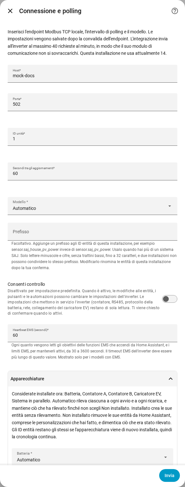

[en](../../en-gb/user/optional-equipment.md) | [de](../../de/user/optional-equipment.md) | [nl](../../nl/user/optional-equipment.md) | [fr](../../fr/user/optional-equipment.md) | [zh](../../zh-hans/user/optional-equipment.md) | [es](../../es/user/optional-equipment.md) | it | [pl](../../pl/user/optional-equipment.md) | [sv](../../sv/user/optional-equipment.md)

# Apparecchiature opzionali

La pagina Apparecchiature opzionali spiega come SAJ Local scopre quali apparecchiature opzionali ha il tuo inverter e come correggere il risultato. L'elenco completo è nella sezione [Apparecchiature opzionali](../../../custom_components/saj_local/docs/features.md#optional-equipment) dell'elenco delle funzionalità dell'integrazione. La pagina delle [apparecchiature supportate](supported-equipment.md) indica quale modello può avere che cosa, e il [riferimento delle entità](entities/README.md) indica quali entità aggiunge ogni apparecchiatura.

## Che cosa rileva SAJ Local

La configurazione non chiede nulla sulle apparecchiature. Ogni volta che SAJ Local viene caricato, e questo include ogni avvio di Home Assistant e ogni ricarica, SAJ Local chiede all'inverter che cosa è installato e crea entità solo per quelle apparecchiature.

| Apparecchiatura | Modelli |
| --- | --- |
| Batteria | HS3 e H2 |
| Contatore A, il contatore di rete | HS3 e H2 |
| Contatore B, il secondo contatore | HS3 e H2 |
| Sistema in parallelo | HS3 e H2 |
| Caricatore EV | Solo HS3 |

- **L'inverter non risponde al controllo:** SAJ Local presume una batteria e il Contatore A, e non presume le altre apparecchiature.
- **Un contatore è offline durante un riavvio:** le apparecchiature rilevate vengono ricordate, quindi l'apparecchiatura mantiene le proprie entità.
- **Apparecchiatura installata in seguito:** SAJ Local la rileva al riavvio o alla ricarica successivi.

## Quando un'apparecchiatura memorizzata non viene più rilevata

SAJ Local mantiene le entità dell'apparecchiatura, così cronologia e plance restano invariate, e solleva un problema da riparare in Home Assistant. Il problema nomina l'apparecchiatura e il sistema. Controlla l'apparecchiatura, oppure imposta l'apparecchiatura su Non installato come descritto qui sotto. Il problema scompare al caricamento successivo che rileva di nuovo l'apparecchiatura, o quando cambi l'impostazione.

## Correggere il rilevamento

1. Apri Configura, l'ingranaggio sulla riga del sistema nella pagina dell'integrazione SAJ Local.
2. Espandi la sezione Apparecchiature.
3. Imposta ogni apparecchiatura su Automatico, Installato o Non installato, poi scegli Invia.

La sezione elenca anche ciò che SAJ Local considera installato ora.

| Impostazione | Che cosa fa l'impostazione |
| --- | --- |
| Automatico | Rileva l'apparecchiatura a ogni avvio e a ogni ricarica, e mantiene ciò che è stato rilevato finché non scegli Non installato. Automatico è il valore predefinito. |
| Installato | Crea le entità dell'apparecchiatura senza rilevare l'apparecchiatura. |
| Non installato | Rimuove da Home Assistant le entità dell'apparecchiatura, comprese le modifiche che hai fatto alle entità, come un nuovo nome. SAJ Local dimentica ciò che era stato rilevato. |

Gli ID entità restano invariati, quindi la cronologia continua se imposti di nuovo l'apparecchiatura su Installato o Automatico. Le entità di un'apparecchiatura non installata non possono essere lette, interrogate né scritte.

La sezione elenca solo le apparecchiature che il tuo modello può avere. Solo HS3: il caricatore EV.

## Moduli batteria

- **H2:** un H2 comunica quanti moduli batteria ha, fino a cinque. SAJ Local crea le entità dei moduli per quel numero di moduli. Un conteggio di 0 mantiene le entità di ogni modulo. SAJ Local ricorda il conteggio più alto che ha visto. Ogni modulo ha entità di identità, create disabilitate.
- **HS3:** un HS3 ha entità per un modulo batteria.

## Caricatore EV

Solo HS3: un HS3 con un caricatore EV ottiene anche le letture, le impostazioni, le fasce di ricarica e i controlli di ricarica EMS del caricatore. La maggior parte viene creata disabilitata. Attivare Consenti controllo abilita le impostazioni e le fasce, vedi la [modifica delle impostazioni](changing-settings.md#linsieme-dei-controlli).

## Non ancora supportato

- Le apparecchiature che SAJ Local non rileva. Le apparecchiature nella tabella sono l'elenco completo.
- Il rilevamento di un caricatore EV su un H2.
