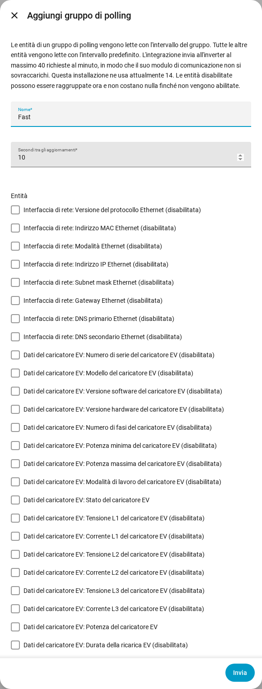

[en](../../en-gb/user/polling.md) | [de](../../de/user/polling.md) | [nl](../../nl/user/polling.md) | [fr](../../fr/user/polling.md) | [zh](../../zh-hans/user/polling.md) | [es](../../es/user/polling.md) | it | [pl](../../pl/user/polling.md) | [sv](../../sv/user/polling.md)

# Polling

La pagina Polling spiega ogni quanto SAJ Local legge l'inverter e come leggere alcune entità più velocemente o più lentamente. L'elenco completo è nella sezione [Polling](../../../custom_components/saj_local/docs/features.md#polling) dell'elenco delle funzionalità dell'integrazione. I limiti che si applicano a ogni richiesta sono nella pagina [protezione dell'inverter](protecting-the-inverter.md).

SAJ Local legge l'inverter tramite Modbus TCP sulla tua rete locale, con una pianificazione che controlli tu. Nulla esce dalla tua rete.

## L'intervallo predefinito

Ogni entità abilitata viene letta ogni 60 secondi per impostazione predefinita. Cambia il campo Secondi tra gli aggiornamenti in Configura, l'ingranaggio sulla riga del sistema nella pagina dell'integrazione SAJ Local. L'intervallo non è mai più breve di 10 secondi.

Vengono lette solo le entità abilitate. Disabilita un'entità in Home Assistant e il registro dell'entità non viene più letto.

## Gruppi di polling

Un gruppo di polling legge entità scelte più velocemente o più lentamente del valore predefinito. Usa un gruppo, per esempio, per leggere la potenza della casa, solare, della batteria e della rete ogni 10 secondi mentre tutto il resto resta a 60.

1. Apri il menu sulla riga del sistema nella pagina dell'integrazione SAJ Local e scegli Aggiungi gruppo di polling. Anche il pulsante Aggiungi gruppo di polling in alto nella pagina apre il modulo Aggiungi gruppo di polling.
2. Inserisci un nome, i secondi tra gli aggiornamenti (almeno 10) e le entità del gruppo.
3. Scegli Invia, leggi il riepilogo, poi scegli Salva il gruppo.

- **Qualsiasi entità:** un gruppo può contenere entità di qualsiasi tipo. Si può scegliere anche un'entità disabilitata, che non costa nulla finché non abiliti l'entità.
- **Al massimo un gruppo:** un'entità appartiene al massimo a un gruppo. Ogni entità senza gruppo resta sull'intervallo predefinito.
- **Ordine dei registri:** il modulo elenca le entità in ordine di registro, ciascuna con l'etichetta del blocco di registri da cui l'entità viene letta, così le entità che possono condividere una richiesta stanno vicine.
- **Modificare o eliminare:** apri il gruppo di polling dalla pagina dell'integrazione. Modificare o eliminare un gruppo mantiene le entità, i nomi delle entità e la cronologia delle entità.

Tutti gli intervalli di un sistema condividono un solo orologio, quindi le entità in scadenza insieme vengono lette insieme. Una lettura che sfora non viene recuperata. I cicli persi vengono scartati e il polling prosegue dal ciclo successivo.

## Il carico di richieste

SAJ Local invia a un inverter al massimo 40 richieste in 60 secondi. Il modulo mostra quanto costa la tua scelta, in richieste al minuto rispetto a quel limite. Il modulo qui sopra mostra come esempio un carico attuale di 14 richieste al minuto.

- **Prima di salvare un gruppo:** il passaggio di riepilogo mostra quante richieste richiede una lettura del gruppo, e il carico prima e dopo il salvataggio.
- **Oltre il limite:** puoi comunque salvare il gruppo. Il riepilogo avverte che le letture sono più lente di quanto hai configurato, perché SAJ Local non invia mai più del limite.
- **Un nuovo intervallo predefinito:** Configura ti chiede di confermare quando il nuovo intervallo porta il carico oltre il limite.
- **Meno richieste:** le entità che stanno insieme in un blocco di registri costano una richiesta. Le entità in blocchi diversi costano una richiesta ciascuna.

Abilitare un'entità in Home Assistant non può essere intercettato da un modulo. Il [download della diagnostica](troubleshooting.md#download-della-diagnostica) elenca in quel caso il carico pianificato rispetto al limite.

## Non ancora supportato

- Un gruppo di polling con un intervallo inferiore a 10 secondi.
