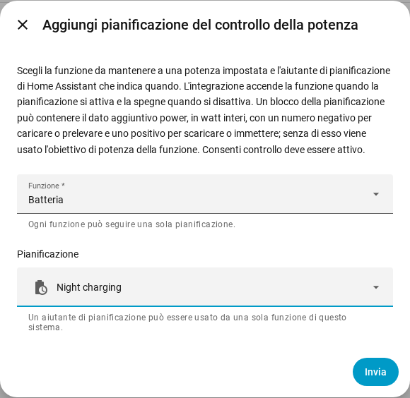

[en](../../en-gb/user/power-control.md) | [de](../../de/user/power-control.md) | [nl](../../nl/user/power-control.md) | [fr](../../fr/user/power-control.md) | [zh](../../zh-hans/user/power-control.md) | [es](../../es/user/power-control.md) | it | [pl](../../pl/user/power-control.md) | [sv](../../sv/user/power-control.md)

# Controllo della potenza

La pagina Controllo della potenza spiega come mantenere la batteria, il punto di collegamento alla rete o l'inverter a una potenza impostata, a mano o con una pianificazione di Home Assistant. L'elenco completo è nella sezione [Controllo della potenza](../../../custom_components/saj_local/docs/features.md#power-control) dell'elenco delle funzionalità dell'integrazione. Gli interruttori e gli obiettivi sono nelle [entità aggiunte dall'integrazione](entities/added-by-the-integration.md) del riferimento delle entità.

Il controllo della potenza funziona in un solo modo su ogni modello che offre una funzione. Il controllo della potenza non fa nulla finché [Consenti controllo](changing-settings.md#consentire-il-controllo) è disattivato o il modello non è verificato.

| Funzione | Che cosa la funzione mantiene alla potenza impostata | HS3 | H2 |
| --- | --- | --- | --- |
| Batteria | La batteria carica o scarica. | Sì | Sì |
| Rete | Il punto di collegamento alla rete preleva o immette. Richiede il Contatore A. | Sì | No |
| Inverter | L'inverter assorbe o eroga potenza. | Sì | No |

Una potenza positiva scarica, immette o eroga. Una potenza negativa carica, preleva o assorbe. I segni seguono il [segno della potenza](entities-and-prefix.md#segno-della-potenza) delle letture.

## Mantenere una funzione a una potenza

Ogni funzione ha un interruttore e un obiettivo di potenza in watt interi. Entrambi vengono creati disabilitati e sono nella categoria configurazione. Attivare Consenti controllo abilita gli interruttori e gli obiettivi, vedi [l'insieme dei controlli](changing-settings.md#linsieme-dei-controlli).

1. Imposta l'obiettivo di potenza della funzione. L'obiettivo viene arrotondato al passo più vicino che l'inverter supporta, e mostra la potenza che l'inverter mantiene.
2. Accendi la funzione. Una funzione ha bisogno di un obiettivo di potenza prima di poter essere accesa.
3. Per fermarla, spegni la funzione.

- L'obiettivo viene mantenuto tra i riavvii e viene inviato quando la funzione parte. Cambiare l'obiettivo mentre la funzione è in esecuzione invia subito la nuova potenza.
- Una sola funzione è in esecuzione alla volta. Accendere una funzione mentre un'altra è in esecuzione viene rifiutato, e il messaggio nomina la funzione in esecuzione.
- L'interruttore è acceso finché l'inverter segnala la funzione in esecuzione, anche quando la funzione è stata avviata fuori da Home Assistant.
- Un avvio che fallisce viene annullato. Un arresto che fallisce viene inviato di nuovo a ogni intervallo di heartbeat, finché l'inverter non segnala la funzione ferma.
- La [scheda controlli della plancia](cards/controls-card.md) mostra ogni funzione con un interruttore, un obiettivo e un suggerimento sul segno.

### Quando Home Assistant si ferma

Una funzione che hai acceso da Home Assistant viene spenta quando SAJ Local viene scaricato e quando Home Assistant si ferma. Una funzione che era già in esecuzione quando SAJ Local è stato caricato viene lasciata in esecuzione.

- Solo HS3: l'heartbeat EMS mantiene attiva la funzione. Dopo un arresto improvviso, il timeout EMS dell'inverter può terminare la funzione, ma SAJ Local non fa affidamento sul timeout. Vedi [EMS](changing-settings.md#ems).
- Solo H2: una funzione lasciata in esecuzione da un arresto improvviso continua a funzionare finché non spegni la funzione.

## Seguire una pianificazione

Una pianificazione del controllo della potenza fa seguire a una funzione un aiutante di pianificazione di Home Assistant. La funzione è accesa mentre la pianificazione è accesa e si spegne quando la pianificazione si spegne.

1. Crea un aiutante di pianificazione in Home Assistant: Impostazioni, Dispositivi e servizi, Aiutanti, Crea aiutante, Pianificazione. Imposta gli orari e i giorni della settimana della pianificazione.
2. Apri il menu sulla riga del sistema nella pagina dell'integrazione SAJ Local e scegli Aggiungi pianificazione del controllo della potenza.
3. Scegli la funzione e l'aiutante di pianificazione, poi scegli Invia.

Un blocco dell'aiutante di pianificazione può portare il dato aggiuntivo `power`, in watt interi con il segno indicato sopra, per esempio `power: -600` per caricare la batteria a 600 W. Senza `power`, SAJ Local usa l'obiettivo di potenza della funzione.

- Ogni funzione segue una sola pianificazione, e un aiutante di pianificazione comanda una sola funzione di un sistema.
- La pianificazione segue la ridenominazione dell'aiutante. Un aiutante che non è nel registro delle entità viene rifiutato, quindi scegli un aiutante che hai creato nell'interfaccia.
- SAJ Local rifiuta una pianificazione mentre Consenti controllo è disattivato.
- Cambia o rimuovi una pianificazione dalla pagina dell'integrazione. Il sistema si ricarica quando lo fai.

### Che cosa fa una pianificazione

| Situazione | Che cosa succede |
| --- | --- |
| La pianificazione si accende e nessuna funzione è in esecuzione | SAJ Local imposta la potenza dal blocco, oppure usa l'obiettivo di potenza, poi avvia la funzione. |
| Il blocco non ha `power` e la funzione non ha un obiettivo di potenza | Non parte nulla. L'azione resta in sospeso, con un avviso. |
| La funzione è già in esecuzione | SAJ Local cambia la potenza quando il blocco ne ha una, e prende in carico la funzione. |
| Un'altra funzione è in esecuzione | Non viene scritto nulla. L'azione resta in sospeso. |
| L'avvio viene rifiutato o fallisce | L'azione resta in sospeso. SAJ Local riprova a ogni intervallo di heartbeat. |
| Il `power` del blocco non è un numero intero nell'intervallo dell'obiettivo | Non parte nulla. L'azione resta in sospeso, con un avviso. |
| La pianificazione passa a un blocco con un altro `power` | SAJ Local cambia la potenza. |
| Spegni la funzione a mano mentre la pianificazione è accesa | La funzione resta spenta fino alla successiva accensione della pianificazione. |
| La pianificazione si spegne e SAJ Local aveva avviato la funzione | SAJ Local ferma la funzione. |

Senza nulla di richiesto e nulla in sospeso, SAJ Local non invia nulla. Il [download della diagnostica](troubleshooting.md#download-della-diagnostica) elenca ogni funzione, ogni pianificazione e l'azione in sospeso.

## Non ancora supportato

- Il controllo della potenza Rete e Inverter sull'H2.
- Più di una funzione alla volta.
- Più di una pianificazione per una funzione.
