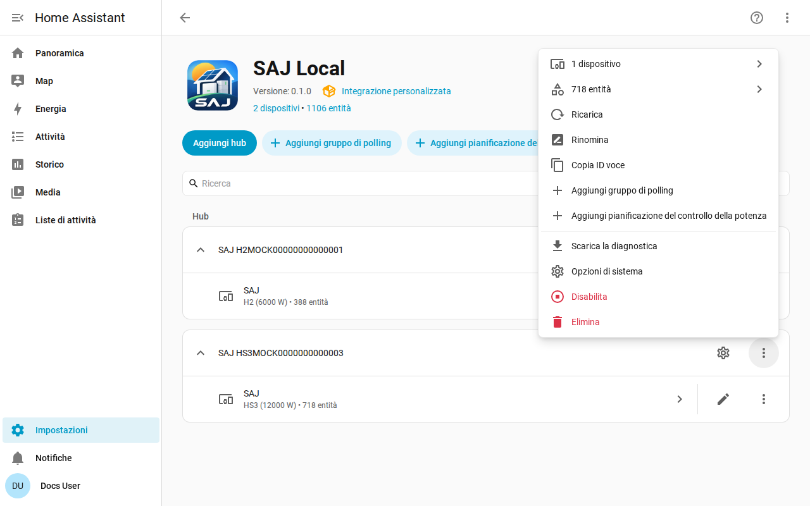

[en](../../en-gb/user/troubleshooting.md) | [de](../../de/user/troubleshooting.md) | [nl](../../nl/user/troubleshooting.md) | [fr](../../fr/user/troubleshooting.md) | [zh](../../zh-hans/user/troubleshooting.md) | [es](../../es/user/troubleshooting.md) | it | [pl](../../pl/user/troubleshooting.md) | [sv](../../sv/user/troubleshooting.md)

# Risoluzione dei problemi

La pagina Risoluzione dei problemi mostra come scaricare la diagnostica, attivare la registrazione di debug e leggere i problemi più comuni. L'elenco completo è nella sezione [Diagnostica e registrazione di debug](../../../custom_components/saj_local/docs/features.md#diagnostics-and-debug-logging) dell'elenco delle funzionalità dell'integrazione.

Il download della diagnostica e il log di debug mostrano che cosa restituisce l'inverter e che cosa ha fatto SAJ Local con le letture, senza rivelare chi sei o dove ti trovi. Entrambi usano gli strumenti di Home Assistant, quindi non serve installare nulla e non viene inviato nulla da nessuna parte.

## Parti dalle entità e dalle riparazioni

- Controlla in [Impostazioni e Riparazioni](faults-and-repairs.md#problemi-da-riparare) se c'è un problema da riparare per il sistema. Ogni problema dice che cosa non va e che cosa fare.
- Controlla i [guasti dell'apparecchiatura](faults-and-repairs.md#guasti-dellapparecchiatura) quando l'inverter segnala un problema.
- Le entità che risultano non disponibili dopo un rifiuto sono descritte nella [protezione dell'inverter](protecting-the-inverter.md#quando-linverter-rifiuta-una-lettura).

## Download della diagnostica

1. Apri Impostazioni, poi Dispositivi e servizi, poi SAJ Local.
2. Apri il menu sulla riga del sistema e scegli Scarica diagnostica.

Il file contiene:

- le entità abilitate, gli intervalli con le richieste che ciascuno comporta, e il carico pianificato rispetto al limite di 40 richieste al minuto;
- le entità rifiutate e sospese;
- i guasti attivi con le parole grezze dei guasti, e i bit di guasto non riconosciuti come registro e bit;
- i problemi da riparare aperti, e da quanto tempo l'inverter sta fallendo;
- le funzioni di controllo della potenza, quale è in esecuzione, quale è gestita da SAJ Local e l'azione in sospeso per ogni pianificazione;
- un'istantanea delle parole grezze di ogni registro che SAJ Local ha letto da quando il sistema è stato caricato, con l'età di ciascuna, così un manutentore può confrontare una lettura con il dispositivo reale;
- ogni richiesta che non ha ricevuto una risposta utilizzabile, con il motivo. Una richiesta scaduta ha un aspetto diverso da una richiesta che l'inverter ha rifiutato, e la differenza conta quando un altro client occupa la connessione dell'inverter.

L'istantanea non aggiunge alcuna richiesta all'inverter. L'istantanea parte vuota a ogni caricamento del sistema.

## Attivare la registrazione di debug

1. Apri la pagina dell'integrazione SAJ Local.
2. Apri il menu a tre puntini della pagina dell'integrazione e scegli Abilita registrazione di debug.
3. Quando la configurazione del sistema è fallita, ricarica il sistema dal menu del sistema, così il log copre la configurazione.
4. Riproduci il problema.
5. Scegli Disabilita registrazione di debug. Home Assistant scarica il log.

La registrazione di debug registra ogni connessione, polling, richiesta, scrittura, heartbeat e modifica di pianificazione, una riga per evento. Ogni riga del log inizia con il titolo del sistema e il numero di serie mascherato fino agli ultimi tre caratteri, così le righe di due sistemi si distinguono. Un titolo che contiene il numero di serie ha il numero di serie mascherato sul posto, per esempio `SAJ xxxxx123`.

## Che cosa il file e il log escludono

La diagnostica e i log non contengono mai l'host, la porta, l'ID unità, il numero di serie completo, l'indirizzo MAC, gli indirizzi di rete, il numero di serie del caricatore EV, il prefisso o i nomi dei gruppi di polling. Nell'istantanea dei registri, le parole dei registri che contengono gli indirizzi di rete e i numeri di serie sono sostituite dal marcatore di oscuramento di Home Assistant, così puoi vedere che il registro ha risposto senza vedere che cosa diceva.

## Problemi comuni

| Che cosa vedi | Che cosa controllare |
| --- | --- |
| La configurazione fallisce senza connessione o senza risposta | L'host, la porta e l'ID unità. Assicurati che nessun altro client Modbus occupi la connessione dell'inverter. |
| La configurazione dice che il dispositivo non è riconosciuto | Scegli il modello a mano. Vedi [inizia](getting-started.md#quando-linverter-non-viene-riconosciuto). |
| Un'impostazione rifiuta una modifica | Consenti controllo è disattivato, il modello non è verificato o l'impostazione è un'impostazione di messa in servizio. Il messaggio indica quale. Vedi la [modifica delle impostazioni](changing-settings.md). |
| Le letture sono più lente dell'intervallo impostato | Il carico supera il limite di 40 richieste al minuto. Vedi il [polling](polling.md#il-carico-di-richieste). |
| Un'entità che hai abilitato non ha ancora un valore | Home Assistant ricarica il sistema circa 30 secondi dopo che abiliti un'entità, e l'entità viene letta dalla lettura successiva. |
| Gli ID entità hanno ottenuto un numero | L'ID che l'entità voleva era già in uso. Vedi [entità e prefisso](entities-and-prefix.md#il-prefisso). |
| Mancano delle entità | L'apparecchiatura non è rilevata o è impostata su Non installato. Vedi le [apparecchiature opzionali](optional-equipment.md). |

## Aiuto e feedback

Domande, segnalazioni di errori e idee sono benvenute nell'[issue tracker](https://github.com/Counterphase-Labs/ha-saj-local/issues). Apri il modulo Bug report per un problema con l'integrazione e il modulo Card bug report per un problema con una scheda della plancia. Il modulo Bug report richiede il download della diagnostica. Segnala un problema di sicurezza in privato, vedi la [politica di sicurezza](../../../SECURITY.md).
