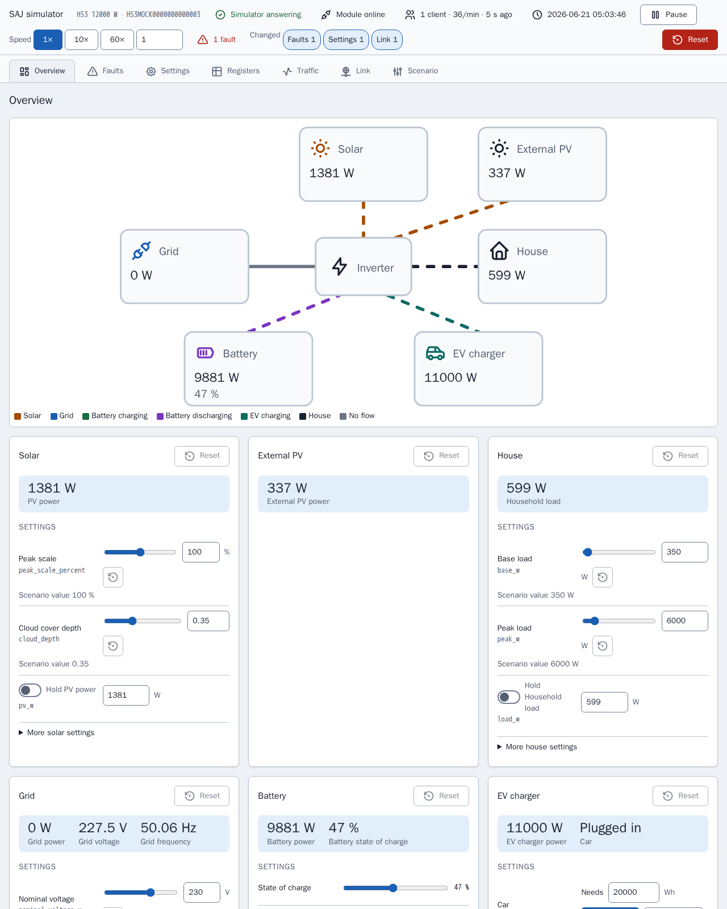

[en](../../en-gb/developer/README.md) | [de](../../de/developer/README.md) | nl | [fr](../../fr/developer/README.md) | [zh](../../zh-hans/developer/README.md) | [es](../../es/developer/README.md) | [it](../../it/developer/README.md) | [pl](../../pl/developer/README.md) | [sv](../../sv/developer/README.md)

# SAJ Local ontwikkelaarsdocumentatie

Hoe SAJ Local wordt gebouwd, gecontroleerd en uitgebracht, en waar de waarheid over elk onderdeel staat. De documentatie legt uit waarom het project zo is gebouwd en linkt naar het bestand dat elk feit bevat. Versies, commandolijsten en registerkaarten staan in de code en de configuratie, niet hier.

Begin met [CONTRIBUTING.md](../../../CONTRIBUTING.md) om een werkende checkout te krijgen en een wijziging in te sturen. SAJ Local is een uitsluitend lokale Home Assistant-integratie: SAJ Local praat via het lokale netwerk met de omvormer en voegt geen cloudservice of aanvullende SDK toe.

## Ontwikkelen zonder omvormer

De simulator is een vervangend SAJ-apparaat, dus voor het meeste werk is geen hardware nodig. Elke simulator serveert een pagina die toont wat het gesimuleerde systeem doet en waarmee een ontwikkelaar het systeem kan wijzigen terwijl Home Assistant pollt, zonder een scenario te bewerken en opnieuw te starten.

[Modbus-simulator](simulator.md) legt uit waarvoor de simulator dient en hoe u een scenario draait. [Simulatorpagina](simulator-page.md) toont elke weergave van de pagina.

## Pagina's

- [Modbus-simulator](simulator.md): waarvoor de simulator dient, scenario's en een ander systeem draaien.
- [Simulatorpagina](simulator-page.md): elke weergave van de pagina, de registerinspecteur, het verkeerslogboek, linkstoringen, presets en opgeslagen toestand.
- [Omgeving](environment.md): een checkout instellen en de ontwikkel-Home Assistant met de simulators draaien.
- [Controles](checks.md): de make-targets, de dekkingsdrempel en hoe u een run beperkt.
- [Architectuur](architecture.md): de SAJ-bibliotheek en de integratie, profielen, de catalogus, polling en stabiele namen.
- [Frontend](frontend.md): de bron van de kaarten, de build en de showcase-dashboards.
- [Documentatie](documentation.md): hoe deze pagina's, het gegenereerde entiteitenoverzicht en de schermafbeeldingen worden gemaakt en gecontroleerd.
- [Releasen](releasing.md): de ophoging van de Home Assistant-versie en de stappen voor een release.

De gebruikersdocumentatie staat in de [gebruikersdocumentatie](../user/README.md).

## Waar de waarheid staat

| Vraag | Autoriteit |
| --- | --- |
| Wat moet het project doen? | [Globale requirements](../../../.github/work/requirements.md), [requirements van de integratie](../../../custom_components/saj_local/docs/requirements.md), [requirements van de kaarten](../../../frontend/docs/requirements.md), [requirements van de simulator](../../../mock/docs/requirements.md) |
| Wat doet elk onderdeel vandaag? | [Functies van de integratie](../../../custom_components/saj_local/docs/features.md), [functies van de kaarten](../../../frontend/docs/features.md), [functies van de simulator](../../../mock/docs/features.md) |
| Hoe worden code, tests en documentatie geschreven? | [code-style.md](../../../.github/work/code-style.md) |
| Welke regels binden iedereen die hier werkt? | [AGENTS.md](../../../AGENTS.md) |
| Wat is gebouwd, en waarom? | [done/index.md](../../../.github/work/done/index.md) |
| Wat is gepland? | [.github/work/future/](../../../.github/work/future/) |
| Welke commando's bestaan er? | [Makefile](../../../Makefile) |
| Wat draait CI? | [ci.yml](../../../.github/workflows/ci.yml) |
| Python-afhankelijkheden en toolinstellingen | [pyproject.toml](../../../pyproject.toml) |
| Frontend-afhankelijkheden en scripts | [frontend/package.json](../../../frontend/package.json) |
| Ontwikkelservices | [compose.yaml](../../../compose.yaml) |

Bestaande code heeft geen gezag over requirements. Waar ze verschillen, is de code fout of wijzigt de eigenaar de requirement.

## Codestijl

[code-style.md](../../../.github/work/code-style.md) is de autoriteit. De documentatieregel van code-style.md bepaalt deze pagina's: leg uit waarom, niet hoe, en laat namen en typen de rest beschrijven.
