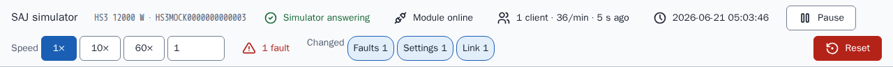
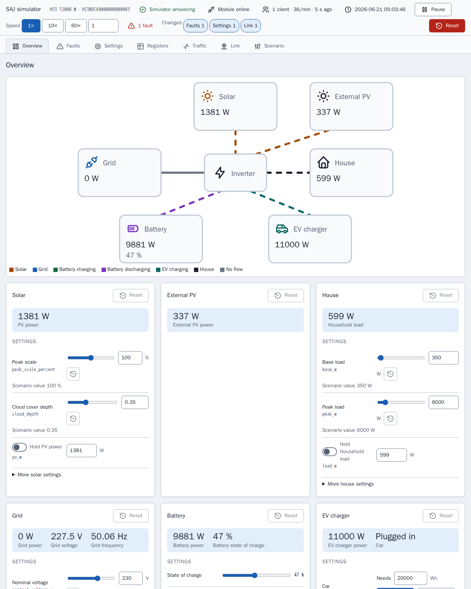
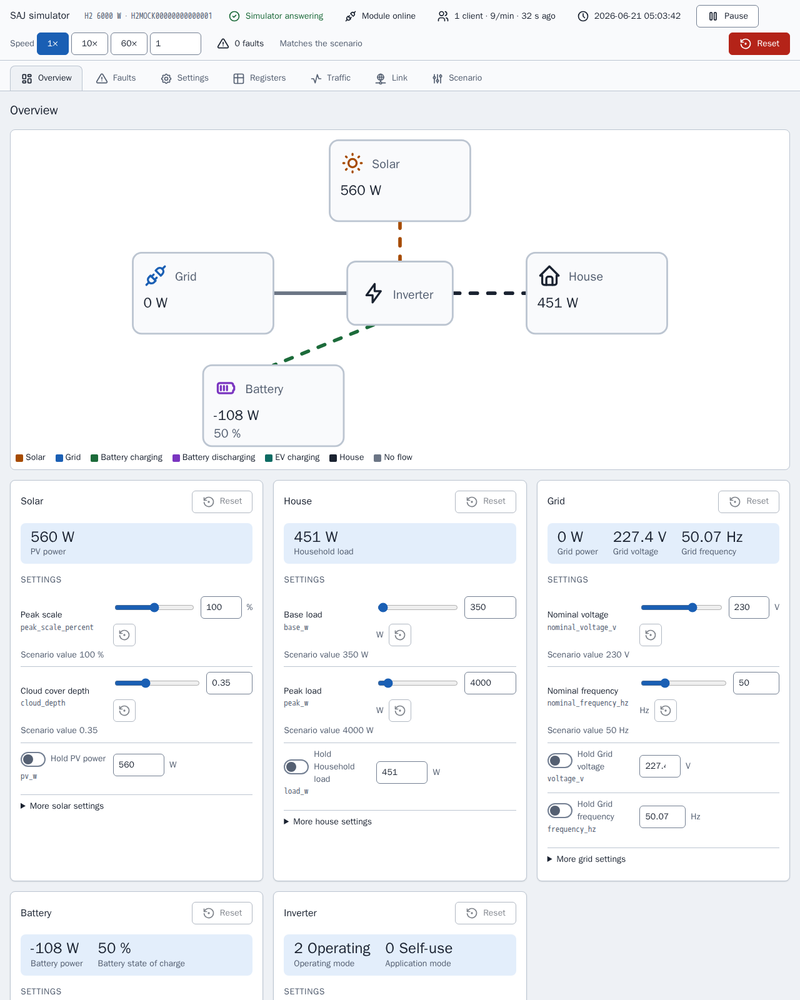
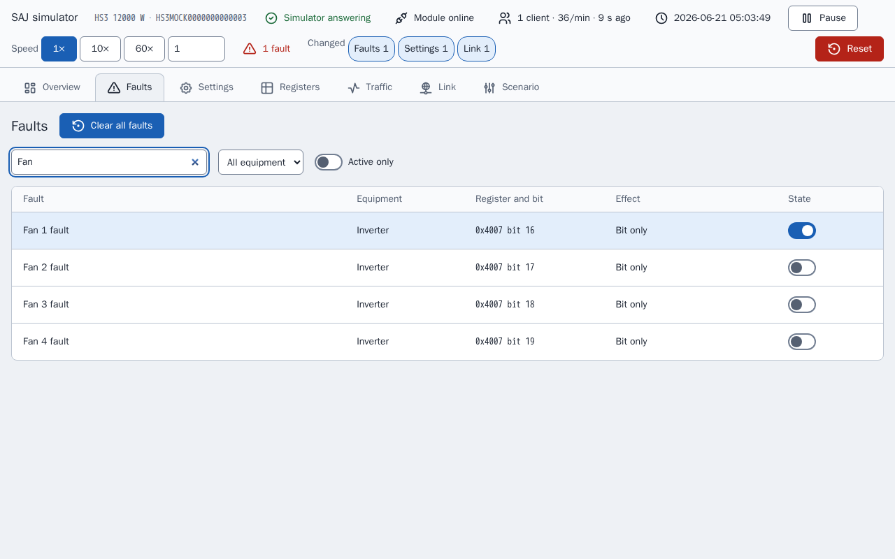
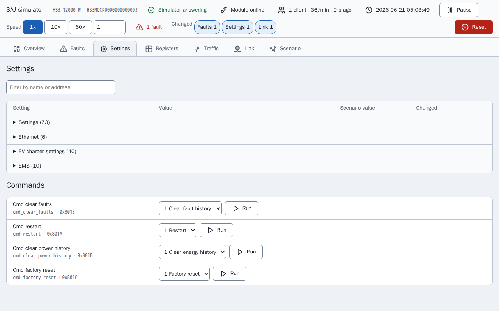
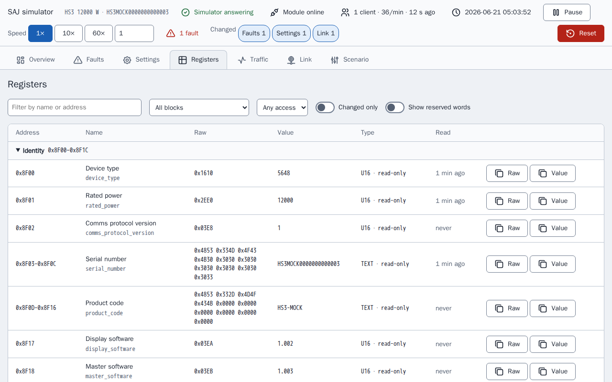
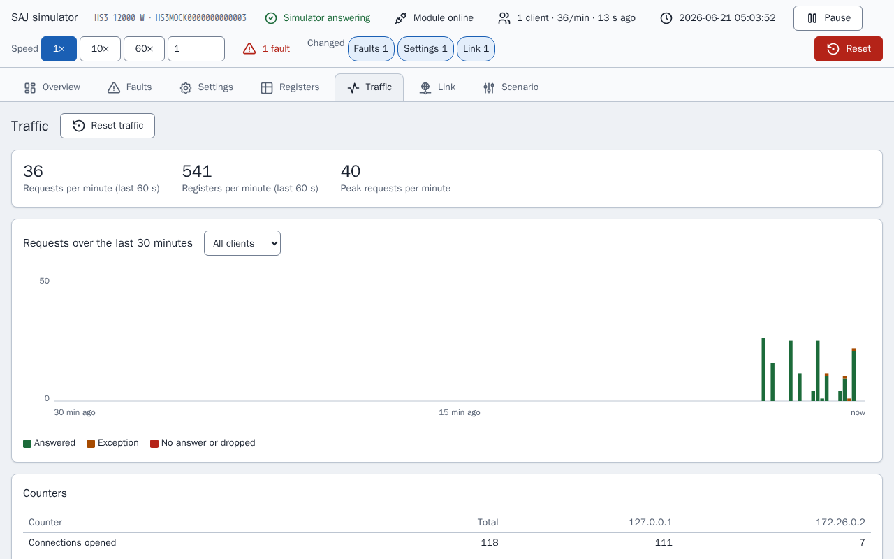
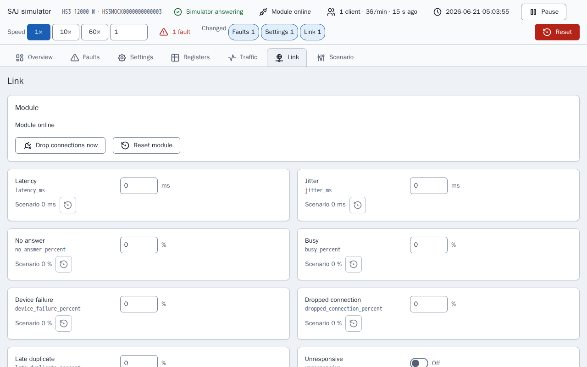
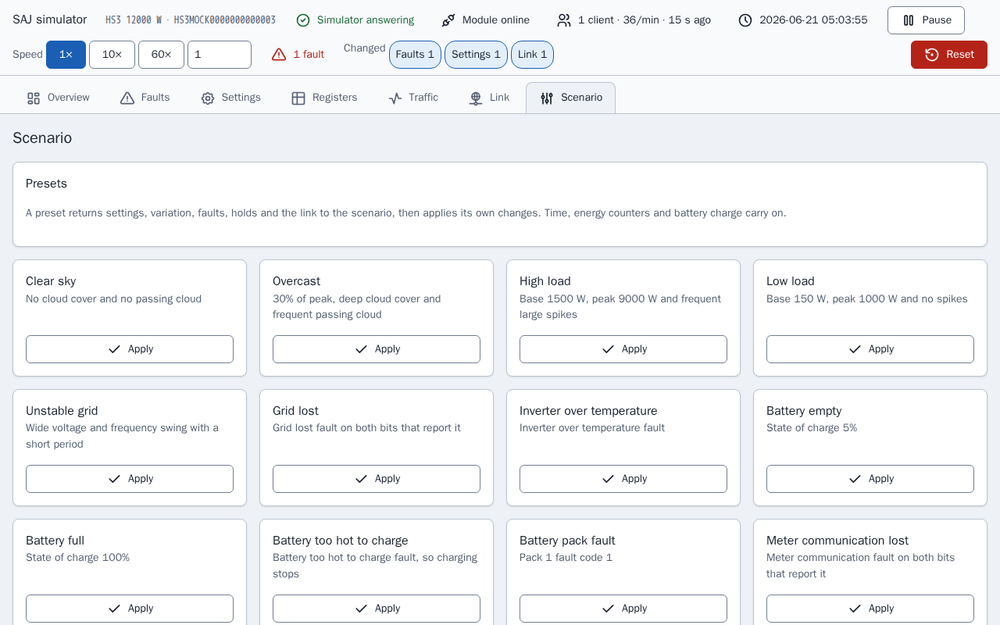
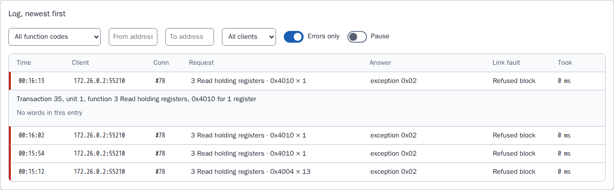

[en](../../en-gb/developer/simulator-page.md) | [de](../../de/developer/simulator-page.md) | nl | [fr](../../fr/developer/simulator-page.md) | [zh](../../zh-hans/developer/simulator-page.md) | [es](../../es/developer/simulator-page.md) | [it](../../it/developer/simulator-page.md) | [pl](../../pl/developer/simulator-page.md) | [sv](../../sv/developer/simulator-page.md)

# Simulatorpagina

De bedieningspagina van een simulator: weergaven, registerinspecteur, verkeerslogboek, linkstoringen, storingseffecten, presets en opgeslagen toestand.

De volledige lijst van wat de pagina dekt staat in de secties [Bedieningspagina](../../../mock/docs/features.md#control-page), [Toestand en presets](../../../mock/docs/features.md#state-and-presets), [Registerinspecteur en verkeerslogboek](../../../mock/docs/features.md#register-inspector-and-traffic-log) en [Linkstoringen](../../../mock/docs/features.md#link-faults) van de functielijst. De simulatorpagina zelf is alleen Engels, dus de namen van weergaven, knoppen en presets staan hieronder zoals de pagina ze toont.

Elke simulator serveert een webpagina op `http://localhost:<panel port>/`: `5080` voor de HS3 en `5081` voor de H2 die `make up` start (`SAJ_MOCK_PANEL_HOST_PORT` en `SAJ_MOCK_H2_PANEL_HOST_PORT` wijzigen de poorten). In de container luistert de pagina op `server.panel_port`, standaard 8080. Er is geen authenticatie: de simulator is een ontwikkelhulpmiddel.

De pagina bestaat zodat een ontwikkelaar kan zien wat het gesimuleerde systeem doet en het systeem in een situatie kan brengen zonder een scenario te bewerken en opnieuw te starten. De pagina bouwt elk bedieningselement op uit de beschrijving van het apparaat, dus de pagina toont alleen de apparatuur die is geïnstalleerd.
De pagina pollt de toestand elke 3 seconden, zodat een wijziging vanuit Home Assistant zichtbaar wordt, en de weergaven Registers en Traffic verversen ook elke seconde zolang de weergaven open zijn. Een bedieningselement dat de focus heeft wordt niet overschreven. Twee clients kunnen tegelijk iets wijzigen: de laatste schrijfactie wint, zoals op een echt apparaat. Elke wijziging toont een korte bevestiging en elke weigering toont de reden.

Een statusbalk op elke weergave beantwoordt of de simulator draait als zijn scenario of is gewijzigd: of de module online is, de verbonden clients en hun verzoeksnelheid, de gesimuleerde tijd, uitvoeren en pauzeren, de snelheid, de actieve storingen en één chip voor elke soort wijziging ten opzichte van het scenario die van kracht is. Dezelfde samenvatting (`changes` in de toestand) markeert de gewijzigde rijen en kaarten. Pauzeren zet de snelheid op 0 en afspelen herstelt de eerdere snelheid, zodat pauzeren de snelheid niet kwijtraakt.



De huidige weergave staat in het URL-fragment (`#registers`), zodat een herlaadactie de weergave behoudt. Er wordt niets in de browser opgeslagen. De schermafbeeldingen van de weergaven hieronder zijn gemaakt nadat één storing, "Fan 1 fault", is ingesteld en nadat de simulator één register heeft geweigerd, zodat elke weergave een wijziging ten opzichte van het scenario toont.

De pagina leidt leesbare namen af uit veldnamen en rondt elke geschaalde waarde af op het aantal decimalen van de schaal, zodat een ruwe 65535 bij schaal 0.0001 als 6.5535 wordt getoond in plaats van ruis van drijvendekommagetallen.

## Weergaven

### Overzicht (Overview)

Een vermogensstroomdiagram van de geïnstalleerde apparatuur, gekleurd en geanimeerd naar richting, boven één kaart per onderdeel van de apparatuur. Een kaart bevat de live meting, de bedieningselementen die de meting instellen en de storingen van de apparatuur, met een reset naar het scenario voor die kaart.



De H2-pagina heeft minder kaarten dan de HS3-pagina hierboven, omdat het H2-scenario minder apparatuur installeert.



Een kaart houdt wat een bedieningselement instelt gescheiden van de meting die het bedieningselement oplevert, omdat de twee verschillen zodra een vasthouding, een storing of het laadniveau meespeelt: een piekschaal van 100% betekent niet 100% van het PV-vermogen. De reset van een kaart zet de variatie, de vasthoudingen en de storingsbits van de kaart terug en laat het laadniveau, de auto, de klok en de energietellers met rust, om dezelfde reden als bij presets. Een kaart met een actieve storing is gemarkeerd, zoals in de kaart hieronder.


### Storingen (Faults)

Elke storingsbit van de geïnstalleerde apparatuur, doorzoekbaar, met wat de simulator doet wanneer de bit is gezet. Bits die het document niet noemt staan als gereserveerd in de lijst, zodat het pad voor niet-herkende storingen van de integratie kan worden geprobeerd.

De afbeelding toont de zoekopdracht "Fan", met de vier ventilatorstoringen en de schakelaar van de ingestelde storing, "Fan 1 fault", aan.



### Instellingen (Settings)

De schrijfbare instellingen en opdrachten, met namen voor de ruwe waarden en de scenariowaarde van elk.



### Registers (Registers)

De registerinspecteur, hieronder beschreven.



### Verkeer (Traffic)

Het verkeerslogboek, hieronder beschreven.



### Koppeling (Link)

De linkstoringen en de modulestatus, hieronder beschreven.



### Scenario (Scenario)

Presets, de gesimuleerde tijd, de energietellers, reset en export.



## Registerinspecteur

`GET /api/registers` toont elk blok van het apparaat en, voor elk veld van een blok dat antwoordt, de ruwe woorden, de gedecodeerde waarde met het label, de toegang (alleen lezen, schrijfbaar of opdracht) en wanneer een client het veld voor het laatst las. De weergave Registers toont de lijst als tabel met een filter, een schakelaar "changed only" en een markering bij een waarde die zojuist is veranderd, zodat het effect van een storing of een schrijfactie op de registers zichtbaar is zonder Modbus-client.

De inspecteur toont alleen. De inspecteur leest het apparaat zonder de waarnemer van het apparaat, dus naar een register kijken is geen leesactie van een client: het kijken telt niet als keep-alive, raakt het veld niet aan dat een leesactie zou aanraken en wordt niet in het verkeer vastgelegd. Een register wordt alleen geschreven via de bedieningselementen die door dezelfde validatie gaan als een Modbus-schrijfactie.

## Verkeerslogboek

De Modbus-server meldt elke verbindingsgebeurtenis en elk verzoek, met het antwoord, aan een recorder (`traffic.py`). `GET /api/traffic?after=<sequence>` geeft de vermeldingen na een volgnummer terug, zodat de pagina alleen vraagt wat nieuw is, samen met de tellers en een geschiedenis van 30 minuten in emmers van 10 seconden; `POST /api/traffic/reset` wist ze. De weergave Traffic toont de live verzoeksnelheid, een grafiek van verzoeken in de tijd, de tellers per client en het logboek, dat kan worden gefilterd en geopend voor de gelezen of geschreven woorden. De afbeelding toont het logboek met alleen de fouten en één geweigerd verzoek geopend: een geweigerd verzoek heeft geen woorden, dus de vermelding zegt dat en noemt de linkstoring die het verzoek weigerde.



Tellers tellen verzoeken en registers, omdat veldrapporten zo de belasting van een module beschrijven, en beide worden getoond omdat niet bekend is of ook de grootte van een verzoek ertoe doet. De recorder bewaart de laatste 2000 vermeldingen in het geheugen en slaat ze niet op: het logboek beschrijft wat er met de huidige run van de simulator is gebeurd, en een herstart is een nieuwe run.

## Linkstoringen

De weergave Link en de sectie `link` van een scenario bepalen hoe de gesimuleerde module zich misdraagt. Elke instelling reproduceert een storing die veldrapporten van SAJ-communicatiemodules beschrijven, en geen enkele is ingesteld tenzij een scenario of de pagina haar instelt.

| Sleutel | Effect |
| --- | --- |
| `latency_ms`, `jitter_ms` | Elk antwoord wacht de latentie plus of min maximaal de jitter, 0 tot 60000 ms |
| `no_answer_percent` | Het verzoek wordt gelezen en nooit beantwoord, en de verbinding blijft open |
| `busy_percent`, `device_failure_percent` | Het antwoord is uitzondering `0x06` of `0x04` |
| `dropped_connection_percent` | De module sluit de verbinding in plaats van te antwoorden |
| `late_duplicate_percent` | Na een uitzonderingsantwoord wordt hetzelfde frame opnieuw verzonden vlak voor het volgende antwoord op die verbinding |
| `refused_blocks` | Een lijst van `start`, `end` en `code` (0 tot 255). Een verzoek dat het blok raakt wordt met die code beantwoord, zodat apparaten die niet-standaardcodes sturen, inclusief 0, kunnen worden nagebootst |
| `unresponsive` | Verbindingen worden geaccepteerd en er wordt nooit iets beantwoord |
| `offline` | De module stopt met luisteren en sluit elke verbinding |
| `offline_seconds`, `offline_period_seconds` | Offline gedurende de eerste `offline_seconds` van elke periode, die minstens even lang moet zijn |
| `lockout_requests`, `lockout_window_seconds`, `lockout_whole_port` | Een client die binnen het venster meer dan `lockout_requests` verzoeken stuurt, krijgt zijn verbinding gesloten en zijn adres geweigerd, of elke client wanneer `lockout_whole_port` is ingesteld, totdat de module wordt gereset. Een venster is vereist wanneer een drempel is ingesteld |

<!-- jscpd:ignore-start -->
```yaml
link:
  latency_ms: 800
  jitter_ms: 400
  busy_percent: 10
  refused_blocks:
    - {start: 0x4000, end: 0x40FF, code: 0}
```
<!-- jscpd:ignore-end -->

Percentages zijn 0 tot 100. Een verkeerde waarde, of een combinatie die niet kan werken, stopt de simulator bij het starten en noemt de sleutel, zoals `link.offline_seconds`.

De beslissingen worden genomen in `link.py` en uitgevoerd door het transport, dat de link vraagt voordat het een verbinding accepteert en voordat het antwoordt. De eerste controle die van toepassing is beslist, in deze volgorde: offline, unresponsive, lockout, dropped connection, no answer, refused block, device failure, busy. Latentie geldt voor elk antwoord dat wordt verzonden. Of een kans van toepassing is wordt getrokken uit de simulatieseed en het volgnummer van het verzoek, dus dezelfde seed en dezelfde verzoeken geven dezelfde storingen, en een storing die tijdens het debuggen is gevonden kan worden gereproduceerd. Latentie, de offlineperiode en het lockoutvenster lopen op wandklok-tijd, niet op gesimuleerde tijd, omdat de instellingen de link beschrijven zoals de client de link ziet en de kloksnelheid ze niet mag wijzigen.

Linkinstellingen en een lockout blijven bewaard bij herstarts en worden met het scenario geëxporteerd. Een lockout wordt alleen gewist door "Reset module", door Reset of door een preset, omdat veldrapporten een lockout beschrijven die duurde totdat de module een nieuw adres kreeg, en "Reset module" staat voor het nieuwe adres. "Drop connections now" sluit eenmalig elke open verbinding. De routes zijn `POST /api/link`, `/api/link/drop` en `/api/link/reset`.

De verkeersrecorder toont welke storing op elk verzoek is toegepast, zodat het effect van een instelling op de client uit het logboek kan worden afgelezen.

## Storingseffecten

Sommige storingen doen meer dan hun bit zetten, waar een echt systeem dat ook zou doen. Een storing die een net-, PV-, DC-bus-, batterijpoort-, temperatuur-, relais-, sensor- of isolatietoestand noemt stopt de omvormer, netverlies laat de omvormer off-grid draaien, verlies van meetercommunicatie laat Meter A zwijgen, sommige batterijstoringen stoppen het opladen of ontladen, elke packstoringscode anders dan 0 stopt beide en een storing van de EV-lader stopt de lader. Elke andere storing, en elke gereserveerde bit, zet alleen de bit. De tabellen staan in `mock/saj_local_mock/profiles/fault_tables.py` en de effecten worden toegepast door `simulation/faults.py`.

## Presets, opgeslagen toestand en export

**Presets** zetten de instellingen, variatie, seed, storingen en vasthoudingen eerst terug naar het scenario en passen daarna hun wijzigingen toe, zodat elke preset dezelfde omstandigheden geeft, hoe de simulator ook is achtergelaten. De gesimuleerde tijd, de kloksnelheid, de energietellers en het laadniveau van de batterij lopen door tenzij de preset de waarden instelt, zodat Home Assistant de klok niet terug ziet springen en de levensduurtotalen niet ziet dalen. **Reset** is degene die alles terugspoelt. Apparatuur die niet is geïnstalleerd heeft geen presets, en een model waarvan de tabellen de storing niet noemen evenmin. Een preset zet ook de link terug naar het scenario, stelt dan zijn eigen linkwijzigingen in en een lockout wordt gewist. De linkpresets worden op elk model aangeboden: Slow link, Flaky link, Busy module, Module offline en Module locked out. Geen veldrapport geeft de belasting waarbij een module in lockout gaat, dus de drempel van Module locked out is een beginpunt om op de pagina te wijzigen en is niet afgeleid van een limiet van de integratie.

**Opgeslagen toestand.** Wijzigingen blijven bewaard bij herstarts in `/data/state.json`, in een gemounte map per service in [compose.yaml](../../../compose.yaml): `mock/state/hs3/` en `mock/state/h2/`, terug te zetten door de inhoud van de map te verwijderen. Linkinstellingen en een lockout worden met de toestand opgeslagen. Een toestand die voor een ander scenario is opgeslagen wordt genegeerd en eenmaal gelogd, omdat toepassing ervan op een ander systeem fout zou zijn. Een toestand die niet kan worden gelezen wordt op dezelfde manier genegeerd en het bestand blijft bewaard. Alleen de instellingen die een client kan schrijven worden opgeslagen, zodat een wijziging van een vast register in de code nooit door een oud bestand wordt gemaskeerd, en de energietellers worden opgeslagen met het begin van elke dag, maand en elk jaar, zodat een herstart geen tellerreset is. Zonder gemounte map logt de simulator één regel dat wijzigingen niet worden bewaard en draait door. **Reset** verwijdert het bestand en keert terug naar het scenario. De Playwright-stack mount geen map, dus elke run begint bij het scenario.

**Export** downloadt de lopende seed, variatie, storingen, link en klok als scenario, zodat een afgestelde toestand kan worden gecommit en opnieuw gedraaid in een verse simulator met dezelfde variatie.

## Iconen

De iconen van de pagina komen uit de Tabler-iconenset onder `mock/static/vendor/tabler/`, omdat de simulator zelfstandig moet zijn en niets van buiten mag laden. Alleen de iconen die de pagina gebruikt worden bewaard, als de originele SVG-bestanden, zodat de set met de bron kan worden vergeleken. De map bevat ook de `LICENSE` van de set en een `README.md` die de release van de iconen noemt. De pagina plaatst de iconen inline zodat de iconen de tekstkleur nemen; een icoonlettertype of een emoji wordt niet gebruikt. Elke set onder de MIT- of ISC-licentie mag op deze manier worden meegeleverd, met de licentie ernaast.
