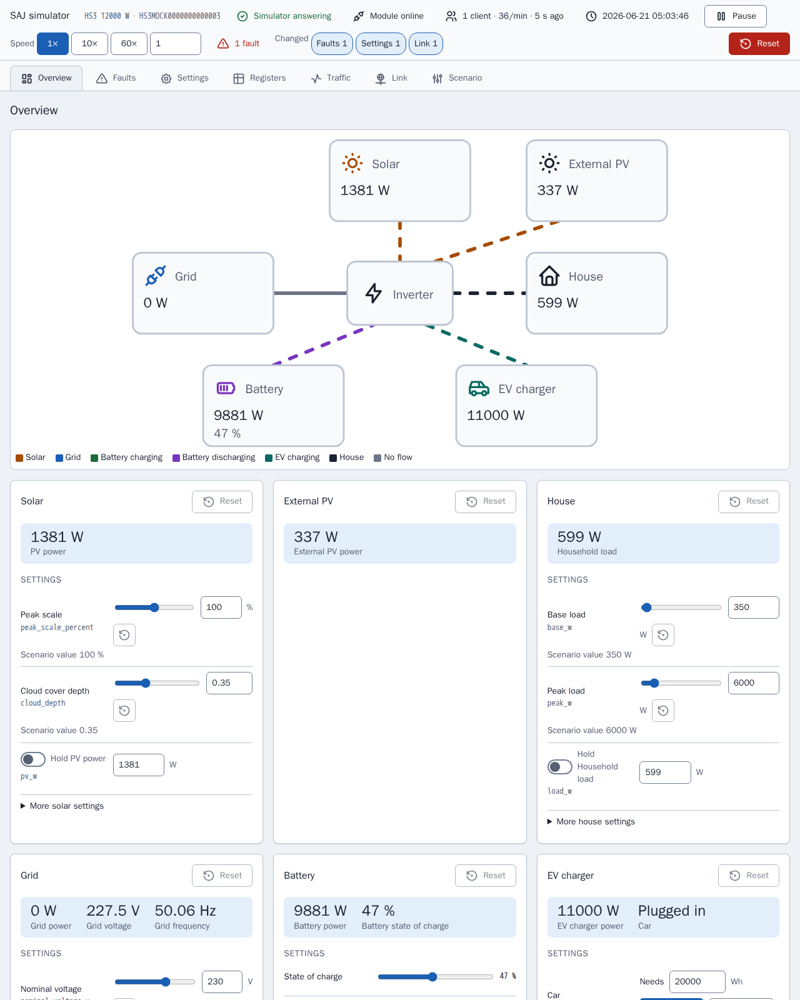

[en](../../en-gb/developer/simulator.md) | [de](../../de/developer/simulator.md) | nl | [fr](../../fr/developer/simulator.md) | [zh](../../zh-hans/developer/simulator.md) | [es](../../es/developer/simulator.md) | [it](../../it/developer/simulator.md) | [pl](../../pl/developer/simulator.md) | [sv](../../sv/developer/simulator.md)

# Modbus-simulator



Waarvoor de simulator dient, hoe u een scenario draait en configureert, en hoe u de simulator uitbreidt.

De volledige lijst van wat de simulator dekt staat in de secties [Gesimuleerde modellen](../../../mock/docs/features.md#simulated-models), [Scenario's](../../../mock/docs/features.md#scenarios) en [Variatie](../../../mock/docs/features.md#variation) van de functielijst.

De simulator is een vervangend SAJ-apparaat waarmee Home Assistant of elke Modbus-client verbinding kan maken, zodat de integratie kan worden ontwikkeld zonder de hardware te bezitten of de hardware te riskeren. De simulator mikt op geloofwaardig smoke-testen, niet op exacte emulatie, en is geen algemene Modbus-server. Het pakket is `mock/saj_local_mock/`, en elke simulator draait in een eigen container.

## Ontwerpbeslissingen

- **Zelfstandig.** De simulator deelt geen code met de integratie, en een import-linter-contract verbiedt de simulator Home Assistant of `custom_components` te importeren. Als beide kanten dezelfde registerdefinities gebruikten, zou een fout in de definities onzichtbaar zijn.
- **Een eigen Modbus-laag.** Echte SAJ-apparaten wijken van de standaard af: vreemde uitzonderingscodes, blokken die leesacties over hun einde heen weigeren, een lage clientlimiet. De integratie moet met zulke storingen kunnen omgaan, dus de storingen zijn ingebouwd.
- **Eén container, één apparaat.** Elke instantie houdt haar eigen toestand bij, in een eigen map onder `mock/state/`, zodat instanties elkaar nooit beïnvloeden.
- **Wijzigbaar tijdens het draaien.** Het scenario is het beginpunt, niet de enige invoer. De simulatorpagina en binnenkomende verzoeken wijzigen het draaiende systeem, en het scenario blijft de bekende toestand om naar terug te keren.
- **Deterministisch.** Weer en belasting hangen alleen af van de seed en de gesimuleerde tijd. Hetzelfde scenario, hetzelfde moment en dezelfde schrijfacties geven dezelfde waarden, hoe vaak een client ook pollt.
- **Eén energiebalans.** Alleen instraling en belasting worden gegenereerd; al het andere wordt afgeleid, zodat de registers elkaar nooit tegenspreken.
- **Schrijfacties werken door.** Instellingen worden opgeslagen, teruggelezen en uitgevoerd. Een schrijfactie vanaf de pagina gaat door dezelfde validatie en afhandeling als een Modbus-schrijfactie, zodat de integratie de twee niet uit elkaar kan houden en de pagina het apparaat niet in een toestand kan brengen die een client niet kan bereiken.
- **De pagina weet niets van modellen.** De pagina bouwt zichzelf op uit de beschrijving die het apparaat geeft, dus een nieuw model vraagt geen wijziging van de pagina. De pagina is een ontwikkelhulpmiddel, dus de pagina bestaat uit gewone HTML-, CSS- en JavaScript-bestanden in `mock/static/` die zoals ze zijn worden geserveerd, zonder bibliotheken, zonder buildstap en zonder eigen tests van de pagina, terwijl de Python achter de pagina wordt getest zoals de rest. Zie de [simulatorpagina](simulator-page.md).
- **De module maakt deel uit van de simulatie.** De Modbus-server staat voor de communicatiemodule waarmee een client verbinding maakt, dus de storingen die veldrapporten van die modules beschrijven (trage of ontbrekende antwoorden, vreemde uitzonderingscodes, weggevallen verbindingen, een lockout) zijn instellingen van de simulator en geen bijzondere gevallen die door het apparaat verspreid liggen.
- **Schrijfgedrag komt uit de SAJ-documenten.** Schrijfacties worden gespecificeerd door de SAJ-protocoldocumenten en echte metingen, niet door de simulator. Als de simulator afwijkt van het gedocumenteerde gedrag van `0x06` en `0x10`, is de afwijking een defect van de simulator om te melden, niet iets om de integratie omheen aan te passen.

## Uw weg vinden

| Voor | Kijk in |
| --- | --- |
| Waarom de simulator is gebouwd zoals hij is | Het afgeronde werk [SAJ Modbus-mocksimulator bouwen](../../../.github/work/done/build-saj-modbus-mock-simulator.md), [Bedieningspaneel van de simulator toevoegen](../../../.github/work/done/add-simulator-control-panel.md) en [Simulatorpaneel opnieuw ontwerpen met inspecteur en linkstoringen](../../../.github/work/done/redesign-simulator-panel-with-inspector-and-link-faults.md) |
| Kant-en-klare systemen | [mock/scenarios/](../../../mock/scenarios/) |
| Geldige scenariosleutels en standaardwaarden | `mock/saj_local_mock/scenario.py` |
| Wat elk model ondersteunt | `mock/saj_local_mock/models.py` |
| Registers | `mock/saj_local_mock/profiles/` |
| Hoe waarden evolueren | `mock/saj_local_mock/simulation/` |
| Services en poorten | [compose.yaml](../../../compose.yaml) |
| Simulatorpagina | `panel.py` (routes), `description.py`, `presets.py` en de pagina in [mock/static/](../../../mock/static/) |
| Linkstoringen | `mock/saj_local_mock/link.py` (instellingen, grenzen, beslissingen) en `transport.py` (de beslissingen uitvoeren) |
| Verkeersopname | `mock/saj_local_mock/traffic.py` |
| Storingsbits per model | `mock/saj_local_mock/profiles/fault_tables.py` |
| Opgeslagen toestand | `mock/saj_local_mock/persistence.py` |

Het transport weet niets van SAJ, het apparaat bezit adressen en toegangsregels, een profiel koppelt registers aan gesimuleerde grootheden, en de simulatie weet niet hoe waarden worden getransporteerd. De lagen gescheiden houden maakt het mogelijk elke laag afzonderlijk te unittesten.

## Met de simulator praten vanaf een terminal

`make up` start de simulators. Home Assistant bereikt elke simulator via de Compose-servicenaam op de eigen poort van de simulator; gebruik vanaf uw machine `localhost` en de gepubliceerde poort uit `compose.yaml`.

De voorbeelden gebruiken [mbpoll](https://github.com/epsilonrt/mbpoll) tegen de gepubliceerde poort van de HS3-simulator. `-0` laat adressen overeenkomen met de registerkaarten, `-1` leest eenmaal, `-t 4` kiest holdingregisters en `-a` is de unit-ID.

Lees het apparaattype en het nominale vermogen (registers `0x8F00` en `0x8F01`):

<!-- jscpd:ignore-start -->
```bash
mbpoll -m tcp -p 5020 -a 1 -0 -1 -t 4:hex -r 0x8F00 -c 2 localhost
```
<!-- jscpd:ignore-end -->

Een HS3 en een H2 antwoorden met verschillende apparaattypen, wat de snelste manier is om te bevestigen welk systeem een poort simuleert.

Schrijf een instelling en lees de instelling terug (hier de toepassingsmodus op `0x3647`):

<!-- jscpd:ignore-start -->
```bash
mbpoll -m tcp -p 5020 -a 1 -0 -t 4 -r 0x3647 localhost 1
mbpoll -m tcp -p 5020 -a 1 -0 -1 -t 4 -r 0x3647 localhost
```
<!-- jscpd:ignore-end -->

Bekijk hoe de simulator een verzoek weigert, bijvoorbeeld een adres buiten elk blok:

<!-- jscpd:ignore-start -->
```bash
mbpoll -m tcp -p 5020 -a 1 -0 -1 -t 4 -r 0x0001 localhost
```
<!-- jscpd:ignore-end -->

Zie een waarde veranderen door `-1` weg te laten; mbpoll pollt dan eenmaal per seconde tot u stopt.

Draai de eigen healthcheck van de simulator, waarvoor geen client hoeft te zijn geïnstalleerd:

<!-- jscpd:ignore-start -->
```bash
docker compose exec mock python -m saj_local_mock healthcheck; echo $?
```
<!-- jscpd:ignore-end -->

Schrijfacties blijven bewaard bij herstarts in `mock/state/`, dat Git negeert, en worden teruggezet vanaf de simulatorpagina of door de inhoud van de map te verwijderen, zie [Opgeslagen toestand](simulator-page.md#presets-opgeslagen-toestand-en-export). Adressen komen uit de profielen; de drie hierboven zijn slechts beginpunten.

## Een scenario configureren

Een scenario is een YAML-bestand dat op `/config/config.yaml` is gemount. Alleen `device.model` is vereist, dus een bestand vermeldt alleen wat van de standaardwaarden verschilt:

<!-- jscpd:ignore-start -->
```yaml
device:
  model: hs3
simulation:
  start: "2026-06-21T12:00:00"
  speed: 600
battery:
  modules: 4
```
<!-- jscpd:ignore-end -->

In het voorbeeld is `simulation.speed` het aantal gesimuleerde seconden per echte seconde, dus dit draait elke seconde tien gesimuleerde minuten vanaf het middaguur van hartje zomer: handig om in een paar minuten een volledige dag laden en ontladen te zien. `simulation.seed` kiest het weer en de belasting.

Twee secties bepalen het willekeurige gedrag en de storingen bij het starten; een derde, `link`, wordt beschreven onder [Linkstoringen](simulator-page.md#linkstoringen). `variation` stelt de grenzen, de diepte en de periode van de generatoren voor zon, belasting en net in (het belastingniveau blijft in `site.load`), en `faults` vermeldt de actieve storingsbits per apparatuur met register en bit, plus batterijpackcodes:

<!-- jscpd:ignore-start -->
```yaml
variation:
  cloud_depth: 0.9
faults:
  inverter:
    - {register: 0x4005, bit: 23}
  packs:
    - {pack: 1, fault: 1}
```
<!-- jscpd:ignore-end -->

Een verkeerde sleutel of een onmogelijke combinatie stopt de simulator bij het starten en noemt de sleutel. De simulator schrijft de regel naar de foutuitvoer en stopt:

```text
invalid scenario: ev_charger.installed: not available on h2
```

## Een ander of extra systeem draaien

**Probeer een scenario eenmalig**, zonder een bestand aan te raken. De simulator draait op de voorgrond op een eigen poort tot u de simulator stopt:

<!-- jscpd:ignore-start -->
```bash
docker compose run --rm --no-deps -p 5030:502 \
  -v ./mock/scenarios/hs3-off-grid.yaml:/config/config.yaml:ro \
  -v ./mock/state/off-grid:/data \
  mock
```
<!-- jscpd:ignore-end -->

De extra `-v` is nodig omdat de service `mock` anders de mount `/data` van `mock/state/hs3/` meebrengt, en de eerste wijziging in de off-grid-run het `state.json` van de ontwikkel-HS3 door off-grid-toestand zou vervangen. De off-grid-run bewaart zijn eigen toestand in `mock/state/off-grid/` tussen runs.

Wijs de eerste `-v` naar uw eigen bestand om een scenario te draaien dat u zelf schreef.

**Wijzig wat `make up` start** in `compose.override.yaml`. Een ander bestand over hetzelfde pad mounten vervangt het scenario; een nieuwe service voegt een systeem toe:

<!-- jscpd:ignore-start -->
```yaml
services:
  mock:
    volumes:
      - ./mock/scenarios/hs3-ev.yaml:/config/config.yaml:ro

  mock-off-grid:
    build:
      context: ./mock
    volumes:
      - ./mock/scenarios/hs3-off-grid.yaml:/config/config.yaml:ro
    ports:
      - "5022:502"
```
<!-- jscpd:ignore-end -->

Elke service is een onafhankelijk apparaat met een eigen toestand. Home Assistant bereikt de nieuwe service als `mock-off-grid`, dus meerdere systemen kunnen naast elkaar aan één Home Assistant worden toegevoegd.

## De simulator uitbreiden

- **Nieuw scenario:** een bestand in `mock/scenarios/`. `make mock-smoke` pakt elk bestand in de map op.
- **Nieuw model:** een vermelding in `models.py`, een profiel in `profiles/` en acceptatie door de scenariovalidatie in `scenario.py`.
- **Nieuwe eigenaardigheid:** in de laag die haar bezit. Framing en verbindingen in het transport, adressen en toegang in het apparaat, modelgedrag in het profiel.

De simulator doorstaat dezelfde poorten als de integratie, zie de [pagina Controles](checks.md).
