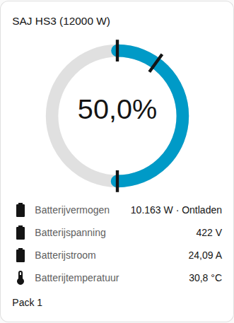
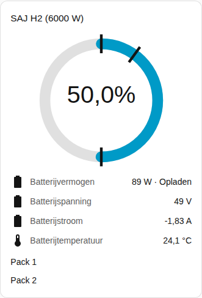

[en](../../../en-gb/user/cards/battery-card.md) | [de](../../../de/user/cards/battery-card.md) | nl | [fr](../../../fr/user/cards/battery-card.md) | [zh](../../../zh-hans/user/cards/battery-card.md) | [es](../../../es/user/cards/battery-card.md) | [it](../../../it/user/cards/battery-card.md) | [pl](../../../pl/user/cards/battery-card.md) | [sv](../../../sv/user/cards/battery-card.md)

# Batterijkaart

De pagina Batterijkaart legt de batterijkaart uit, die de lading, het vermogen en de metingen van de batterij toont. De volledige lijst staat in de sectie [Batterijkaart](../../../../frontend/docs/features.md#battery-card) van de functielijst van de kaarten. [Een element toevoegen](README.md#een-element-toevoegen) legt uit hoe u de kaart toevoegt en een systeem kiest.

## Wat de kaart toont

- Een ring toont het laadniveau. Markeringen op de ring tonen de back-upreserve, de oplaadlimiet en de ontlaadlimiet aan het net.
- Het batterijvermogen verschijnt met of de batterij oplaadt of ontlaadt, en onder het vermogen de spanning, de stroom, de temperatuur en de bruikbare capaciteit. De richtingen volgen het [teken van het vermogen](../entities-and-prefix.md#teken-van-het-vermogen).
- Met Batterijpacks tonen aan, wat de standaard is, krijgt elk pack een rijgroep met het laadniveau, de gezondheid, de spanning, de stroom, de temperatuur, de cycli, de storing en de waarschuwing. Een packmeting verschijnt alleen wanneer de entiteit van de meting is ingeschakeld. De meeste packmetingen worden uitgeschakeld aangemaakt, en daarom toont de schermafbeelding alleen de naam van het pack. Schakel de entiteiten die u wilt in Home Assistant in. De [batterijpackentiteiten](../entities/battery-packs.md) staan in het entiteitenoverzicht.
- Eén rij toont de tijd tot batterij vol zolang de batterij oplaadt en de tijd tot batterij leeg zolang de batterij ontlaadt. De rij vervalt als de batterij stilstaat of als het systeem zo'n entiteit niet heeft. De [berekende sensoren](../entities-and-prefix.md#berekende-sensoren) leggen de schattingen uit.
- Een systeem zonder batterij zegt dat.

## Verschillen tussen de modellen

- **HS3:** één pack.
- **H2:** één rijgroep voor elk pack dat de omvormer meldt, maximaal vijf. De schermafbeelding toont een H2 met twee packs. Zie [optionele apparatuur](../optional-equipment.md#batterijpacks).

De [storingenkaart](faults-card.md) vermeldt de actieve storing en waarschuwing van elk pack. De storings- en waarschuwingsentiteiten zijn standaard ingeschakeld.

## Opties

| Optie in de editor | YAML-sleutel | Standaard |
| --- | --- | --- |
| Systeem | `device` | Het eerste systeem |
| Batterijpacks tonen | `show_packs` | Aan |

## Nog niet ondersteund

- Een batterij-instelling wijzigen vanaf de kaart. De batterijkaart toont alleen metingen. Gebruik de [bedieningskaart](controls-card.md) voor de batterijlimieten.
