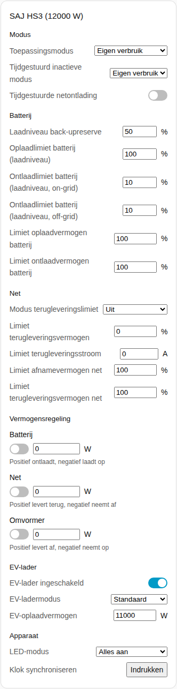
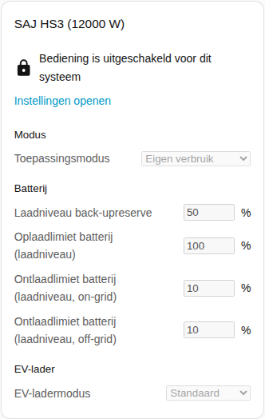
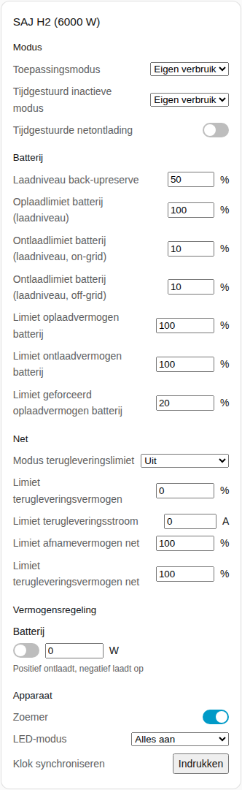

[en](../../../en-gb/user/cards/controls-card.md) | [de](../../../de/user/cards/controls-card.md) | nl | [fr](../../../fr/user/cards/controls-card.md) | [zh](../../../zh-hans/user/cards/controls-card.md) | [es](../../../es/user/cards/controls-card.md) | [it](../../../it/user/cards/controls-card.md) | [pl](../../../pl/user/cards/controls-card.md) | [sv](../../../sv/user/cards/controls-card.md)

# Bedieningskaart

De pagina Bedieningskaart legt de bedieningskaart uit, die de instellingen van een systeem in secties bij elkaar brengt, zodat u de instellingen vanaf een dashboard kunt wijzigen. De volledige lijst staat in de sectie [Bedieningskaart](../../../../frontend/docs/features.md#controls-card) van de functielijst van de kaarten. [Een element toevoegen](README.md#een-element-toevoegen) legt uit hoe u de kaart toevoegt en een systeem kiest. De instellingen achter de bediening worden beschreven in [instellingen wijzigen](../changing-settings.md).

## Wat de kaart toont

- De secties zijn Modus, Batterij, Net, Vermogensregeling, EV-lader en Apparaat. Een sectie zonder iets om te tonen wordt weggelaten.
- **Modus:** de toepassingsmodus en de tijdgestuurde instellingen.
- **Batterij:** de back-upreserve en de oplaad- en ontlaadlimieten.
- **Net:** de instellingen van de terugleveringslimiet en de netvermogenslimieten.
- **Vermogensregeling:** elke functie van [vermogensregeling](../power-control.md) die het systeem heeft, met een schakelaar, een vermogensdoel en een aanwijzing over wat een positief en een negatief vermogen doen.
- **EV-lader:** de schakelaar, de modus en het oplaadvermogen van de lader.
- **Apparaat:** de zoemer, de LED-modus en de kloksynchronisatie.
- Elke instelling gebruikt de bediening die bij de instelling past: een schuifregelaar of een getalveld, een lijst, een schakelaar, een tijdveld of een knop.
- Een bediening wijzigt de omvormer één keer per beslissing en toont dan de waarde die de omvormer bevat. Een geweigerde wijziging verschijnt onder de bediening.
- De kaart heeft geen knop Omvormer herstarten, zodat een tik op een dashboard de omvormer niet kan herstarten. Herstarten blijft een entiteit.

## Wanneer bediening niet is toegestaan

Zolang [Bediening toestaan](../changing-settings.md#bediening-toestaan) uit staat voor het systeem, is elke bediening uitgeschakeld. Een slot boven de bediening verwijst naar de instellingen van de integratie, waar u Bediening toestaan inschakelt.

## Verschillen tussen de modellen

- **Alleen HS3:** de sectie EV-lader, en de vermogensregelfuncties Net en Omvormer.
- **Alleen H2:** de zoemer en de limiet van het gedwongen oplaadvermogen van de batterij. De H2 heeft alleen de vermogensregelfunctie Batterij.

## Opties

| Optie in de editor | YAML-sleutel | Standaard |
| --- | --- | --- |
| Systeem | `device` | Het eerste systeem |
| Secties | `sections`, een lijst van `mode`, `battery`, `grid`, `power_control`, `ev_charger` en `device` | Alle secties |

## Nog niet ondersteund

- Een knop Omvormer herstarten. Herstarten blijft een entiteit.
- Schema's voor vermogensregeling. Stel de schema's in op de integratiepagina, zie [vermogensregeling](../power-control.md#een-schema-volgen).
