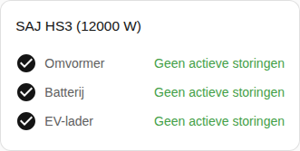

[en](../../../en-gb/user/cards/faults-card.md) | [de](../../../de/user/cards/faults-card.md) | nl | [fr](../../../fr/user/cards/faults-card.md) | [zh](../../../zh-hans/user/cards/faults-card.md) | [es](../../../es/user/cards/faults-card.md) | [it](../../../it/user/cards/faults-card.md) | [pl](../../../pl/user/cards/faults-card.md) | [sv](../../../sv/user/cards/faults-card.md)

# Storingenkaart

De pagina Storingenkaart legt de storingenkaart uit, die de actieve storingen van elk onderdeel van de apparatuur vermeldt. De volledige lijst staat in de sectie [Storingenkaart](../../../../frontend/docs/features.md#faults-card) van de functielijst van de kaarten. [Een element toevoegen](README.md#een-element-toevoegen) legt uit hoe u de kaart toevoegt en een systeem kiest. De storingen komen uit de [apparaatstoringsentiteiten](../faults-and-repairs.md#apparaatstoringen).

## Wat de kaart toont

- Storingen zijn gegroepeerd per omvormer, batterij en EV-lader, en elke actieve storing toont hoe lang geleden de storing begon. De storingen en waarschuwingen van de batterijpacks staan in de batterijgroep.
- Een niet-herkende storing zegt dat u in de [diagnosedownload](../troubleshooting.md#diagnose-downloaden) naar het register en het bit moet kijken.
- Een knop Storing wissen staat onder de actieve storingen van de omvormer. De knop verstuurt de opdracht Huidige storing wissen. Zolang bediening niet is toegestaan voor het systeem, is de knop uitgeschakeld en verwijst een slot naar de instellingen van de integratie. Zie [Bediening toestaan](../changing-settings.md#bediening-toestaan).
- Met Groepen zonder storingen tonen aan, wat de standaard is, toont een groep zonder actieve storing zich als in orde, zoals in de schermafbeelding. Met de optie uit toont de kaart alleen de groepen met een actieve storing.

Een systeem zonder batterij of EV-lader heeft geen storingen om te tonen voor de ontbrekende apparatuur, dus de kaart tekent de groep van de apparatuur niet.

## Opties

| Optie in de editor | YAML-sleutel | Standaard |
| --- | --- | --- |
| Systeem | `device` | Het eerste systeem |
| Groepen zonder storingen tonen | `show_groups_without_faults` | Aan |

## Nog niet ondersteund

- De storingen van de batterij of de EV-lader wissen vanaf de kaart. De knop Storing wissen staat alleen onder de actieve storingen van de omvormer.
