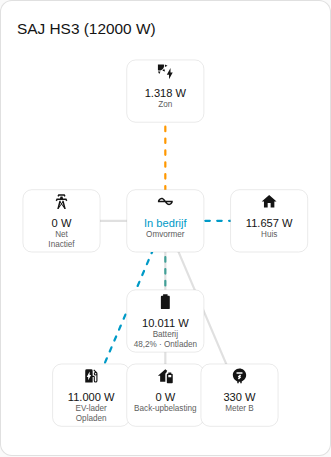
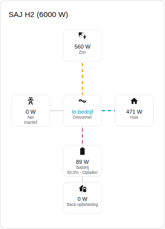

[en](../../../en-gb/user/cards/power-flow-card.md) | [de](../../../de/user/cards/power-flow-card.md) | nl | [fr](../../../fr/user/cards/power-flow-card.md) | [zh](../../../zh-hans/user/cards/power-flow-card.md) | [es](../../../es/user/cards/power-flow-card.md) | [it](../../../it/user/cards/power-flow-card.md) | [pl](../../../pl/user/cards/power-flow-card.md) | [sv](../../../sv/user/cards/power-flow-card.md)

# Vermogensstroomkaart

De pagina Vermogensstroomkaart legt de vermogensstroomkaart uit, die live vermogen tekent tussen zon, batterij, net, huis en de optionele apparatuur. De volledige lijst staat in de sectie [Vermogensstroomkaart](../../../../frontend/docs/features.md#power-flow-card) van de functielijst van de kaarten. [Een element toevoegen](README.md#een-element-toevoegen) legt uit hoe u de kaart toevoegt en een systeem kiest.



## Wat de kaart toont

- Zon, batterij, net en huis worden rond de omvormer getekend, die de bedrijfstoestand toont.
- Elke lijn toont de richting van de stroom en beweegt sneller naarmate het vermogen groeit. Een vermogen van 10 W of minder wordt als inactief getekend.
- De batterij toont het laadniveau en of de batterij oplaadt of ontlaadt. Het net toont of het systeem afneemt of teruglevert. De richtingen volgen het [teken van het vermogen](../entities-and-prefix.md#teken-van-het-vermogen).
- Met Optionele apparatuur tonen aan, wat de standaard is, tekent de kaart ook de back-upbelasting, Meter B en de EV-lader wanneer het systeem de apparatuur heeft. Meter B is een meting zonder richting.
- Met Zonnestrings tonen aan wordt het vermogen van elke zonnestring vermeld. De optie staat standaard uit.
- Bereik kiest tussen de metingen van het systeem, wat de standaard is, en de metingen van het parallelle systeem. Een systeem zonder parallelle metingen toont de lege toestand met het parallelle bereik.

## Verschillen tussen de modellen

- **Alleen HS3:** de EV-lader, zoals in de schermafbeelding hierboven.
- **H2:** de kaart tekent de onderdelen van de HS3-kaart, behalve de EV-lader. De schermafbeelding hieronder toont een H2 die de batterij oplaadt.



## Opties

| Optie in de editor | YAML-sleutel | Standaard |
| --- | --- | --- |
| Systeem | `device` | Het eerste systeem |
| Zonnestrings tonen | `show_strings` | Uit |
| Optionele apparatuur tonen | `show_optional_equipment` | Aan |
| Bereik | `scope` (`system` of `parallel`) | `system` |

<!-- jscpd:ignore-start -->
```yaml
type: custom:saj-local-power-flow-card
device: 0123456789abcdef0123456789abcdef
show_strings: false
show_optional_equipment: true
scope: system
```
<!-- jscpd:ignore-end -->

De waarde `device` is de ID van het apparaat in Home Assistant. De visuele editor vult de waarde voor u in. De namen van de entiteiten achter elk onderdeel staan in het [entiteitenoverzicht](../entities/README.md).

## Nog niet ondersteund

- Een richting voor Meter B. De kaart tekent Meter B als een meting zonder richting.
